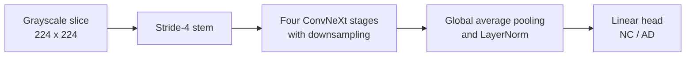
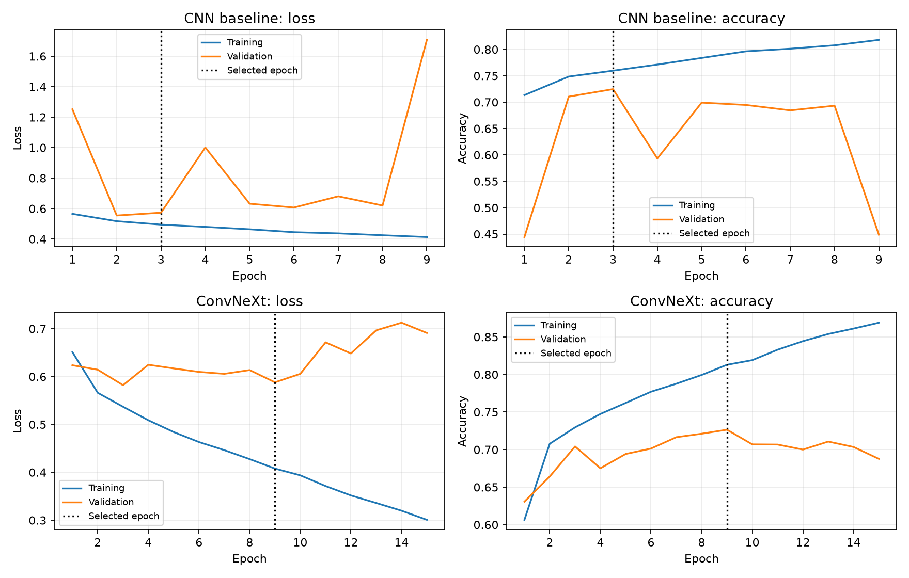
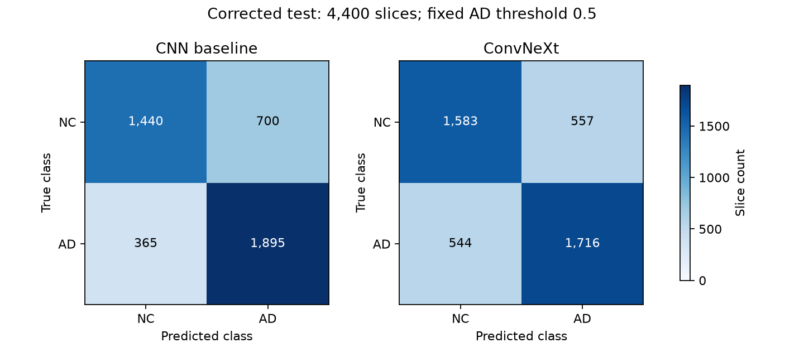
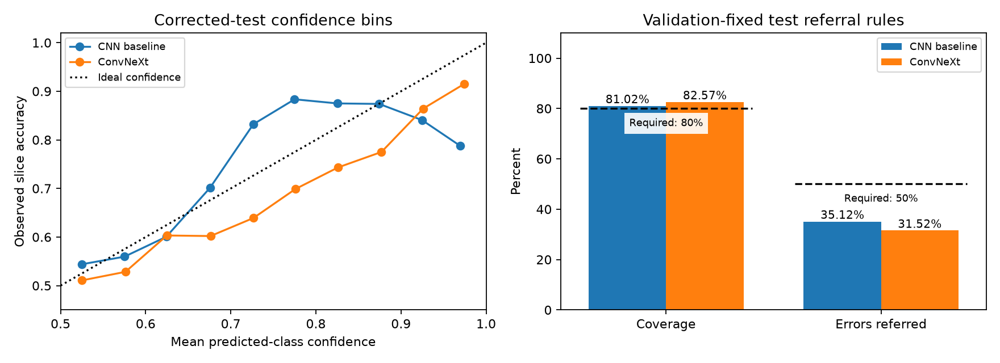
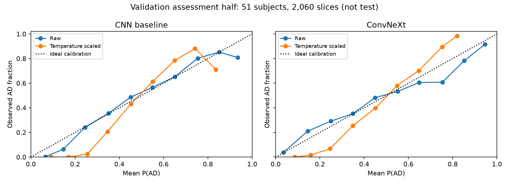
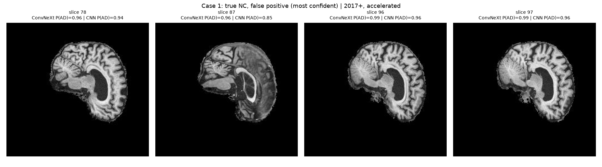
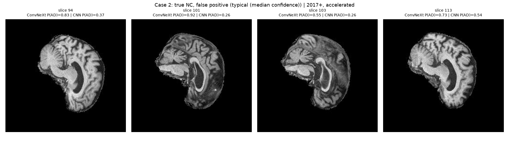
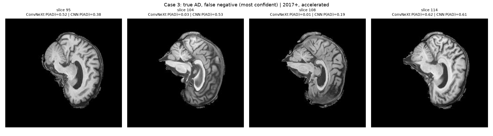
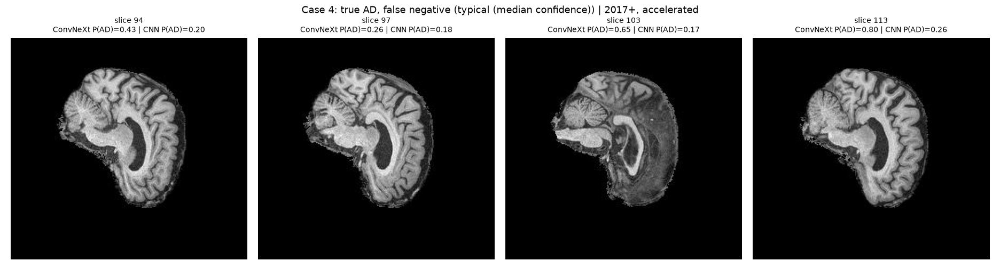
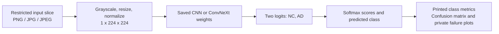

# ConvNeXt for Alzheimer's Disease Classification

**Student:** Khairunnisa Rahmahdani Danang | **Student ID:** s50220353<br>
**Course:** COMP3710 Pattern Recognition and Analysis<br>
**Track:** 2.1 Classification - Medical Diagnosis | **Difficulty:** Hard

## Project summary

In this project, I compare ConvNeXt with a small CNN to classify brain MRI
slices as Alzheimer's disease (**AD**) or cognitively normal (**NC**).
I investigate three questions: which model is more accurate, whether low
confidence helps identify mistakes for human review, and whether ConvNeXt's
extra computation provides a useful benefit.

**Main conclusion:** ConvNeXt ranks AD probabilities better, but the CNN has higher
accuracy and detects more AD slices at the fixed decision threshold. Neither
model meets the 80% accuracy target or the error-referral criterion.

| Main finding | Result |
|---|---|
| Overall corrected-test accuracy | CNN **75.80%**; ConvNeXt **74.98%** |
| Assignment target: at least 80% overall test accuracy | **Not met by either model** |
| Confidence-based referral | Both rules retain over 80% of slices but refer fewer than 36% of errors |
| Cost of ConvNeXt | 71.5 times as many parameters; 3.45 times the observed training time |
| Recommendation | CNN retained as the research baseline; **neither model is suitable for automated diagnosis** |

> **Scope and validity.** This is an educational prototype, not a clinical
> diagnostic system. The main comparison uses a corrected, subject-disjoint
> split. Earlier work consulted test data from the same underlying cohort,
> so these results are exploratory, not an independent external evaluation.

## Contents

1. [Feasibility review](#1-feasibility-review)
2. [Data and method](#2-data-and-method)
3. [Classification results](#3-classification-results)
4. [Confidence and referral](#4-confidence-and-referral)
5. [Failure analysis](#5-failure-analysis)
6. [Computational cost](#6-computational-cost)
7. [Recommendation and limitations](#7-recommendation-and-limitations)
8. [Reproduction](#8-reproduction)
9. [References and AI disclosure](#9-references-and-ai-disclosure)

Appendices: [historical experiments](#appendix-a-historical-experiments),
[run records](#appendix-b-run-records), and
[normalization experiment](#appendix-c-normalization-experiment).

Results describe **slices, not patient diagnoses**, unless explicitly labelled
otherwise. NC is the dataset's name for the normal class
(called CN in the assignment).

## 1. Feasibility review

*This section presents the feasibility rationale and the subsequent
implementation outcomes. Midpoint check-off completion is not documented here.*

### 1.1 Intended use and success criteria

I compare ConvNeXt with a small CNN to determine whether the larger model
offers better predictions at a reasonable computational cost. I also examine
whether uncertain predictions can help identify mistakes for human review.

The prototype classifies individual MRI slices as **AD or NC**. It is a
research tool, not a patient diagnostic system. The study measures which
errors are referred for review, but not whether a reviewer corrects them.

The comparison uses five success criteria:

| Criterion | Expected outcome |
|---|---|
| **Subject separation** | All **30,520 slices** are included. Each person's scans remain in one split, with **no subjects shared** between training, validation and test. |
| **Classification performance** | At least **80% accuracy across all test slices**, supported by recall for each class, macro-F1 and AUROC. |
| **Error referral** | At least **80% of slices remain accepted**, while at least **50% of errors are referred** for human review. Confidence thresholds are selected using validation data. |
| **Computational cost** | Each training job stays within **two GPU-hours**, and calibration stays within **15 GPU-minutes**. Model size, GPU memory use and prediction time are reported. |
| **Failure analysis** | **3-5 incorrect cases** are examined to identify possible causes and guide the recommendation for further work. |

The **80% accuracy target** comes from the assignment. The referral targets
and compute limits are goals set for this project, not clinical standards.

### 1.2 Model and evaluation design

I adapted ConvNeXt to accept grayscale images and predict two classes
(Liu et al., 2022). I used a four-convolution CNN as the baseline and trained
both models from scratch. Both learn image features through convolution.
ConvNeXt also uses residual connections and normalization within its blocks.
The training recipe uses AdamW, augmentation and early stopping.

The design includes all 30,520 course ADNI slices, grouping every visit by metadata subject.
The diagnosis-stratified split assigns **476/102/102 subjects** to training,
validation and test. Both models receive the same preprocessing and recipe.
Validation selects checkpoints and referral rules; final classification uses
all held-out slices. Prior test feedback means this is an exploratory
same-cohort comparison, not a fresh independent evaluation.

### 1.3 Evidence supporting feasibility

I first audited the data and linked **1,526 scans to 680 subjects**.
The audit found **216 subjects** in both supplied training and test folders.
After this, I rebuilt the split using subject identities rather than scan
prefixes, keeping each person's visits together.
An earlier ConvNeXt run completed in **70.65 minutes**, supporting a two-hour
job cap, not guaranteeing accuracy or runtime on the corrected split.
Its scan-grouped scores are not evidence of unseen-subject performance.

### 1.4 Risks and bounded next step

- **Main risks:** acquisition shortcuts, overfitting, repeated use of
  validation data and limited GPU quota.
- **Planned comparison after the audit:** matched CNN and ConvNeXt training,
  using validation data for model selection.
- **Resource budget:** two jobs, each capped at **two GPU-hours**, followed
  by diagnostics using the saved models.
- **Incomplete runs:** jobs do not retry automatically. A timeout leaves an
  incomplete experiment.
- **Fallback:** if ConvNeXt does not offer a useful balance of accuracy,
  AD recall and computational cost, the CNN remains the research baseline.
  Further work would prioritize better-balanced, independent data.

### 1.5 Implementation updates and outcomes

The investigation led to four main changes:

| Implementation change | Reason and outcome |
|---|---|
| Replaced scan-prefix grouping with metadata subjects | All visits now stay together; the corrected audit found zero subject overlap. This cannot undo earlier test feedback. |
| Disabled horizontal flips | Inspected images have sagittal-profile appearance; geometry remains unverified. No flip ablation or anatomical-axis certification is claimed. |
| Completed the matched model comparison | CNN/ConvNeXt trained in 9.52/32.82 minutes. Test accuracy was 75.80%/74.98%; neither met 80%. |
| Tested confidence and three validation-only remedies | Referral criteria were unmet. Sampling, lower learning rate and training-derived normalization did not resolve weaker AD detection. |

The results and four-case failure analysis show that training is practical within the available
resources, but neither model is reliable enough for automated diagnosis.

## 2. Data and method

### 2.1 Subject separation

The data source is the course-provided Alzheimer's Disease Neuroimaging
Initiative (ADNI) collection (Alzheimer's Disease Neuroimaging Initiative,
n.d.). Inventory counts and overlap findings below come from this project's
audit, not from the ADNI website.

The course ADNI inventory contains **30,520 slices, 1,526 scans and 680
subjects**: 459 NC and 221 AD subjects. Labels are NC = 0 and AD = 1.
The image filename prefix identifies a **scan**, not a person; multiple scans
can belong to the same subject.

The original training and test folders share **216 subjects**. Earlier
scan-grouped results therefore do not measure performance on unseen subjects.
The corrected `subject_70_15_15` protocol uses the metadata mapping to keep
every scan and slice from one subject in a single partition.

| Corrected partition, seed 42 | Subjects | Scans | Slices |
|---|---:|---:|---:|
| Training | 476 | 1,091 | 21,820 |
| Validation | 102 | 215 | 4,300 |
| Test | 102 | 220 | 4,400 |
| **Total** | **680** | **1,526** | **30,520** |

The audit verifies zero pairwise subject overlap and metadata-label agreement.
It does not establish absence of duplicate image content. Diagnosis-stratified
assignment holds out 15% of subjects, rounded up, for each of validation and
test. Slice proportions differ because subjects have different scan counts.

[dataset.py](dataset.py) constructs the split using shared identity helpers
from [utils.py](utils.py). The subject audit checks identities and labels.
The private split manifest records the inventory and metadata hash; evaluation
checks their agreement.

### 2.2 Preprocessing and augmentation

For the completed main comparison:

Image conversion, resizing, normalization and affine augmentation use
torchvision transforms (PyTorch Contributors, n.d.). The numerical settings
below are project choices, not a published ADNI harmonization protocol.

1. Images are converted to single-channel grayscale.
2. They are resized to **224 x 224**, with pixel values converted to `[0, 1]`.
3. Normalization uses fixed **mean 0.5 and standard deviation 0.5**.
4. Training-only random affine augmentation allows up to **8 degrees**
   rotation, **4%** translation and **5%** scale variation.

Validation and test use deterministic resize and normalization only.
No skull stripping, anatomical segmentation or disease-region cropping is used.
Fixed intensity scaling does not harmonize scanner differences.

**Horizontal flips are disabled.** Three inspected training contact sheets
show sagittal-profile appearance; mirroring reverses the visible front-back
direction. This is not a verified anatomical-axis mapping. Pixel images alone
cannot certify orientation or justify assuming a left-right anatomical flip.
Source geometry or export documentation is needed before changing this policy.
The training-only review produced nine contact sheets in job 719152; no
flip-augmented training experiment was enabled.

A matched flip comparison was prepared but **training had not started at the
report cutoff**. It was deferred because the estimated GPU start time left
insufficient time before the deadline. No flip-training results are included;
the proposed evaluation is discussed in Section 7.

The separate normalization experiment estimates this dataset's training-only
mean and standard deviation. This is a separate validation-only comparison
([Appendix C](#appendix-c-normalization-experiment)).

### 2.3 Models

**ConvNeXt is a CNN, not a Transformer.** It adopts design ideas associated
with Vision Transformers while retaining convolutional operations
(Liu et al., 2022).
This project adapts the architecture, not the paper's full ImageNet training
recipe or reported performance.



Each ConvNeXt block uses a 7 x 7 depthwise convolution, channel-wise LayerNorm,
fourfold channel expansion, GELU and a scaled residual connection.
The baseline uses four convolutions with batch normalization, ReLU,
max pooling and global average pooling.

#### How the model processes a slice

Each stage reduces spatial detail while increasing the number of learned
features:

| Step | Output per slice | Blocks |
|---|---|---:|
| Input | `1 x 224 x 224` | - |
| Stem and stage 1 | `96 x 56 x 56` | 3 |
| Downsample and stage 2 | `192 x 28 x 28` | 3 |
| Downsample and stage 3 | `384 x 14 x 14` | 9 |
| Downsample and stage 4 | `768 x 7 x 7` | 3 |
| Global average, normalization and head | 2 logits: NC, AD | - |

Within a block, spatial and channel processing have different roles.
Depthwise convolution filters each channel separately over a local
neighborhood. LayerNorm rescales the channel vector at each location, and
two linear projections expand and compress that vector to combine features.
The residual connection adds the transformed features to the block input,
allowing the model to learn a correction rather than replace the representation
at every block. Layer scale controls that correction's magnitude.

Stochastic depth and classifier dropout are implemented options, but **both
are disabled in the main comparison**. Their presence in the source is not
evidence that they regularized these particular runs.

The CNN baseline provides a less expensive reference: its channels increase
through 32, 64, 128 and 256, using ReLU and pooling rather than ConvNeXt blocks.
Both models learn from the same corrected training subjects. The comparison
tests the complete model designs; it does not isolate a single architectural
component or establish that a feature represents a particular disease marker.

| Model | Stage depths | Channels | Parameters |
|---|---|---|---:|
| CNN baseline | Four convolutional layers | Not a ConvNeXt layout | 389,314 |
| **ConvNeXt: main comparison** | **(3, 3, 9, 3)** | **(96, 192, 384, 768)** | **27,818,594** |
| Historical shallower ConvNeXt | (3, 1, 3, 1) | (96, 192, 384, 768) | 10,468,706 |
| Historical reduced-width ConvNeXt | (2, 2, 6, 2) | (40, 80, 160, 320) | 3,373,882 |

The main ConvNeXt model uses the published stage layout specified above
(Liu et al., 2022; Facebook Research, n.d.-a),
adapted to grayscale and two classes. Its convolutional/linear weights use truncated normal
initialization with standard deviation 0.02 and zero biases; layer scales
start at `1e-6`. Other variants retain their earlier initialization.
Implementation: [modules.py](modules.py).

### 2.4 Matched training and evaluation

| Setting | Main corrected comparison |
|---|---|
| Initialization / seed | From scratch / 42 |
| Optimizer | AdamW |
| Learning rate / weight decay | `5e-5` / `0.05` |
| Batch size / maximum epochs | 8 / 40 |
| Loss / label smoothing | Cross-entropy / 0 |
| Scheduler | Cosine decay over the 40-epoch horizon |
| Early stopping / checkpoint | Patience 6 / highest validation slice accuracy |
| Drop-path / head dropout | 0 / 0 |
| Augmentation / normalization | Standard affine / fixed 0.5, 0.5 |
| AD decision threshold | P(AD) >= 0.5 |

The main baseline and ConvNeXt runs share the corrected split and recipe.
Training skips test inference. Frozen evaluation checks checkpoint hashes,
metadata and split manifests before evaluating both selected checkpoints.

**Primary metric:** correct predictions divided by **all** test slices.
Per-class precision/recall, macro-F1 and AUROC provide complementary evidence.
AD average precision is reported as PR-AUC. Subject-level probability
averages are secondary diagnostics, not substitutes for slice accuracy.

#### Reading the evaluation measures

| Measure | What it answers in this report |
|---|---|
| Accuracy | What fraction of all evaluated slices received the right class? |
| AD recall | Of the AD slices, how many were detected rather than missed? |
| AD precision | Of the slices predicted as AD, how many were actually AD? |
| Macro-F1 | How well are precision and recall balanced when both classes receive equal weight? |
| AUROC | Across decision thresholds, how well do AD scores rank AD above NC? |
| AD average precision | How well does the ranking retain AD precision as recall increases? |

AUROC and average precision describe ranking, whereas accuracy and recall
describe predictions at the selected threshold. A gain in one does not
necessarily produce a gain in the other.

## 3. Classification results

### 3.1 Validation checkpoint selection

Saved learning histories: [CNN](results/baseline_history.json) and
[ConvNeXt](results/convnext_history.json).

| Observation | CNN baseline | ConvNeXt |
|---|---:|---:|
| Best validation accuracy | 72.47% | 72.65% |
| Selected epoch / epochs completed | 3 / 9 | 9 / 15 |
| Training accuracy at selected epoch | 75.96% | 81.29% |
| Training duration | 9.52 min | 32.82 min |
| Training job | 717634 | 717690 |

I selected each model's saved weights using its highest validation accuracy.
ConvNeXt improved this score by only **0.19 percentage points** and took
**3.45 times longer** to train. The CNN's validation scores fluctuated, while
ConvNeXt kept improving on training data without sustained validation gains.
This suggests difficulty generalizing beyond the training images, although
the learning curves alone cannot explain the cause.



**Figure 1. Training dynamics on the corrected subject split.** Redrawing the
saved histories from jobs 717634 and 717690 shows the baseline's unstable
validation trajectory and ConvNeXt's widening training-validation gap.
Dotted lines mark the accuracy-selected checkpoints (epochs 3 and 9);
the lowest validation loss was not the selection rule. Later training
improvements did not yield sustained validation gains.

### 3.2 Frozen corrected-test comparison

Numerical evidence: [test metrics and confusion counts](results/test_metrics.json).

Job **719057** evaluated both original corrected checkpoints on the same
**4,400 slices from 220 scans and 102 subjects**. Classification used the
fixed 0.5 threshold, no temperature scaling and no rejection.

| Test metric | CNN baseline | ConvNeXt |
|---|---:|---:|
| **Overall accuracy** | **75.80%** | **74.98%** |
| Correct / total slices | 3,335 / 4,400 | 3,299 / 4,400 |
| Accuracy: 95% subject-clustered interval | 68.39-82.13% | 67.61-81.11% |
| NC precision | 0.7978 | 0.7442 |
| NC recall | 0.6729 | 0.7397 |
| NC F1 | 0.7300 | 0.7420 |
| AD precision | 0.7303 | 0.7549 |
| AD recall | 0.8385 | 0.7593 |
| AD F1 | 0.7806 | 0.7571 |
| Macro-F1 | 0.7553 | 0.7495 |
| AUROC | 0.8187 | 0.8284 |
| AD PR-AUC: average precision | 0.7724 | 0.8375 |
| **80% overall test target** | **Unmet: 4.20 points below** | **Unmet: 5.02 points below** |

Confusion matrices, with rows = true class and columns = predicted class:

| Model | True NC: predicted NC / AD | True AD: predicted NC / AD |
|---|---:|---:|
| CNN baseline | 1,440 / 700 | 365 / 1,895 |
| ConvNeXt | 1,583 / 557 | 544 / 1,716 |

**Interpretation:** ConvNeXt separates AD from NC better when predictions are
ranked by score, as shown by its higher AUROC and average precision. However,
at the fixed 0.5 decision threshold, it is less accurate and misses more AD
slices. It correctly classifies 143 more NC slices but 179 fewer AD slices.
The CNN therefore gets 36 more slices right overall, a difference of
0.82 percentage points. With only one training seed, I cannot conclude that
the CNN would consistently outperform ConvNeXt.



**Figure 2. Frozen corrected-test errors (job 719057).** Both panels use the
same count color scale. The lower-left cells are false negatives: ConvNeXt
misses 544 AD slices versus 365 for the baseline, despite making fewer
false-positive predictions (upper-right). These are correlated slice counts,
not independent patient outcomes; neither model meets 80% overall accuracy.

Intervals use 2,000 class-stratified subject bootstrap replicates, retaining
all slices for each sampled subject. They condition on the selected checkpoint,
exclude training-seed uncertainty and are not paired significance tests.
An interval extending above 80% does **not** mean the measured target was met.

### 3.3 Acquisition-group performance

| Test group | Subjects / scans / slices | Baseline recall | ConvNeXt recall |
|---|---:|---:|---:|
| NC, 2017+, accelerated | 69 / 107 / 2,140 | 67.29% | 73.97% |
| AD, 2017+, accelerated | 10 / 15 / 300 | 67.33% | 63.67% |
| AD, pre-2017, accelerated | 2 / 2 / 40 | 100.00% | 100.00% |
| AD, pre-2017, non-accelerated | 23 / 96 / 1,920 | 86.09% | 77.34% |

Overall baseline AD recall of 83.85% hides much weaker recall in later-era AD
scans. Neither model reaches 80% AD recall in that subgroup. Perfect recall
in the 40-slice subgroup represents only two subjects. Subject counts across
groups are not additive because a subject can have visits in multiple groups.

## 4. Confidence and referral

**Research question:** does ConvNeXt recognize when its predictions are wrong,
and can confidence identify enough errors for human review to justify its
extra computational cost?

I investigate this through a baseline comparison, validation-selected referral
rules, a calibration experiment and inspection of actual MRI failures.
The key distinction is between **ranking predictions well** and **reliably
identifying mistakes**. A higher AUROC alone does not answer both questions.

### 4.1 What the operating rule measures

Confidence is `max(P(AD), 1 - P(AD))`. A slice is accepted when confidence
reaches a chosen threshold; otherwise it is marked for proposed review.
The AD classification threshold stays at 0.5.

| Term | Meaning |
|---|---|
| Coverage | Accepted slices / all evaluated slices |
| Accepted accuracy | Correct accepted slices / accepted slices |
| Error referral | Referred errors / all errors |

The project criterion requires **at least 80% coverage and at least 50% of
errors referred**. It is not a clinical standard. Accepted accuracy excludes
referred slices and cannot satisfy the assignment's overall accuracy target.
Referral is not evidence that a human reviewer would correct the error.

On corrected validation, thresholds maximize accepted accuracy subject to
80% coverage over a prespecified grid from 0.50 to 1.00. Ties favor higher
coverage, then lower threshold. The selected thresholds are **0.60 for CNN**
and **0.65 for ConvNeXt**. Selection and assessment on that same validation
set are optimistic; the separate calibration study below checks transfer
between subject groups.

### 4.2 Validation-fixed rules on corrected test

Numerical evidence: [fixed-rule referral and confidence bins](results/test_referral.json).

Supplemental job **719094** applied the unchanged thresholds to the frozen
test checkpoints. It did not tune thresholds or overwrite the classification
report. Its confusion matrices matched job 719057 exactly, and the repeated
probability-quality measurements agreed within the specified numerical tolerance.

| Test referral metric | CNN baseline | ConvNeXt |
|---|---:|---:|
| Confidence threshold | 0.60 | 0.65 |
| Accepted / referred slices | 3,565 / 835 | 3,633 / 767 |
| Coverage | 81.02% | 82.57% |
| Accepted accuracy | 80.62% | 79.25% |
| Accepted false positives | 501 | 378 |
| Accepted false negatives | 190 | 376 |
| Errors referred / total errors | 374 / 1,065 | 347 / 1,101 |
| **Share of errors referred** | **35.12%** | **31.52%** |
| Confidence-versus-correctness AUROC | 0.6646 | 0.7062 |
| False negatives at confidence >=0.90 | 20 | 130 |
| **Coverage and error-referral criterion** | **Unmet** | **Unmet** |

ConvNeXt ranks correctness better, but its fixed rule refers fewer errors
and accepts more false negatives. The operating points have different coverage;
this is not a matched-coverage superiority test. Its 130 high-confidence
false-negative slices also show why confidence cannot guarantee correctness.
Slices from the same subject are correlated, not independent diagnoses.

This supplemental diagnostic was specified after overall test scores were
known. It is an exploratory additional inference pass, not an untouched test.
No test-driven threshold changes are made.



**Figure 3. Confidence does not reliably screen out mistakes (job 719094).**
Left: points below the diagonal have confidence exceeding observed accuracy;
these bins summarize slices and do not provide an individual correctness
guarantee. Right: both validation-fixed rules exceed the 80% coverage floor
but miss the 50% error-referral requirement. Referring uncertain slices is not
equivalent to correcting them. This is the supplemental exploratory test
diagnostic, not a threshold search on test data.

### 4.3 Does temperature scaling help?

Numerical evidence: [calibration and assessment summaries](results/calibration.json).

After examining confidence-based referral, I investigated temperature scaling.
This method adjusts probability scores using one positive value fitted on
held-out data (Guo et al., 2017). It can change confidence without changing
the predicted class. I evaluated whether this adjustment helped on the
project's validation data.

Job **719040** split the 102 validation subjects into 51 calibration and
51 assessment subjects, stratified by diagnosis. All visits and slices from
one subject stayed together. Temperatures and thresholds were fitted only
on the calibration half, then applied unchanged to assessment.

| Assessment probability quality | CNN raw | CNN scaled | ConvNeXt raw | ConvNeXt scaled |
|---|---:|---:|---:|---:|
| Brier score | 0.1533 | 0.1705 | 0.1485 | 0.1585 |
| Negative log-likelihood | 0.4754 | 0.5233 | 0.4486 | 0.4910 |
| Expected calibration error | 0.0383 | 0.1233 | 0.0403 | 0.0985 |
| Coverage | 83.01% | 83.59% | 81.84% | 85.19% |
| Share of errors referred | 34.99% | 34.13% | 36.12% | 30.84% |

Lower values are better for the first three measures. In this experiment,
all three became worse after scaling for both models. The fitted temperatures
were 1.9422 for CNN and 2.4653 for ConvNeXt. I therefore do not recommend
using either fitted temperature.

Brier score measures squared error in the predicted AD probability.
Negative log-likelihood penalizes assigning little probability to the true
class, especially confident mistakes. ECE compares predicted AD probability
with observed AD frequency within bins. Together they assess probability
quality from different perspectives; none is a certificate that individual
accepted predictions are safe.

Accuracy stayed at 77.52% for CNN and 77.96% for ConvNeXt on this assessment
half. Positive scalar temperature scaling preserves the 0.5 decision boundary
and probability ranking; it cannot repair classification errors
(Guo et al., 2017, Section 4.2). These
half-validation scores do not replace full-validation or test results.

Both halves previously informed checkpoint selection, so subject separation
here does not create an independent holdout. ECE uses ten equal-width
AD-probability bins and depends on binning. The study is a one-split diagnostic,
not evidence of safe calibration or automatic triage.



**Figure 4. Calibration transfer within validation (job 719040).** Each point
compares mean P(AD) with the observed AD fraction in a nonempty probability
bin. The diagonal represents agreement, not diagnostic accuracy. Temperature
scaling does not consistently bring assessment bins closer to that line;
the aggregate Brier, NLL and ECE measurements above all worsen. These
2,060 assessment slices are not the corrected test set, and both validation
halves previously informed checkpoint selection.

### 4.4 Answer to the engineering dilemma

**Confidence is informative, but not reliable enough for the proposed
review workflow.** ConvNeXt's confidence-versus-correctness AUROC is 0.7062,
compared with 0.6646 for CNN, so confidence contains some information about
errors. However, the validation-selected operating rules fail to refer half
of the errors while retaining at least 80% of slices.

The practical trade-off is clearer when expressed as workload and missed errors:

| Model | Slices sent for review | Incorrect slices still accepted | AD slices incorrectly accepted as NC |
|---|---:|---:|---:|
| CNN | 835 / 4,400 (18.98%) | 691 | 190 |
| ConvNeXt | 767 / 4,400 (17.43%) | 754 | 376 |

These are different validation-selected operating points, not a comparison
at equal coverage. Neither establishes safe automation. Even the CNN's
80.62% accepted accuracy excludes referred slices and leaves 691 accepted
errors; it does not meet the overall test accuracy target.

The qualitative evidence explains why an uncertainty rule alone is insufficient:
case C1 is wrong on every slice yet receives no referral, while case C3
contains confident missed AD predictions. Temperature scaling also worsened
probability quality on the validation assessment half, rather than repairing
this weakness. These observations link the numerical results to actual
failure modes, without claiming that the suspected image triggers are proven.

**Conclusion:** the additional ConvNeXt complexity improved ranking but did
not produce a better tested screening workflow. The evidence supports a
lower-cost CNN research baseline, investigation of acquisition-related
failures, and independent evaluation before reconsidering deployment.
This conclusion is limited to the tested models, one training seed and the
previously consulted cohort; it is not a general rejection of ConvNeXt.

## 5. Failure analysis

### 5.1 Acquisition confounding

The metadata audit found a strong diagnosis-acquisition association:

| Acquisition group, whole inventory | NC scans | AD scans |
|---|---:|---:|
| 2017+, accelerated | 783 | 118 |
| 2017+, non-accelerated | 0 | 2 |
| Pre-2017, accelerated | 0 | 102 |
| Pre-2017, non-accelerated | 0 | 521 |

Every NC scan is from 2017 or later; approximately 84% of AD scans are earlier.
In the original training and validation folders, era separates the classes
perfectly. A date-only rule predicting AD before 2017 reaches **100% original
validation accuracy but 73.33% original test accuracy**, close to the trained
models' original test scores.

This supports acquisition shortcut learning as a plausible explanation for
the validation-test gap, but does not prove which image features the networks
use. The corrected split introduces later-era AD into training but cannot
create missing earlier-era NC data. A split correction alone cannot remove
this confound.

### 5.2 Four actual corrected-validation failures

To understand the errors beyond summary scores, I examined four validation
cases. Job **718436** selected ConvNeXt's most-confident and median-confidence
false-positive and false-negative subject-level errors. All four belong to
the later-era accelerated group, which contains both diagnoses in training.

| Case | Error | Mean P(AD) | Slice error rate | Baseline also wrong? |
|---|---|---:|---:|---|
| C1 | Most-confident false positive | 0.972 | 100% | Yes |
| C2 | Median-confidence false positive | 0.612 | 70% | No |
| C3 | Most-confident false negative | 0.173 | 87.5% | Yes |
| C4 | Median-confidence false negative | 0.470 | 55% | Yes |

The images below show saved slice predictions, not heatmaps or anatomical
diagnoses. P(AD) >= 0.5 predicts AD; lower scores predict NC. The table averages
**all** case slices, not only the displayed panels. Selecting an extreme and
a median-confidence error of each type illustrates failure modes, not their
population frequency.

**Image permission:** the author confirmed permission to publish these four
examples. Visible identifiers were checked and source metadata removed.
Identity mappings remain private; this does not guarantee anonymity or
authorize redistribution of the wider ADNI dataset.



**Figure 5. C1: persistent false positives.** Both models assign high AD
scores across the displayed positions even though the label is NC.
ConvNeXt misclassifies all 20 slices and refers none. Mean intensity is 0.1020,
below 0.1257 in correctly classified NC reference subjects; foreground coverage
is also lower. **Possible trigger:** contrast or tissue coverage. **Proposed follow-up:** an acquisition-matched NC comparison and validation-only
intensity perturbation study could test this hypothesis. Brightness alone
does not establish the cause.



**Figure 6. C2: model disagreement and slice variation.** The CNN predicts
NC on the first three displayed slices while ConvNeXt predicts AD.
At position 113, both predict AD. Across two scans, ConvNeXt gets 28/40 slices
wrong and refers 40%; the CNN's subject-mean decision is correct.
**Possible trigger:** model-specific sensitivity to position or tissue
coverage. **Proposed follow-up:** comparison with correctly classified NC
cases by scan and slice position would guide a matched input ablation.



**Figure 7. C3: confident false negatives within a known acquisition group.**
ConvNeXt assigns P(AD) = 0.03 and 0.01 at displayed positions 104 and 108,
so both are highly confident NC predictions despite the true AD label.
Across four scans, ConvNeXt gets 70/80 slices wrong and refers only 16.25%.
**Possible trigger:** weak sensitivity within an imbalanced training group
(84 AD versus 554 NC scans), not an unseen group. **Proposed follow-up:**
assessment of additional subjects in that group would test the pattern.
The sampling experiment below did not establish a
remedy, so imbalance remains a hypothesis rather than a case-level diagnosis.



**Figure 8. C4: mixed slice evidence.** ConvNeXt predicts NC at positions
94 and 97 but AD at 103 and 113. Averaging all 20 slices gives P(AD) = 0.4701,
a false-negative subject-mean decision, with 11/20 slices wrong.
**Possible trigger:** inconsistent evidence across positions.
**Proposed follow-up:** within-scan variation analysis and separate validation
of an aggregation rule would test whether multi-slice evidence is more consistent.
Slice referral is 45%, while the diagnostic subject-mean rule refers the case;
these use different units and neither measures successful human correction.

### 5.3 Proposed review gates

These are research checks, not an approved clinical operating procedure:

1. **Acquisition gate:** eligibility requires at least 50 training scans of
   each diagnosis in the acquisition group; other groups are routed to review.
2. **Confidence gate:** eligible groups use the validation-fixed confidence
   threshold.
3. **Release check:** eligibility also requires at least 80% validation AD
   recall in those groups, followed by evaluation on independent data.

Only the 2017+ accelerated group qualifies in corrected training, with
554 NC and 84 AD scans. Validation AD recall there is **62.37% for CNN**
and **62.89% for ConvNeXt**, below the proposed release criterion.
Neither model reaches the proposed 80% validation AD-recall requirement.
The test referral results in Section 4 assess the
confidence gate alone, not the combined gates.

**Implications:** confidence interpretation depends on acquisition coverage,
and familiar acquisition groups still contain serious
errors. The evidence does not justify removing difficult subjects, altering
their labels or treating a high softmax score as an anatomical explanation.

### 5.4 Why is accuracy below 80%, and what was tried?

The measured shortfall is **4.20 percentage points for CNN** and **5.02
points for ConvNeXt**. At least 3,520 of the 4,400 test slices must be correct
to reach 80%; the frozen models produce 3,335 and 3,299 correct predictions.
That is a net deficit of **185 and 221 correct predictions**, respectively.
These counts quantify the shortfall; the test errors were not used to select
the follow-up candidates.

**The strongest concerns are data coverage and generalization.** Every NC
scan is from 2017+, yet most AD scans are earlier. Subject splitting removes
identity overlap but cannot create missing earlier-era NC examples.
Meanwhile, ConvNeXt's training performance improves without sustained
validation gains (Figure 1). Its 27.82 million parameters are learned from
476 subjects, not 21,820 independent people. These observations support
confounding and overfitting as hypotheses; they do not prove their individual
contribution to the accuracy gap.

After identifying these concerns, I investigated three possible changes.
Each experiment used validation data, leaving the reported test results unchanged.

| Change and motivation | Validation accuracy | Later-era AD recall | Decision |
|---|---:|---:|---|
| Era-aware CNN sampling: rebalance exposure to existing acquisition groups | 72.74% -> 74.23% | 63.16% -> 59.47% | Accuracy gain did not fix the intended subgroup |
| Lower ConvNeXt learning rate: improve optimization | 72.65% -> 73.12% | 62.89% -> 47.89% | More NC predictions came with weaker AD detection |
| Training-only normalization: test intensity scaling | 72.65% -> 72.09% | 62.89% -> 42.89% | No screening improvement |

Saved comparisons: [era sampling](results/era_sampling.json),
[lower learning rate](results/lower_learning_rate.json) and
[normalization](results/normalization.json). These are validation results,
not replacements for the frozen test comparison.

The sampling study uses a fresh matched CNN control; the other two use the
original ConvNeXt as a historical control. All use one seed. Normalization
results are supported by the completed-job log; full source/environment and
checkpoint verification remains incomplete. Details are in
[Appendix A.2](#a2-corrected-validation-only-follow-ups) and
[Appendix C](#appendix-c-normalization-experiment).

**A higher accuracy score did not always mean better AD detection.** Lower learning rate and
normalization reduced overall AD recall to 65.27% and 64.09%, respectively,
from 74.84%. A small accuracy increase can hide a worse screening trade-off.
Calibration also cannot change fixed-boundary predictions (Guo et al., 2017).
None of these candidates was selected through new test evaluation.

The case images also show predictions changing across slice positions.
A multi-slice approach could be worth investigating, but I have not evaluated
it. Scanner differences and label noise are other possible explanations that
need evidence. Removing difficult cases or reporting accuracy only on accepted
predictions would hide errors rather than solve them. Section 7 sets out the
next experiments suggested by these findings.

## 6. Computational cost

Numerical evidence: [resource profile and recorded environment](results/resource_profile.json).

The corrected-validation benchmark in job **718436** compares both selected
checkpoints using batch size 8 and `num_workers=0`.

| Measurement | CNN baseline | ConvNeXt |
|---|---:|---:|
| Parameters | 389,314 | 27,818,594 |
| Training duration | 9.52 min | 32.82 min |
| Inference peak allocated memory | 111.2 MiB | 216.6 MiB |
| Synthetic training-step peak allocated memory | 287.5 MiB | 1,199.4 MiB |
| Synthetic training-step peak reserved memory | 422 MiB | 1,444 MiB |
| Pipeline median batch latency | 10.68 ms | 16.74 ms |
| Pipeline p95 batch latency | 11.27 ms | 17.24 ms |
| Amortized pipeline latency per slice | 1.352 ms | 1.988 ms |

Pipeline timing includes image loading, preprocessing, transfer, forward pass,
softmax and CPU probability copy. It uses 537 warm-cache batches after one
warm-up batch, covering 4,292 timed slices; all 4,300 slices contribute to
metrics. It excludes model loading and reporting and is not model-only latency.

Training-step memory comes from three synthetic batch-8 updates, not the
maximum over full training. Allocated and reserved memory are PyTorch
measurements, not total driver-level VRAM. Timings are allocation-specific,
and training durations depend on different early-stopping histories.

The resource comparison shows that ConvNeXt uses **71.5 times the parameters**, about
**1.95 times the allocated inference memory**, and **1.47 times the amortized
pipeline time per slice**, without a demonstrated screening advantage.

## 7. Recommendation and limitations

### Deployment decision memo

**To:** Project Manager, MRI Classification Research Prototype<br>
**Subject:** Model selection and next-stage evaluation

**Decision:** I recommend retaining the small CNN for research comparisons
and withholding both models from automated diagnosis. ConvNeXt's additional
cost has not produced a clear operational benefit in this investigation.

#### Evidence supporting the decision

| Decision factor | Evidence | Management implication |
|---|---|---|
| **Classification** | CNN accuracy is **75.80%**, compared with **74.98%** for ConvNeXt. AD recall is **83.85%** versus **75.93%**. | Neither meets the 80% overall accuracy target. The CNN is the stronger research baseline at the fixed threshold. |
| **Ranking quality** | ConvNeXt has higher AUROC: **0.8284** versus **0.8187**. | Better ranking alone does not outweigh its lower accuracy and higher number of missed AD slices. |
| **Human-review routing** | The fixed confidence rules refer only **35.12% of CNN errors** and **31.52% of ConvNeXt errors**, below the 50% project target. | The tested rules are insufficient for dependable error screening. Accepted predictions cannot be assumed correct. |
| **Calibration** | Temperature scaling worsened Brier score, negative log-likelihood and ECE for both models on validation assessment. | The fitted temperatures are not recommended for use. |
| **Compute cost** | ConvNeXt has **71.5 times as many parameters** and took **3.45 times longer** to train. | Its extra cost is not justified by the measured accuracy and referral outcomes. |

These are slice-level results from one training seed per model. The corrected
split separates subjects, but earlier feedback from the same cohort limits
claims about performance on independent patients.

#### Recommended actions

1. **Keep the CNN as a benchmark, not a clinical service.** Its lower cost
   makes it the reference for further experiments; this is not approval for
   patient screening.
2. **Prioritize the failure pattern.** Better acquisition coverage and stronger
   later-era AD detection take priority over a small gain in overall accuracy.
   The sampling, lower-rate and normalization studies did not resolve this issue.
3. **Maintain specialist responsibility.** Neither model nor its confidence
   score should determine a patient's diagnosis or whether review is needed.
   The proposed referral workflow has not been clinically evaluated.
4. **Gate further investment on validation evidence.** A candidate should
   improve accuracy without reducing overall AD or later-era AD recall.
   Repeated-seed confirmation and independent evaluation would follow before
   any deployment decision.

### Prioritized improvement plan (not yet executed)

**Deferred augmentation comparison.** I prepared a matched comparison of
standard augmentation against the same settings with a **50% training-only
horizontal-flip probability**. Job 719873 was still waiting for GPU resources
at the report cutoff, with an estimated start of 23:50 on 30 October 2026.
The comparison was therefore excluded from the deadline submission.
There is **no measured evidence that enabling or disabling flips improves
accuracy** in this project.

Before a future experiment, image geometry would need verification because
the inspected slices appear sagittal. Two fresh seed-42 ConvNeXt runs would
then be compared on validation accuracy, overall AD recall and acquisition-group
recall, with all other settings matched and evaluation transforms unchanged.
Test data would not select the augmentation policy. A validation improvement
alone would not establish that the flipped anatomy is appropriate.

These results motivate further investigation of data coverage and
generalization. The proposed experiments below have not yet been evaluated,
so their effect on the 80% accuracy target remains unknown.

1. **Data coverage.** A scanner/site audit and permitted data collection would
   target both diagnoses across acquisition groups. Weighting cannot replace
   missing examples.
2. **Single-factor generalization study.** A matched scratch control would be
   compared with either stochastic depth or approved pretrained initialization,
   not both. Pretrained use would require verified weight mapping and
   grayscale adaptation.
3. **Slice consistency.** Geometry verification would precede a multi-slice
   experiment. Separate slice and subject outcomes would distinguish any
   subject-level gain from the slice-level acceptance target.
4. **Validation acceptance rule.** One paired-seed pilot, capped at two
   GPU-hours per training job, would precede three-seed confirmation.
   Advancement would require higher accuracy without lower overall AD or
   later-era AD recall.
5. **Independent evaluation.** The current reports remain frozen. Further
   same-cohort tuning is exploratory; a new generalization claim requires
   an authorized independent cohort and settings fixed beforehand.

Candidate rejection criteria are increased AD false negatives, resource-budget
overruns or dependence on test-driven retuning.
The sampling, lower-rate and normalization outcomes already demonstrate why
a small accuracy gain is not sufficient justification for adoption.

### What the two reference papers suggest

**ConvNeXt: architecture is not the whole recipe.** Liu et al. (2022,
Section 3) train on ImageNet for 300 epochs, with effective batch 4,096,
learning rate `4e-3` and 20-epoch warmup. They also use stochastic depth,
label smoothing, stronger augmentation and exponential moving average
(EMA). This project's short, batch-8 scratch runs do not reproduce those conditions.
Their `5e-5` fine-tuning rate belongs to pretrained models, so neither
published learning rate can be transferred here without testing.

The official model agrees with the main stage layout used here. Its training guide
uses maximum stochastic-depth rate 0.1 for that layout (Facebook Research,
n.d.-a, n.d.-b). The implementation already supports stochastic depth, so a validation
comparison changing only `drop_path_rate=0.1` is a concrete next experiment.
It is **untested on the corrected split**, not an established ADNI remedy.

**Calibration: better probabilities are not more correct classes.**
Guo et al. (2017, Sections 4 and 4.2) fit temperature on held-out data and
assume comparable training/evaluation distributions. This project's assessment worsens
after scaling, so the published success does not transfer automatically.
Acquisition imbalance could matter, but it does not prove the cause.

**Metric compatibility:** the original calibration demonstration bins maximum
class confidence against correctness, with 15 bins by default (Pleiss, n.d.).
The implemented ECE bins **P(AD) against AD frequency**, using ten equal-width bins.
This differs from the paper's calibration summary, preventing direct numerical
comparison. Figure 3 addresses
predicted-class confidence, while Figure 4 addresses AD-probability reliability.
The demonstration repository also identifies itself as unmaintained
(Pleiss, n.d.); it was consulted as a methodological reference and is not a
project dependency.

These are general computer-vision studies, not clinical ADNI validation.
They justify controlled follow-up questions, not a claim that the current
checkpoints can reach 80%. The current evidence supports controlled validation
studies rather than unverified changes to the final model recipe.

### Important limitations

- **Prior test exposure:** the corrected subject split is not a new independent
  cohort. Historical test feedback still limits all subsequent same-cohort work.
- **One main training seed:** observed differences do not establish reliable
  architecture superiority. CUDA kernels were not forced deterministic.
- **2D task:** slice predictions and secondary subject averages are not a
  validated 3D patient diagnostic method.
- **Confounding:** era and sequence are associated with diagnosis; site/scanner
  fields require separate verification.
- **Validation reuse:** checkpoint selection, autopsy and threshold development
  reuse validation data. The calibration assessment half is not independent
  of prior checkpoint selection.
- **Measurement scope:** bootstrap intervals condition on fixed checkpoints;
  short memory profiles are not full-training peaks, and warm-cache latency
  is not cold-start performance.
- **Privacy:** apart from the four author-approved MRI contact sheets in
  Section 5.2, MRI data, metadata, subject mappings, detailed manifests and
  per-slice predictions remain in approved restricted storage.

**Conclusion:** added architectural complexity has not demonstrated a
dependable operational benefit in this investigation. Better data coverage
and independent evaluation are more defensible next steps than claiming
that high confidence or higher validation accuracy establishes safety.

## 8. Reproduction

### 8.1 Directory layout

```text
recognition/ConvNeXt_ADNI_s5022035/
|-- README.md       Report, results and reproduction commands
|-- modules.py      PyTorch-only CNN and ConvNeXt architectures
|-- dataset.py      Image transforms and subject-disjoint data loading
|-- train.py        Training, validation, checkpoints and learning curves
|-- predict.py      Checkpoint loading, evaluation and failure plots
|-- utils.py        Identity checks, acquisition parsing and sampling helpers
|-- figures/        Four quantitative plots and four approved MRI contact sheets
`-- results/        Nine aggregate JSON evidence files
```

The [results/](results/) folder contains epoch-by-epoch histories, test metrics,
referral, calibration, resource measurements and three validation-only
comparisons. Each non-history file identifies its source job and evaluation
split. The [figures/](figures/) folder contains the images discussed in this
report. Restricted datasets, weights and subject-level records are not included.

<details>
<summary>Figure provenance</summary>

The four aggregate plots were rendered from saved experimental reports
without additional inference. The four approved MRI contact sheets were
re-encoded without source metadata.
Metadata removal does not remove visible text or identifying anatomy;
any replacement images would require separate visual review and permission.
Source reports, private mappings and weights are not exported.

</details>

### 8.2 Environment and data

The reported GPU experiments ran on **UQ Rangpur**, using the existing
`comp3710` virtual environment inside Slurm GPU allocations. The recorded
dependencies are:

| Package | Version |
|---|---|
| Python | 3.11.13 |
| PyTorch | 2.7.1+cu118 |
| torchvision | 0.22.1+cu118 |
| NumPy | 2.4.6 |
| scikit-learn | 1.9.1 |
| SciPy | 1.17.1 |
| Pillow | 12.3.0 |
| Matplotlib | 3.11.2 |

Package versions come from both main training snapshots (jobs 717634 and
717690). Python, CUDA runtime **11.8** and cuDNN **9.1.0** were recorded by
audit 718436; the training interpreter was not independently verified.
These records describe the observed environment, not a portable installation
lockfile.

**1. Environment activation**

The following Linux commands run on Rangpur within an allocated GPU session:

```bash
cd ~/PatternAnalysis-2026/recognition/ConvNeXt_ADNI_s5022035
source ~/venvs/comp3710/bin/activate
python -c "import torch; print(torch.__version__); print('CUDA available:', torch.cuda.is_available())"
```

**2. Dataset and metadata locations**

Both training and inference use these course-provided locations:

```text
/home/groups/comp3710/ADNI/AD_NC
  train/NC/
  train/AD/
  test/NC/
  test/AD/

/home/groups/comp3710/ADNI/meta_data_with_label.json
```

The loader accepts **PNG, JPG and JPEG**. The metadata file is required for
subject-disjoint splitting; filename prefixes identify scans, not subjects.
The restricted dataset remains outside the repository.

### 8.3 Inference and example output

**3. Saved-checkpoint evaluation**

The command below requires the saved weights, matching configuration and split
manifest. These are held in approved storage and are not supplied in a clean
clone. It evaluates the test partition with fixed settings; it is not used
for model selection or to replace the frozen report.

An input is one course-provided PNG/JPG/JPEG slice under a class folder,
with filename pattern `<scan_id>_<slice_position>.png`. This pattern is
illustrative. The metadata maps the scan ID
to its subject; the prefix identifies a scan rather than a subject.
After preprocessing, a batch has shape `[B, 1, 224, 224]` and normalized
pixel range `[-1, 1]` for the main fixed-scaling checkpoints. The model
returns `[B, 2]` logits in **NC, AD** order.



```bash
python predict.py \
  --model convnext --convnext_variant paper_tiny \
  --checkpoint ./checkpoints/subject_paper_tiny_seed42_717690/best_convnext_paper_tiny_model.pt \
  --data_dir /home/groups/comp3710/ADNI/AD_NC \
  --metadata_path /home/groups/comp3710/ADNI/meta_data_with_label.json \
  --split_protocol subject_70_15_15 --seed 42 \
  --results_dir ./results/authorized_demo
```

The command loads checkpoint-specific normalization, verifies
the split, prints a classification report and writes:

- `results/authorized_demo/test_confusion_matrix.png`: aggregate errors.
- `results/authorized_demo/failure_case_autopsy.png`: selected errors, **only
  when errors exist**. This output contains MRI images and identifiers;
  it is restricted and excluded from publication.

The following class rows are reconstructed from the **saved
frozen ConvNeXt confusion matrix**, not a newly executed demonstration:

```text
              precision    recall  f1-score   support
          NC     0.7442    0.7397    0.7420      2140
          AD     0.7549    0.7593    0.7571      2260
    accuracy                         0.7498      4400
```

Figure 2 visualizes these counts. Figure 5 provides an approved example of
an incorrect prediction from the separate validation autopsy.

### 8.4 Training

**4. Validation-only training**

The following command specifies the main ConvNeXt recipe from Section 2.
It requires the environment and data described in Section 8.2 and runs inside
a GPU allocation. Bare [train.py](train.py) defaults do not reproduce this recipe.

```bash
python train.py \
  --model convnext --convnext_variant paper_tiny \
  --split_protocol subject_70_15_15 \
  --metadata_path /home/groups/comp3710/ADNI/meta_data_with_label.json \
  --data_dir /home/groups/comp3710/ADNI/AD_NC \
  --seed 42 --epochs 40 --batch_size 8 --lr 5e-5 --weight_decay 0.05 \
  --patience 6 --loss cross_entropy --label_smoothing 0 \
  --drop_path_rate 0 --head_dropout 0 --layer_scale_init 1e-6 \
  --normalization fixed --augmentation standard --skip_test \
  --save_dir ./checkpoints/convnext_reproduction
```

This launches a **new validation-only training run** in an empty output
directory, not a replacement for the frozen checkpoint pair. The baseline
comparison uses `--model baseline` with the same recipe and a separate empty
output directory. Allocation time limits are set by the job scheduler,
not by this command.

Each run bundle comprises its checkpoint, training configuration, split manifest,
subject audit, training history, source snapshot and hash record. The main ConvNeXt
configuration retains the internal identifier `paper_tiny` in commands and
filenames for checkpoint compatibility; this is not a separate architecture.

The optional `--augmentation standard_flip` profile implements the deferred
experiment described in Section 7. It was not used to train either reported
model and has no MRI performance result in this submission.

### 8.5 Software verification and reproducibility

Software verification and model evaluation address different questions:

| Evidence | What was established | What it does not establish |
|---|---|---|
| 88 automated software checks, completed without reported failures | Expected behavior on small constructed examples, including subject separation, metric calculations, normalization and training-only flips | Accuracy on real MRI data or completion of the planned flip training |
| Shell-language checks of 25 existing job scripts and the new flip runner | No Bash syntax errors were detected | GPU execution, available quota or successful training |
| Runtime import, inference and command-line checks | The runtime files loaded independently, a baseline forward calculation ran, and training/inference help commands were available | Reproduction of every historical experiment |
| Completed MRI evaluation, job 719057 | CNN and ConvNeXt achieved 75.80% and 74.98% accuracy on the corrected test split | Achievement of the 80% target or independent clinical validation |

The software checks did not retrain the reported MRI models or generate new
test-set measurements.

#### Experimental diagnostics

| Diagnostic | Purpose |
|---|---|
| Subject audit | Metadata identity, label agreement and subject-overlap checks |
| Acquisition audit | Acquisition-era/sequence counts and date-only reference |
| Failure autopsy | Corrected-validation metrics, profiling and private failure cases |
| Calibration | Validation-only temperature fitting and assessment |
| Frozen final evaluation | Evaluation of the original saved models after verifying file fingerprints |
| Referral evaluation | Validation-selected referral rules applied to test data, with agreement checked against the original evaluation |
| Era sampling | Matched validation-only sampling pilot |
| Learning-rate comparison | Validation-only lower-rate comparison |
| Normalization comparison | Validation-only training-derived normalization comparison |
| Orientation review | CPU-only training-image inspection |

The final-test and referral evaluations use protected output directories to
prevent accidental replacement of the reported results. File fingerprints
identify the original saved models. Completion is documented by the numerical
report and job exit status, not merely by creation of an output directory.

Run records retain the available source code, package versions, job details,
training settings, split inventory, learning history and model-file
fingerprints. Missing or unverified records are identified separately.
The main comparison uses seed **42**, but CUDA operations were not forced
deterministic. Matching seeds therefore does not guarantee bitwise-identical
weights or metrics. Each main model was trained once; training-seed variability
has not been measured. Further same-cohort tuning remains exploratory because
of the prior test exposure described in Section 2.

## 9. References and AI disclosure

### References

Alzheimer's Disease Neuroimaging Initiative. (n.d.). *ADNI data*.
[https://adni.loni.usc.edu/data-samples/adni-data/](https://adni.loni.usc.edu/data-samples/adni-data/)

Facebook Research. (n.d.-a). *ConvNeXt model implementation*
[Source code]. GitHub.
[https://github.com/facebookresearch/ConvNeXt/blob/main/models/convnext.py](https://github.com/facebookresearch/ConvNeXt/blob/main/models/convnext.py)

Facebook Research. (n.d.-b). *Training* [Software documentation]. GitHub.
[https://github.com/facebookresearch/ConvNeXt/blob/main/TRAINING.md](https://github.com/facebookresearch/ConvNeXt/blob/main/TRAINING.md)

Guo, C., Pleiss, G., Sun, Y., & Weinberger, K. Q. (2017). On calibration of
modern neural networks. In D. Precup & Y. W. Teh (Eds.), *Proceedings of the
34th International Conference on Machine Learning* (Vol. 70, pp. 1321–1330).
PMLR.
[https://proceedings.mlr.press/v70/guo17a.html](https://proceedings.mlr.press/v70/guo17a.html)

Liu, Z., Mao, H., Wu, C.-Y., Feichtenhofer, C., Darrell, T., & Xie, S. (2022).
A ConvNet for the 2020s. In *Proceedings of the IEEE/CVF Conference on Computer
Vision and Pattern Recognition* (pp. 11976–11986).
[https://doi.org/10.1109/CVPR52688.2022.01167](https://doi.org/10.1109/CVPR52688.2022.01167)

Pleiss, G. (n.d.). *Temperature scaling* [Source code and documentation].
GitHub.
[https://github.com/gpleiss/temperature_scaling](https://github.com/gpleiss/temperature_scaling)

PyTorch Contributors. (n.d.). *Transforming and augmenting images*.
Torchvision documentation.
[https://docs.pytorch.org/vision/stable/transforms.html](https://docs.pytorch.org/vision/stable/transforms.html)

External sources support the methodological discussion. Project measurements
are attributed to the experimental run records in Appendix B.

### Artificial Intelligence Usage Disclosure

**Tool and tasks:** GitHub Copilot, 

## Appendix A. Historical experiments

<details>
<summary>Historical results and follow-up records</summary>

These results document the investigation's development and are excluded from
the corrected unseen-subject comparison.
The original and pooled protocols grouped scan prefixes rather than actual
subjects and both contained subject overlap. Historical clustered intervals
resampled scans, not subjects.

### A.1 Earlier scan-grouped experiments

| Experiment | Validation accuracy | Exploratory test accuracy | Main lesson |
|---|---:|---:|---|
| Historical CNN, 10 epochs | 88.15% | 72.68% | High validation accuracy did not transfer |
| Historical CNN, 20 epochs | 90.80% | 72.80% | More epochs did not solve generalization |
| ConvNeXt initial scratch run | 85.99% | 69.02% | Larger architecture alone was insufficient |
| ConvNeXt scratch trial 2 | 89.91% | 74.63% | Best historical original-test score still below 80% |
| Patient-balanced ConvNeXt | 89.69% | Not evaluated | Validation only |
| Historical regularized ConvNeXt | 87.96% | 73.79% | Joint regularization changes, not a single-factor ablation |
| Layer-scale trial 1 | 76.05% | 68.96% | No demonstrated improvement |
| Reduced-width ConvNeXt, 20 / 40 epochs | 79.01% / 82.84% | Not evaluated / 72.17% | Longer training did not reach the target |
| ConvNeXt, original split | 88.70% | 73.14% | A 15.56-point validation-test gap |
| Pooled shallower ConvNeXt, seed 42 | 80.52% | 76.21% | Different cohort and subject leakage; not a repaired benchmark |

The scratch-trial-2 confusion matrix is TN=4,151, FP=389, FN=1,894,
TP=2,566, giving macro-F1 0.7382 and AUROC 0.8221 in the archived report.
ConvNeXt's original-split test macro-F1/AUROC are 0.7268/0.8225.
No historical result meets the 80% overall test target.

The matched original-split three-seed validation means were **85.15% for
CNN**, **82.17% for CE-control ConvNeXt** and **85.14% for regularized
ConvNeXt**. Regularization jointly changed smoothing, drop-path, head dropout
and augmentation, so the difference does not isolate a cause.
Matched CNN test accuracies for seeds 42/43/44 were 73.99%/72.81%/70.84%.
Repeated evaluations use the same cohort, not independent samples.

On original-split validation, separately selected confidence rules gave CNN
83.51% coverage and 92.85% accepted accuracy, versus 80.62% and 87.03% for
the CE control. They referred 50.27% and 44.29% of errors, respectively.
These optimistic, scan-grouped validation results do not override the
corrected referral findings.

Position-balanced training reached 81.10% validation accuracy versus 81.23%
for its CE control. The five original-split failure cases included persistent
NC false positives and AD regressions; position balancing did not eliminate
high-confidence errors. They remain historical private evidence, superseded
for the main report by the four corrected cases in Section 5.

### A.2 Corrected validation-only follow-ups

| Study | Comparison | Result and decision |
|---|---|---|
| Era-aware sampling, job 718509 | Matched fresh CNN control vs weighted CNN | Accuracy 72.74% -> 74.23%, but later-era AD recall 63.16% -> 59.47%. Not recommended as a remedy for that subgroup. |
| Lower learning rate, job 719263 | Original ConvNeXt `5e-5` vs new `2e-5` | Accuracy 72.65% -> 73.12%, but AD recall 74.84% -> 65.27% and later-era AD recall 62.89% -> 47.89%. Not recommended as an AD-screening improvement. |
| Training-derived normalization, job 719449 | Original ConvNeXt vs new training-only statistics | Accuracy 72.65% -> 72.09%, AD recall 74.84% -> 64.09%, later-era AD recall 62.89% -> 42.89%. Not adopted; job completion is recorded, but full artifact verification is incomplete. No test evaluation. |

Era weighting kept equal expected NC/AD mass and split AD draw mass equally
between earlier and later eras, with subject weighting within each group.
It did not balance sequence separately.

The lower-rate probe changed only initial learning rate. It trained for
16 epochs in 36.74 minutes; best validation accuracy selected epoch 10.
Its minimum validation loss was 0.5501 at epoch 16, not the selected checkpoint.
Macro-F1 fell from 0.7248 to 0.7235 and AUROC from 0.7976 to 0.7936.
All reported AD acquisition strata regressed at the fixed decision threshold.
A lower loss or smaller final train-validation gap did not establish better
screening performance.

Both studies are one-seed comparisons; the lower-rate study uses a historical
control, with source/environment equivalence not independently established by
the result download. Neither candidate was test-evaluated to choose a model.

</details>

## Appendix B. Run records

<details>
<summary>Archive locators, job IDs and integrity hashes</summary>


### B.1 Core evidence

The following **private archive locators** identify supporting records that
are absent from a clean clone. Aggregate tables provide the relevant findings
without exposing restricted source records.
Selected aggregate evidence is included in [results/](results/); full source
archives, weights and manifests remain private.
Downloaded run archives are stored under `local_work/convnext_adni/runs/`
at repository root. Additional private audit archives, including
`subject_autopsy_718436`, reside at repository root.

| Evidence | Job | Archive record |
|---|---:|---|
| Corrected CNN training | 717634 | `subject_baseline_seed42_717634` |
| Corrected ConvNeXt training | 717690 | `subject_paper_tiny_seed42_717690` |
| Corrected validation autopsy and profiling | 718436 | `subject_autopsy_718436` |
| Era-aware sampling comparison | 718509 | `era_sampling_comparison_718509.json` |
| Subject-separated calibration | 719040 | `subject_calibration_719040/calibration_comparison.json` |
| Frozen corrected test | 719057 | `subject_final_test_seed42/test_comparison.json` |
| Fixed-rule test referral | 719094 | `subject_test_referral_seed42/test_referral.json` |
| Training orientation review | 719152 | `training_orientation_719152/orientation_review.json` |
| Lower-rate comparison | 719263 | `subject_paper_lower_lr_seed42_719263/learning_rate_comparison.json` |

Training bundles retain configurations, histories, curves and private manifests.
Aggregate plots include test confusion matrices/ROC curves and calibration/
referral curves. Source/environment bundles are separate; an aggregate result
alone does not prove source equivalence.

### B.2 Frozen integrity records

The following SHA-256 fingerprints identify the saved models and data records.
Evaluation compares the complete values.

| Record | SHA-256 |
|---|---|
| Corrected CNN checkpoint | `334f41a9eb89cac75814a1ef6191b5a0b07934a25d537f1300f3a2abfe2e8429` |
| Corrected ConvNeXt checkpoint | `cd1d39aa5b1e651ae0b27bbb5248e9c6ead8325c6483b3dde633174cff9fbaa6` |
| Corrected split manifest | `8052a8e0b20b5a8d69741aaadd9ccb6573ceb4fc68ca793505088ce554c96532` |
| Identity metadata | `600f1d18a51057e688d8efebaab8a71e53e75aa86f40e5ab2ecb2101307817a4` |
| Lower-rate checkpoint | `b428ac01d76896762bc6ee30e13f366334b5e8f54c8033e4d27db5869e8878de` |

The frozen evaluation completed in 39 seconds; supplemental referral completed
in 34 seconds. Both reported exit code `0:0` and empty stderr.
The repeated referral evaluation reproduced the original confusion matrices.
Its classification, Brier and negative-log-likelihood summaries agreed within
absolute tolerance `1e-6`. Agreement of these summaries does not establish
identical probabilities for every slice.

</details>

## Appendix C. Normalization experiment

<details>
<summary>Normalization results, provenance and reproduction details</summary>

Slurm accounting records job **719449 COMPLETED**, exit code `0:0`,
elapsed **01:22:08**. The recorded output contains the completed validation
comparison, and the inspected error-log tail is empty. The elapsed
time is for the whole job, not a separately measured training duration.
Downloaded reports, history, source snapshots and checkpoint hashes have
not yet been verified locally.

### C.1 Observed validation result

| Metric | Original fixed 0.5/0.5 | Training-derived scaling |
|---|---:|---:|
| Overall slice accuracy | 72.65% | 72.09% |
| NC precision / recall | 0.7873 / 0.7098 | 0.7407 / 0.7820 |
| AD precision / recall | 0.6629 / 0.7484 | 0.6914 / 0.6409 |
| Macro-F1 | 0.7248 | 0.7130 |
| AUROC | 0.7976 | 0.7940 |
| AD average precision | 0.7272 | 0.7290 |
| Later-era accelerated AD recall | 62.89% | 42.89% |
| Earlier-era accelerated AD recall | 94.44% | 80.00% |
| Earlier-era non-accelerated AD recall | 75.62% | 68.08% |

Estimated training mean/std were **0.11599525 / 0.22312088**. On the same
4,300 validation slices, normalization yielded 176 more correct NC slices
but 200 fewer correct AD slices: 24 fewer correct overall, a **0.56-point**
accuracy reduction. AD recall fell by **10.75 percentage points** and
later-era AD recall by **20.00 points** (239/380 to 163/380).

The small average-precision increase does not offset weaker AD sensitivity,
macro-F1 or accuracy at the fixed 0.5 decision threshold. This one-seed
historical-control experiment does not support adopting training-derived
scaling as a screening improvement. It does not show that training-derived
normalization is generally unsuitable. Source/environment equivalence and
training histories remain unverified locally; no test evaluation was performed
to choose between these candidates.

### C.2 Controlled change

The experiment changes only normalization in the **original ConvNeXt
`5e-5` recipe**, not the lower-rate recipe. Split, seed, architecture,
augmentation, loss, batch size, epoch budget and checkpoint selection remain
unchanged. No crop, horizontal flip, temperature fitting or threshold search
is added.

With `--normalization training`, [dataset.py](dataset.py) computes population
pixel mean and standard deviation:

- Estimation uses **corrected-training images only**, including training-assigned
  paths originating in the supplied test folder.
- Images are converted to grayscale, resized deterministically to 224 x 224,
  and converted to `[0, 1]`, without random augmentation during estimation.
- All pixels, including background, contribute to float64 accumulation.
- The saved statistics are applied unchanged to every split.

The checkpoint's `normalization.json` records mean/std, image and pixel counts,
resize size, method and split-manifest hash, alongside
`training_config.json` and `split_manifest.json`. Missing statistics, invalid
variance or mismatched provenance fail explicitly rather than silently using
legacy scaling. Default `--normalization fixed` remains 0.5/0.5.

[predict.py](predict.py) loads checkpoint-specific scaling.
Older diagnostic scripts using fixed scaling reject a training-normalized
checkpoint through the shared verifier until explicitly updated to load its
saved statistics.

### C.3 Runner and outputs

The normalization job has a two-hour cap and snapshots the source/environment.
It trains with `--skip_test`, checks the manifest, then runs the validation evaluator.
The evaluator checks the historical checkpoint hash, configuration differences
and identical ordered validation inventories; each model uses its own scaling.

The job output directory contains:

```text
checkpoints/subject_normalization_seed42_719449/
  normalization.json
  training_config.json
  training_history.json
  split_manifest.json
  subject_audit.json
  checkpoint_sha256.txt
  best_convnext_paper_tiny_model.pt
  convnext_paper_tiny_training_curves.png
  normalization_comparison.json
```

The sibling `_source` directory retains source/environment evidence.
The comparison reports class metrics, macro-F1, AUROC, AD average precision
and acquisition-group recall on validation only. A timeout or failed check
leaves an incomplete comparison, with no automatic retry.

This historical-control, one-seed study cannot restore an untouched test cohort
or establish 80% test performance. The completed frozen results remain unchanged.

</details>
