# ConvNeXt for Alzheimer's Disease Classification

**Student:** Khairunnisa Rahmahdani Danang | **Student ID:** s50220353<br>
**Course:** COMP3710 Pattern Recognition and Analysis<br>
**Track:** 2.1 Classification - Medical Diagnosis | **Difficulty:** Hard

## Project summary

In this project, I compare ConvNeXt with a small CNN to classify brain MRI
slices as Alzheimer's disease (**AD**) or cognitively normal (**NC**).
I investigate three questions: which model is more accurate, whether low
confidence helps identify mistakes for human review, and whether ConvNeXt's
extra computation provides a useful benefit.

**Main conclusion:** In the original frozen corrected-test comparison, the CNN has
higher accuracy and detects more AD slices at the fixed threshold, while
ConvNeXt ranks AD probabilities better. A later ImageNet-initialized ConvNeXt
achieved **79.55% test accuracy**, with only **27.00%** recall for later-era
AD. The subsequent regularized model reached **82.09% overall test accuracy**
and **80.22% AD recall** in a frozen exploratory evaluation, meeting the
numerical 80% target. Later-era AD recall remained **50.00%**. Prior test
exposure and this subgroup weakness do not justify clinical screening.

| Main finding | Result |
|---|---|
| Frozen corrected-test accuracy | CNN **75.80%**, scratch ConvNeXt **74.98%** |
| ImageNet follow-up | **82.49% validation / 79.55% test accuracy**. Later-era AD test recall **27.00%** |
| Regularized ImageNet follow-up | **84.65% validation / 82.09% exploratory test accuracy**. AD test recall **80.22%**, later-era AD **50.00%** |
| Assignment target: at least 80% overall test accuracy | **Met numerically by the regularized exploratory test** (3,612 / 4,400). The test cohort had been used in earlier experiments |
| Confidence-based referral | Both primary-model rules retain over 80% of slices but refer fewer than 36% of errors |
| Cost of ConvNeXt | 71.5 times as many parameters and 3.45 times the observed training time |
| Recommendation | Keep the CNN as research baseline. **Do not use either model for automated diagnosis** |


## Contents

1. [Feasibility review](#1-feasibility-review)
2. [Data and method](#2-data-and-method)
3. [Classification results](#3-classification-results)
4. [Confidence and referral](#4-confidence-and-referral)
5. [Failure analysis](#5-failure-analysis)
6. [Computational cost](#6-computational-cost)
7. [Recommendation and limitations](#7-recommendation-and-limitations)
8. [Reproduction](#8-reproduction)
9. [References and AI disclosure](#9-references-and-ai-disclosure)

Results describe **slices, not patient diagnoses**, unless explicitly labelled
otherwise. NC is the dataset's name for the normal class
(called CN in the assignment).

## 1. Feasibility review


### 1.1 Intended use and success criteria

I compare models **ConvNeXt** and a simpler model **CNN** to see if the larger model gives more reliable predictions without using too much computer power. I also test whether the models can flag uncertain cases for a human doctor to check. My goal is to classify individual MRI brain slices as either **Alzheimer's Disease (AD)** or **Cognitively Normal (NC)**.

The comparison uses five success criteria:

| Criterion | Expected outcome |
|---|---|
| **Subject separation** | All **30,520 slices** are used. All brain scans from the same person stay in one group so no patient is accidentally shared across my training, validation, and testing sets. |
| **Classification performance** | Reaches at least **80% accuracy** on unseen test scans, backed up by balanced scores across all categories. |
| **Error referral** | Automatically processes at least **80% of scans**, while correctly flagging at least **50% of mistakes** for a doctor to review. |
| **Computational cost** | Model training takes under 2 GPU hours, calibration takes under 15 GPU minutes, and model size, memory usage, and speed are fully tracked. |
| **Failure analysis** | **3-5 incorrect cases** are examined in detail to understand why the model failed and suggest future improvements. |

### 1.2 Model and evaluation design

I adjusted the ConvNeXt model to process grayscale MRI slices and predict two outcomes (AD vs. NC). For comparison, I built a simple four-layer CNN from scratch. Both models learn features from images using convolutions, but ConvNeXt uses advanced shortcuts and normalization techniques to learn better features. Both models use standard training settings, image adjustments (data augmentation), and early stopping to prevent overfitting.

The dataset contains 30,520 MRI slices from 680 people. I grouped all scans by patient ID and split the people into three groups: 476 patients for training, 102 for validation, and 102 for testing. Both models received the exact same data and training steps. I used validation data to pick the best checkpoints and set referral rules, while final testing was done on the held-out test group. Because I viewed the test group during earlier testing, this report is an initial comparison rather than a completely fresh benchmark.

### 1.3 Evidence supporting feasibility

Before training, I checked the dataset and linked 1,526 total scans to 680 individual patients. I discovered that the original folder setup placed 216 of the same patients in both the training and testing folders. To fix this overlap, I rebuilt the dataset splits using patient IDs instead of file names, ensuring all scans from one person stay together.

An early test run I executed for ConvNeXt took 70.65 minutes, which proves that training easily fits within my 2-hour GPU limit. However, this test run does not guarantee that my final accuracy on the fixed dataset will meet the project goals.

### 1.4 Risks and bounded next step

- **Main risks:** The model picking up on background scanner noise instead of brain features, overfitting, using validation data too many times, and running out of GPU time limits.
- **Completed comparison:** The CNN and scratch ConvNeXt were compared on the corrected subject split. Follow-up model selection used validation data.
- **Resource budget:** Two training runs capped at 2 GPU hours each, followed by diagnostic tests on saved models.
- **If jobs time out:** If a job runs out of time, it will not restart automatically and it will simply save partial results.
- **Fallback:** If ConvNeXt does not offer a good balance of speed, accuracy, and error detection, I will keep the simple CNN as my main baseline for future work.

### 1.5 Implementation updates and outcomes

During this project, I made four main updates:

| Implementation change | Reason and outcome |
|---|---|
| **Grouped data by patient ID instead of scan name** | Preserve all scans from the same person in one group. This fix completely eliminated patient overlap across my datasets. |
| **Kept horizontal flips disabled during data augmentation** | In my matched validation experiment, enabling image flips slightly raised overall accuracy, but it reduced Alzheimer's recall (Section 5.5). |
| **Completed the two-model comparison** | The CNN finished training in 9.52 minutes and ConvNeXt in 32.82 minutes. Test accuracy reached **75.80% (CNN) and 74.98% (ConvNeXt)**.|
| **Tested referral and model alternatives** | The primary models missed the error-referral target. Initial pretraining reached 79.55% test accuracy. The subsequent regularized model reached **82.09% exploratory test accuracy**, meeting the numerical target. Later-era AD test recall remained **50.00%**, so it was not adopted for clinical screening. |

## 2. Data and method

### 2.1 Subject separation

I used the course-provided Alzheimer's Disease Neuroimaging Initiative (ADNI) collection (Alzheimer's Disease Neuroimaging Initiative, n.d.).

The dataset includes **30,520 slices across 1,526 scans from 680 subjects** (459 NC and 221 AD subjects), labeled as NC = 0 and AD = 1. A file's prefix identifies a specific scan, not a person. A single subject can have multiple scans.

My audit revealed that the original training and test folders shared **216 subjects**. As a result, previous scan-grouped results did not measure performance on unseen subjects. To fix this, I created the corrected `subject_70_15_15` split using metadata mappings. This guarantees that all scans and slices from a single person stay within one partition.

| Corrected partition (Seed 42) | Subjects | Scans | Slices |
|---|---:|---:|---:|
| Training | 476 | 1,091 | 21,820 |
| Validation | 102 | 215 | 4,300 |
| Test | 102 | 220 | 4,400 |
| **Total** | **680** | **1,526** | **30,520** |

My audit found zero patient overlap across splits, and the labels matched the metadata. A diagnosis-stratified split sets aside 15% of subjects (rounded up) for validation and another 15% for testing. Total slice counts vary across splits because individual subjects have different numbers of scans.

I built the dataset split in [dataset.py](dataset.py) using helper functions in [utils.py](utils.py). The private split manifest records the overall inventory and metadata hash, which I verify during evaluation.

### 2.2 Preprocessing and augmentation

For my main model comparison, I applied image conversion, resizing, normalization, and affine augmentation using torchvision transforms (PyTorch Contributors, n.d.). These settings reflect my experimental choices rather than a published ADNI standard:

1. Convert images to single-channel grayscale.
2. Resize images to **224 x 224** pizels and scale pizel values to `[0, 1]`.
3. Normalize pixel values using a fixed **mean 0.5 and standard deviation 0.5**.
4. Apply random affine augmentation (training only) allowing up to **8 degrees** of rotation, **4%** translation, and **5%** scaling.

For validation and testing, I used only fixed resizing and normalization without random transforms.

I kept horizontal flips disabled in my main pipeline. Looking at nine training-image contact sheets (Job 719152), the slices showed sagittal side-view brain profiles where left-to-right flips could distort anatomical orientation. My experiment in Section 5.5 confirmed this choice, showing that adding horizontal flips actually reduced Alzheimer's recall across both overall and later-era scans.

In a separate validation test (Section 5.4), I evaluated dataset-specific intensity normalization. Using dataset.py, I calculated pixel mean and standard deviation strictly from corrected training images after grayscale conversion and resizing to `224 × 224 pixels`. This calculation included background pixels, used float64 accumulation for accuracy, and excluded random transforms. I then applied these saved statistics directly to validation and test images without re-calculating values from those sets.

### 2.3 Models

ConvNeXt is a convolutional neural network (CNN) that incorporates design elements from Vision Transformers while retaining standard convolutions (Liu et al., 2022). I adapted its core architecture rather than replicating the paper's full ImageNet training setup.

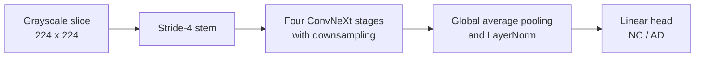

Each ConvNeXt block uses a 7 × 7 depthwise convolution, channel-wise LayerNorm, fourfold channel expansion, GELU activation, and a scaled residual connection. My baseline CNN uses four convolutional layers with batch normalization, ReLU, max pooling, and global average pooling.

#### How the model processes a slice

I designed the ConvNeXt model to process single 2D grayscale MRI slices. As an image moves through the network, the model shrinks its pixel height and width while expanding the number of feature channels.

| Processing step | Output per slice | ConvNeXt blocks |
|---|---|---:|
| Input | `1 x 224 x 224` | - |
| Stem and stage 1 | `96 x 56 x 56` | 3 |
| Downsample and stage 2 | `192 x 28 x 28` | 3 |
| Downsample and stage 3 | `384 x 14 x 14` | 9 |
| Downsample and stage 4 | `768 x 7 x 7` | 3 |
| Global Pooling & Head| 2 scores (NC, AD) | - |

**ConvNeXt block operations**
Inside each ConvNeXt block, three simple steps process the image features:
- **Spatial filtering**: A `7×7` depthwise convolution analyzes local visual patterns within each feature channel separately.
- **Feature mixing**: LayerNorm stabilizes the feature values. Two linear layers with GELU activation expand the channel count fourfold and then restore it, blending information across channels.
- **Residual connection**: The block adds its processed features back to the original input, using a learned scaling parameter to keep training stable.

After Stage 4, global average pooling compresses each 7 x 7 feature map into a single number. The final classification head converts these numbers into two scores (logits) representing normal (NC) and Alzheimer's (AD) predictions.

**Architecture comparison and parameter counts**
My baseline CNN uses a simple design with four standard convolutional layers (32, 64, 128, and 256 channels) paired with ReLU activations and max pooling. This allows me to test whether ConvNeXt's much larger size gives better results on this dataset.

| Model architecture | Stage depths | Channels layout | Total parameters |
|---|---|---|---:|
| **CNN baseline** | Four convolutional layers | (32, 64, 128, 256) | 389,314 |
| **ConvNeXt: main comparison** | **(3, 3, 9, 3)** | **(96, 192, 384, 768)** | **27,818,594** |

I adapted ConvNeXt for single-channel grayscale inputs (Liu et al., 2022). I initialized weights using a truncated normal distribution (std = 0.02), set all biases to zero, and set initial layer-scale parameters to 1e-6. I implemented these network components directly in modules.py.

### 2.4 Matched training and evaluation

| Setting | Main corrected comparison |
|---|---|
| Initialization / seed | From scratch / 42 |
| Optimizer | AdamW |
| Learning rate / weight decay | `5e-5` / `0.05` |
| Batch size / maximum epochs | 8 / 40 |
| Loss / label smoothing | Cross-entropy / 0 |
| Scheduler | Cosine decay over the 40-epoch horizon |
| Early stopping / checkpoint | Patience 6 / highest validation slice accuracy |
| Drop-path / head dropout | 0 / 0 |
| Augmentation / normalization | Standard affine / fixed 0.5, 0.5 |
| AD decision threshold | P(AD) >= 0.5 |

I ran both models using identical training settings and subject splits. Validation performance guided checkpoint selection, while test set evaluation remained completely isolated until final testing.

**Primary metric:** Total correct predictions divided by all test slices. I also evaluated per-class precision/recall, macro-F1, and AUROC scores to analyze overall performance.

**ROC and AUROC:** a receiver operating characteristic (ROC) curve plots
AD sensitivity (true-positive rate) against the NC false-positive rate as
the AD-probability threshold varies. AUROC summarizes this ranking across
thresholds. A score of 0.5 represents chance ranking and 1.0 perfect separation.
It is not accuracy at threshold 0.5, a confidence-calibration measure, or
proof that the model meets the 80% accuracy requirement.

Experiment evaluators report AUROC numerically. The checkpoint-selection
ROC plot is shown in [Section 5.7](#57-checkpoint-selection-and-cached-gpu-augmentation).
The standard `predict.py` command saves confusion/failure plots, not a ROC curve.

The versioned `adni_validation_roc_v1.slurm` job replays only validation
inference for both job-724703 checkpoint selections, with pinned checkpoint
hashes and a ten-minute GPU cap. `evaluate_selection.py --roc_replay` checks
replayed accuracy, macro-F1, AUROC and AD average precision against the saved
comparison (absolute tolerance 1e-6) before plotting. It saves aggregate
ROC coordinates and a PNG in a new job directory, without individual slice
probabilities, retraining, threshold tuning or test inference.

**ROC replay (job 725399):**
ROC coordinates are finite, monotonically nondecreasing and span (0, 0) to
(1, 1). The area under each curve matches the reported validation AUROC.
The frozen test results are unchanged.

## 3. Classification results

This section preserves the original CNN/scratch ConvNeXt benchmark.
Its unmet accuracy targets are historical model-specific outcomes, not the
latest project status. The regularized ConvNeXt subsequently reached
**82.09% exploratory test accuracy**. See [Section 7.3](#73-completed-regularization-results-and-remaining-priorities).

### 3.1 Model training and checkpoint selection

I monitored training progress across all epochs and saved execution histories for both the [CNN](results/baseline_history.json) and [ConvNeXt](results/convnext_history.json).

| Model	| Best validation accuracy | Selected epoch / Total epochs | Training accuracy at selected epoch | Total training time | Job ID |
|---|---:|---:|---:|---:|---:|
| **CNN baseline** | 72.47% | Epoch 3 / 9 | 75.96% | 9.52 minutes | 717634 |
| **ConvNeXt** | 72.65% | Epoch 9 / 15 | 81.29% | 32.82 minutes | 717690 |

I selected the optimal checkpoint weights for each architecture using its highest validation accuracy score. ConvNeXt achieved a peak validation accuracy that was only **0.19 percentage points higher** than the baseline, while requiring **3.45 times longer** to train.

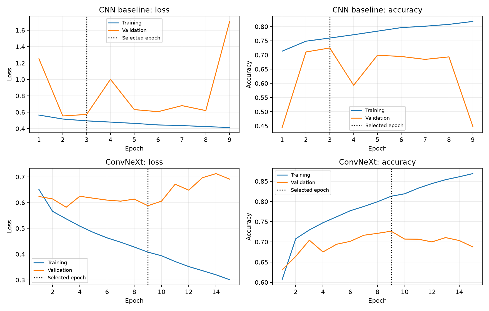

**Figure 1. Training dynamics on the corrected subject split (Jobs 717634 and 717690).** 
- **Top plots (CNN baseline)**: Training loss decreases steadily while validation loss fluctuates wildly, spiking by epoch 9. Validation accuracy peaks early at epoch 3 (72.47%) before dropping sharply.
- **Bottom plots (ConvNeXt)**: Training accuracy climbs steadily past 85% while training loss steadily decreases. However, validation accuracy plateaus and peaks at epoch 9 (72.65%) before declining, showing a widening gap between training and validation performance.
- **Dotted vertical lines**: Mark the checkpoints selected based on peak validation accuracy (epoch 3 for the CNN and epoch 9 for ConvNeXt). I used peak validation accuracy as my selection rule rather than minimum validation loss.

### 3.2 Frozen corrected-test comparison

Numerical evidence: [test metrics and confusion counts](results/test_metrics.json).

I evaluated both selected checkpoints on a fixed test set of 4,400 MRI slices from 220 scans across 102 subjects (Job 719057). For this evaluation, I used the default 0.5 decision threshold without temperature scaling or rejection rules.

| Test metric | CNN baseline | ConvNeXt |
|---|---:|---:|
| **Overall accuracy** | **75.80%** | **74.98%** |
| Correct / total slices | 3,335 / 4,400 | 3,299 / 4,400 |
| Accuracy: 95% subject-clustered interval | 68.39-82.13% | 67.61-81.11% |
| NC precision | 0.7978 | 0.7442 |
| NC recall | 0.6729 | 0.7397 |
| NC F1 | 0.7300 | 0.7420 |
| AD precision | 0.7303 | 0.7549 |
| AD recall | 0.8385 | 0.7593 |
| AD F1 | 0.7806 | 0.7571 |
| Macro-F1 | 0.7553 | 0.7495 |
| AUROC | 0.8187 | 0.8284 |
| AD PR-AUC: average precision | 0.7724 | 0.8375 |
| **80% overall test target** | **Unmet: 4.20 points below** | **Unmet: 5.02 points below** |

| Test metric | CNN baseline | ConvNeXt | Target status |
|---|---:|---:|---:|
| **Overall accuracy** | **75.80%** | **74.98%** | **Unmet (80.00% target)** | 
| Correct / total slices | 3,335 / 4,400 | 3,299 / 4,400 | - |
| Accuracy: 95% subject-clustered interval | 68.39–82.13% | 67.61–81.11% | Includes target, yet mean falls short |
| **Normal (NC) precision** | 0.7978 | 0.7442 | - |
| **Normal (NC) recall** | 0.6729 | 0.7397 | - |
| **Normal (NC) F1 score** | 0.7300	| 0.7420 | - |
| **Alzheimer's (AD) precision** | 0.7303 | 0.7549 | - |
| **Alzheimer's (AD) recall** | 0.8385 | 0.7593	| Higher baseline recall |
| **Alzheimer's (AD) F1 score**	| 0.7806 | 0.7571 | - |
| **Macro-F1 score **|	0.7553 | 0.7495	| - |
| **AUROC** | 0.8187 | 0.8284 | Higher ConvNeXt ranking quality |
| **AD PR-AUC (Average precision)**	| 0.7724 |	0.8375 | Higher ConvNeXt precision |

**Takeaways from the test benchmark**
1. **ConvNeXt ranks probabilities better**. ConvNeXt reaches a higher AUROC (0.8284) and PR-AUC (0.8375) than the CNN baseline. This means ConvNeXt separates Alzheimer's cases from normal cases more accurately when ranking raw confidence scores.
2. **The CNN baseline is more accurate at the standard threshold**. At the default 0.5 decision cutoff, the simple CNN achieves higher overall accuracy (75.80% versus 74.98%). It gets 36 more slices right overall because it misses far fewer Alzheimer's cases (365 missed slices for the CNN versus 544 for ConvNeXt).
3. **Neither model reaches the 80% accuracy target**. The CNN fell short by 4.20 percentage points, and ConvNeXt fell short by 5.02 points. Because I tested only one random training seed, I cannot conclude that the baseline will always outperform ConvNeXt under different starting conditions.

**Confusion matrix comparison**
The table below summarizes class-level predictions, where rows represent true labels and columns represent predicted labels:

| Model architecture | True NC: Predicted NC / AD | True AD: Predicted NC / AD | Total errors |
|---|---:|---:|---:|
| **CNN baseline** | 1,440 / 700 | 365 / 1,895 | 1,065 slices |
| **ConvNeXt** | 1,583 / 557 | 544 / 1,716 | 1,101 slices |

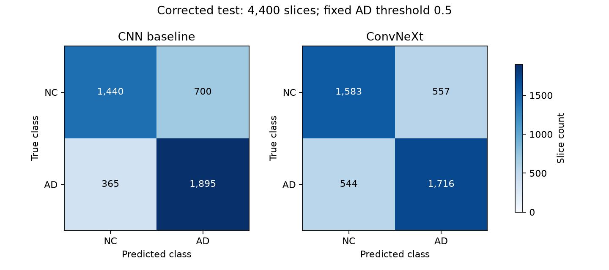

**Figure 2. Corrected test confusion matrices for the CNN baseline and ConvNeXt (Job 719057).** 
- The left matrix displays predictions for the CNN baseline and the right plot displays ConvNeXt across 4,400 test slices
- **Missed disease cases**: The bottom left box in each matrix shows missed Alzheimer's cases. ConvNeXt misses 544 disease slices compared to 365 for the CNN baseline, even though ConvNeXt makes fewer false alarm errors in the top right box (557 versus 700).
- I calculated the 95% confidence intervals using 2,000 subject-level bootstrap samples. These slices represent repeated measurements from individual patients rather than completely independent patient outcomes.


### 3.3 Acquisition-group performance

I evaluated recall across specific acquisition groups to determine how scan dates and imaging protocols affect performance.

| Test group | Subjects / scans / slices | Baseline recall | ConvNeXt recall |
|---|---:|---:|---:|
| **Normal (NC), 2017+, accelerated** | 69 / 107 / 2,140 | 67.29% | 73.97% |
| **Alzheimer's (AD), 2017+, accelerated** | 10 / 15 / 300 | 67.33% | 63.67% |
| **Alzheimer's (AD), pre-2017, accelerated** | 2 / 2 / 40 | 100.00% | 100.00% |
| **Alzheimer's (AD), pre-2017, non-accelerated** | 23 / 96 / 1,920 | 86.09% | 77.34% |

**Takeaway**
- **Overall recall masks subgroup weakness**: The baseline model's overall Alzheimer's recall score of 83.85% hides significantly worse performance on newer scans. In the 2017+ accelerated group, Alzheimer's recall drops to 67.33% for the baseline and 63.67% for ConvNeXt.
- **Neither model hits the target on newer scans**: Neither architecture reaches the 80% Alzheimer's recall target on newer 2017+ scan acquisitions.
- **Small sample size caution**: Although both models achieve 100% recall on pre-2017 accelerated Alzheimer's scans, this subset contains only 40 slices across two subjects.
- **Non-additive subject totals**: Subject counts across these subgroups do not sum to the total subject count because individual patients completed visits across multiple acquisition groups.

## 4. Confidence and referral

**Research question:** Can model confidence identify mistakes well enough to support routing cases for human review, and does ConvNeXt improve on the CNN baseline?

### 4.1 How predictions are accepted or referred

My evaluation framework separates each model's output into two distinct decisions:

1. **Class prediction**: The model assigns a label based on estimated probability. If `P(AD)≥0.5` it predicts **AD** and if 
`P(AD)<0.5` it predicts **NC**
2. **Confidence evaluation***: The model calculates confidence as the larger class probability: `max(P(AD), 1 - P(AD))`.

A slice is accepted for automated reporting when its confidence reaches a chosen threshold, dispite that it is flagged for expert review.

| Term | Mathematical definition | Practical meaning |
|---|---|
| Coverage | Accepted slices / Total evaluated slices |
| Accepted accuracy | Correct accepted slices / Total accepted slices |
| Error referral | Referred incorrect slices / Total incorrect slices |

As the project goal requires at least 80% coverage and 50% error referral. These are research targets rather than clinical standards. Accepted accuracy measures correctness strictly among accepted slices, so it does not replace overall test accuracy.

Using corrected validation data, I selected thresholds by maximizing accepted accuracy subject to a minimum 80% coverage floor over a candidate grid from 0.50 to 1.00. The selected thresholds were **0.60 for the CNN baseline and 0.65 for ConvNeXt**.

### 4.2 Validation-fixed rules on corrected test

In job 719094, I applied these validation-selected thresholds directly to the frozen test checkpoints (results/test_referral.json). I did not adjust thresholds or re-evaluate predictions on the test set.

| Test referral metric |	CNN baseline | ConvNeXt |	Project target | Status |
|---|---:|---:|---:|---:|
| Confidence threshold	| 0.60 | 0.65 | - |	- |
| Accepted / Referred slices | 3,565 / 835 |	3,633 / 767	| - |	- |
| **Slices accepted by the rule (Coverage)** | **81.02%**	| **82.57%** | **>= 80.00%** | **Met** |
| Accepted accuracy	| 80.62% | 79.25% |	- |	- |
| Accepted false positives | 501 | 378 | - | - |
| **Missed AD slices still accepted** | **190**	| **376** | -	| - |
| Errors referred / Total errors | 374 / 1,065 | 347 / 1,101 |	-	| - |
| **Mistakes referred for review** | **35.12%**	| **31.52%** | **>= 50.00%** |	**Unmet** |
| Confidence AUROC | 0.6646 |	0.7062 | - | - |
| False negatives at confidence >= 0.90	| 20 | 130 | - | - |

**Takeaways from Test Results**
1. **Evethough both models accepted enough slices to pass 80% coverage goal (81.02% for CNN and 82.57% for ConvNeXt), neither model referred the required 50% of mistakes**. The CNN referred 35.12% of its errors, and ConvNeXt referred only 31.52%.
2. **ConvNeXt let many dangerous errors pass through**. ConvNeXt accepted 376 missed Alzheimer's slices under its rule, compared to 190 for the baseline. In fact, ConvNeXt produced 130 false-negative slices with confidence scores at or above 0.90, proving that high model confidence does not guarantee correct predictions.
3. **Exploratory diagnostic role**. I specified this extra inference pass after learning the overall test scores to check threshold transfer across patient groups, rather than using test data to search for better thresholds.

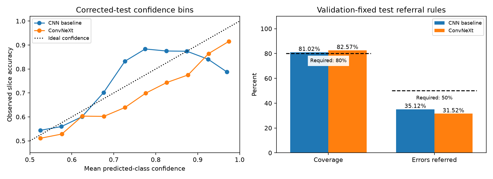

**Figure 3. Evaluation of confidence-based error referral on the corrected test set (Job 719094).**
- **Left**: Compares average predicted confidence against actual slice accuracy. Points below the dotted line show overconfidence, where the model's reported certainty is higher than its real accuracy. ConvNeXt consistently sits below the diagonal in high-confidence bins, showing that high confidence scores cannot guarantee correct predictions.
- **Right**: Shows performance against project targets. Both validation-fixed rules successfully exceed the 80% coverage floor (81.02% for CNN and 82.57% for ConvNeXt). However, both models fail the 50% error referral requirement (35.12% for CNN and 31.52% for ConvNeXt). Referring uncertain slices is an automated routing step, not a guarantee that a human reviewer would correct the mistake.

### 4.3 Does temperature scaling help?

Numerical evidence: [calibration and assessment summaries](results/calibration.json).

I also tested whether temperature scaling improves model probability estimates. Temperature scaling fits a single positive parameter (*T*) to adjust confidence scores without changing the final predicted class (Guo et al., 2017).

In job 719040, I split the 102 validation subjects into 51 calibration subjects and 51 assessment subjects, stratified by diagnosis. All scans and slices from a single subject remained within one split. I fitted the scaling parameters and confidence thresholds strictly on the calibration half (
`T=1.9422` for CNN, `T=2.4653` for ConvNeXt), then applied them unchanged to the assessment half.

| Assessment probability quality (2,060 slices) | CNN raw | CNN scaled | ConvNeXt raw | ConvNeXt scaled | Direction for improvement |
|---|---:|---:|---:|---:|---:|
| **Brier score** | 0.1533 | 0.1705 | 0.1485 | 0.1585 | Lower is better |
| **Negative log-likelihood (NLL)** | 0.4754 | 0.5233 | 0.4486 | 0.4910 | Lower is better |
| **Expected calibration error (ECE)** | 0.0383 | 0.1233 | 0.0403 | 0.0985 | Lower is better |
| **Coverage** | 83.01% | 83.59% | 81.84% | 85.19% | Target >= 80.00% |
| **Share of errors referred** | 34.99% | 34.13% | 36.12% | 30.84% | Target >= 50.00% |

**Takeaways from the Calibration Experiment**
1. **Probability quality worsened after scaling**. The Brier score measures squared probability error, NLL penalizes confident mistakes, and ECE measures agreement between predicted probabilities and real outcomes. All three scores worsened for both models on assessment, so I do not recommend using these fitted temperatures.
2. **Classification results remained unchanged**. Assessment accuracy stayed at 77.52% for my CNN baseline and 77.96% for ConvNeXt. Because positive scalar temperature scaling preserves the original decision boundary at 0.5, it cannot recover missed Alzheimer's predictions at that threshold (Guo et al., 2017).

Temperature scaling fitted on validation data may not transfer reliably
under distribution shift (Guo et al., 2017). Scanner acquisition imbalance
is a concern here, but the observed calibration degradation does not prove
that imbalance caused it. In this experiment, ECE measures P(AD) against
AD frequency in ten equal-width probability bins. Guo et al. use maximum
confidence across 15 bins. These ECE measurements are not directly equivalent.

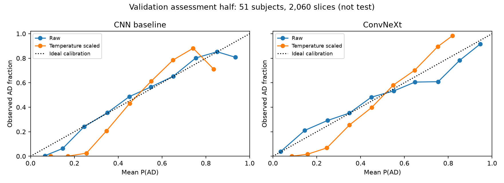

**Figure 4. Reliability curves for raw and temperature-scaled probabilities (Job 719040).** 
- **Diagonal line**: The dotted black line represents ideal calibration, where predicted probabilities match real Alzheimer's case fractions.
- **Blue lines**: Showcase raw model probabilities
- **Orange lines**: Showcase probabilities after temperature scalin
- **Effect of Temperature Scalling**: For both models, temperature scaling shifts the orange curves away from the ideal diagonal line, showing that scaling actually made probability calibration poor on assessment data.

### 4.4 Answer to the engineering dilemma

**Confidence helps rank errors, but neither tested rule identifies enough of them for the proposed workflow.** 

The table below summarizes the practical workload and error trade-offs when applying these rules to the 4,400 test slices:

| Model architecture | Slices sent for review | Total incorrect slices still accepted | Alzheimer's slices misclassified as normal and accepted |
|---|---:|---:|---:|
| **CNN baseline** | 835 / 4,400 (18.98%) | 691 | 190 |
| **ConvNeXt** | 767 / 4,400 (17.43%) | 754 | 376 |

Case C1 illustrates this limitation clearly, as every single slice is wrong yet none are referred for review. Case C3 also contains confident missed Alzheimer's predictions (Section 5.2). In addition, referral measures routing efficiency only, so no human correction outcomes were evaluated.

**Decision:** I chose to retain the lower-cost CNN as my research baseline, though not as a clinical service. ConvNeXt's better score ranking did not outweigh its accepted errors and additional computational cost. This conclusion covers a single training seed and a previously consulted cohort, so independent evaluation is required before any future deployment.

My investigation of this dilemma brings four distinct types of evidence:

| Evidence Source | Contribution to the decision |
|---|---|
| [Matched benchmark, Section 3.2](#32-frozen-corrected-test-comparison) | On identical test slices, ConvNeXt improves AUROC however achieves lower overall accuracy and lower Alzheimer's recall than the baseline CNN. |
| [Failure autopsies, Section 5.2](#52-four-actual-corrected-validation-failures) | Four actual MRI cases show persistent false positives, missed Alzheimer's predictions, and slice-level disagreement. Visual observations suggest potential image triggers rather than proven causes. |
| [Resource profile, Section 6](#6-computational-cost) | Parameter counts, GPU memory usage, and inference latency quantify the additional computational expense of running ConvNeXt. |
| [Manager decision, Section 7](#7-recommendation-and-limitations) | My decision weighs classification accuracy, missed Alzheimer's cases, review workload, and compute cost, while outlining the evidence required before considering clinical deployment. |

## 5. Failure analysis

### 5.1 Acquisition confounding

In the metadata audit has revealed a strong link between a patieent's diagnosis and the time period when their scan was acquired.

| Acquisition group, whole inventory | NC scans | AD scans |
|---|---:|---:|
| 2017+, accelerated | 783 | 118 |
| 2017+, non-accelerated | 0 | 2 |
| Pre-2017, accelerated | 0 | 102 |
| Pre-2017, non-accelerated | 0 | 521 |

Every normal scan in the dataset comes from 2017 or later, while about 84% of the Alzheimer's scans are from before 2017. In the original training and validation folders, the scan era separates the two classes perfectly.

If I use a simple date-only rule that predicts Alzheimer's just because a scan is from before 2017, it reaches **100% accuracy on the original validation set and 73.33% on the original test set**. This matches the trained models' original test scores almost exactly.

This findings showcase that the models may be learning shortcuts based on the scanner era, rather than actual brain anatomy. While my corrected data split introduces newer Alzheimer's scans into the training set, it cannot create older normal scans because they do not exist in the dataset. Therefore, fixing the data split alone cannot completely remove this era-based shortcut.

### 5.2 Four actual corrected-validation failures

To analyze these errors, I examined four specific validation cases. In job 718436, I selected ConvNeXt's most confident and median-confidence errors for both false positives and false negatives. All four cases belong to the newer 2017+ accelerated group, which contains both diagnoses in the training data.

| Case ID | Error type | Mean predicted P(AD) | Slice error rate | Did the CNN also fail? |
|---|---|---:|---:|---|
| **C1** | Most-confident false positive | 0.972 | 100% | Yes |
| **C2** | Median-confidence false positive | 0.612 | 70% | No |
| **C3** | Most-confident false negative | 0.173 | 87.5% | Yes |
| **C4** | Median-confidence false negative | 0.470 | 55% | Yes |

The images below show saved slice predictions rather than heatmaps or anatomical diagnoses. A predicted probability of 
`P(AD) ≥ 0.5` results in an Alzheimer's prediction, while lower scores predict a normal case. The table above averages all slices for each case, not just the four panels displayed below. By selecting both extreme and median-confidence errors, I illustrate specific failure modes rather than their overall frequency.

**Case C1: Consistent false alarms**
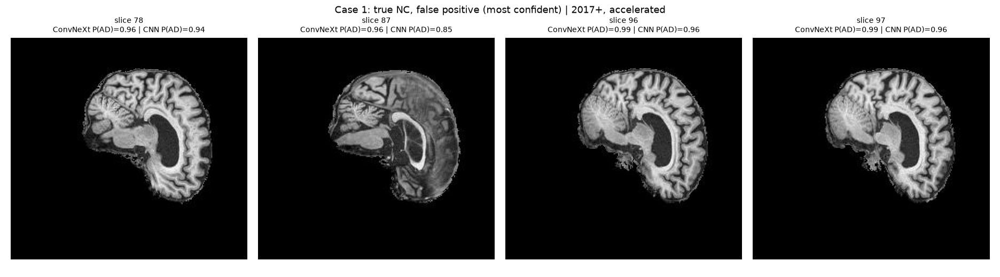

**Figure 5. C1: Consistent false alarms.** 
Both models give high Alzheimer's probabilities (ranging from 0.85 to 0.99) across these slices, even though the patient is completely healthy[cite: 6]. ConvNeXt gets all 20 slices wrong and does not flag any of them for human review. The pixels in these slices are noticeably darker than the average correctly classified normal brain. The actual brain tissue also takes up less space in the image.

- **Possible cause**: Darker image contrast or less tissue showing in the frame.
- **Next step**: A possible imporvement is to run a test taht intentionally change the brightness of the image to see if that causes the error. However, brightness alone does not prove the root causes

**Case C2: Model disagreement and mixed slices**
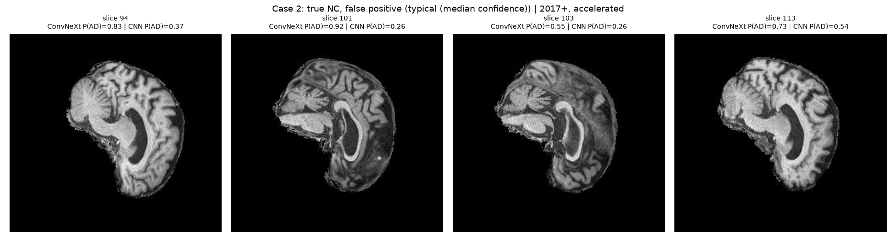

**Figure 6. C2: Model disagreement and mixed slices.** 
The simple CNN correctly predicts a normal brain on the first three slices with low probabilities, but ConvNeXt incorrectly predicts Alzheimer's with high probabilities (up to 0.92). By slice 113, both models switch to predicting Alzheimer's. Across two different scans for this same patient, ConvNeXt gets 28 out of 40 slices wrong and flags 40% of them for review. The CNN's overall average decision for this patient is correct.The CNN predicts

- **Possible cause**: The model is overly sensitive to the slice's position or how the brain is framed.
- **Next step**: Future improvement is to compare this case with correctly classified normal cases at the exact same slice position to see what is confusing the model.

**Case C3: Confident missed cases**
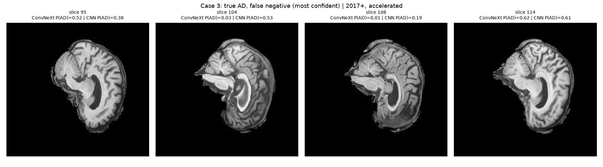

**Figure 7. C3: Confident missed cases.**
ConvNeXt gives extremely low Alzheimer's probabilities (0.03 and 0.01) on slices 104 and 108. These are highly confident but completely wrong normal predictions, because the patient actually has Alzheimer's. Across four scans for this patient, ConvNeXt gets 70 out of 80 slices wrong and flags only 16.25% of them.

- **Possible cause**: The model is weak at detecting Alzheimer's in this specific scanner group because the training data is unbalanced. The training set has only 84 Alzheimer's scans compared to 554 normal scans in this era.
- **Next step**: To test more patients in this specific group to see if this pattern holds up. Because earlier balancing experiments did not fix this, the unbalanced data is just a theory right now, not a proven fact.

**Case C4: Mixed evidence in the same scan**
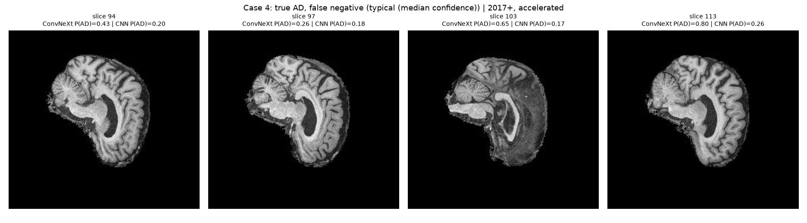

**Figure 8. C4:Mixed evidence in the same scan.** 
ConvNeXt correctly predicts Alzheimer's at slice positions 103 and 113, but it flips to predicting a normal brain at positions 94 and 97. When I average all 20 slices together, the overall Alzheimer's probability is 0.4701. This falls just below the cutoff line, meaning the model ultimately missed the diagnosis. In total, 11 out of 20 slices were wrong.

- **Possible cause**: The visual signs of the disease are not consistent across different parts of the same brain.
- **Next step**: I should analyze how much predictions vary within a single scan. I also need to test a new rule for combining slice scores to see if it makes the final decision more stable. While the slice-level rule flagged 45% of the slices for review, the overall subject-average rule flagged the entire case. These rules work differently, and neither guarantees a doctor would actually catch the mistake.

### 5.3 Proposed review gates

I designed three theoretical safety gates to determine whether an MRI scan can be processed automatically or if it must be routed to a clinician for human review. These serve as research evaluation checks:

1. **Acquisition gate:** A scan group is eligible for automated processing only if the training set includes at least 50 scans for each diagnosis. Scan groups with fewer training examples are automatically routed to a human reviewer.
2. **Confidence gate:** Eligible scan groups must meet a fixed confidence threshold determined on validation data.
3. **Release check:** An eligible group must achieve at least 80% validation Alzheimer's recall before release, followed by evaluation on independent test data.

In my corrected training dataset, only the 2017+ accelerated group meets the 50-scan requirement, containing 554 normal scans and 84 Alzheimer's scans. Within this eligible group, validation Alzheimer's recall reaches only 62.37% for the CNN baseline and 62.89% for ConvNeXt, falling well short of the 80% release requirement.

Neither architecture reaches the required release threshold, neither model qualifies for automated deployment. The test referral results in Section 4 evaluate the confidence gate alone rather than all three gates combined.

**Implications**
- Model confidence scores are unreliable on scan types that appear infrequently during training.
- Both models still make serious classification errors even within the most well-represented scanner types.
- The evidence does not justify removing difficult subjects, altering ground-truth labels, or treating high softmax confidence as an anatomical explanation.

### 5.4 Why did the original models fall below 80%, and what was tried?

To reach the 80% accuracy target on my test set of 4,400 slices, a model must correctly classify at least 3,520 slices. My frozen models fell short of this benchmark:

- **CNN baseline**: Correctly predicted 3,335 slices, leaving a net shortfall of **185 correct predictions** (4.20 percentage points below target).
- **ConvNeXt**: Correctly predicted 3,299 slices, leaving a net shortfall of **221 correct predictions** (5.02 percentage points below target).

These shortfalls describe the original scratch models. The later regularized
ConvNeXt achieved 3,612 correct slices (82.09%), exceeding the required
3,520 by 92. [Section 7.3](#73-completed-regularization-results-and-remaining-priorities)
reports that exploratory result and its limitations.

**Core concerns: Data coverage and overfitting**
- All normal scans in the dataset originate from 2017 or later, whereas most Alzheimer's scans are earlier. Subject-level splitting eliminates patient identity overlap across splits, but it cannot create missing earlier-era normal scans.
- ConvNeXt optimizes 27.82 million parameters using only 476 training subjects. ConvNeXt's training performance improves over time without sustained validation gains (Figure 1), indicating that the network easily memorizes dataset artifacts instead of learning true anatomical features.

**Attempted remedies on validation data**
I evaluated three potential modifications using validation data while keeping the main test evaluation frozen and unchanged.

| Experimental change and motivation | Validation accuracy | Later-era AD recall | Final decision |
|---|---:|---:|---|
| Era-aware CNN sampling: Rebalanced exposure to scanner groups | 72.74% -> 74.23% | 63.16% -> 59.47% | Accuracy gained, yet disease detection in the target subgroup got poorer |
| Lower ConvNeXt learning rate: Reduced starting rate from 5e-5 to 2e-5 | 72.65% -> 73.12% | 62.89% -> 47.89% | Gained normal accuracy at the expense of weaker disease detection |
| Training-only normalization: Applied dataset-specific intensity scaling | 72.65% -> 72.09% | 62.89% -> 42.89% | Overall screening performance declined |

Saved comparisons: [era sampling](results/era_sampling.json),
[lower learning rate](results/lower_learning_rate.json) and
[normalization](results/normalization.json). These are validation results,
not replacements for the frozen test comparison.

**Detailed experimental evaluation**
- **Era-aware CNN sampling**: I rebalanced training batches so the model sampled equal expected mass from normal and Alzheimer's classes, with Alzheimer's draws split equally between earlier and later scan eras. While overall validation accuracy increased from 72.74% to 74.23%, Alzheimer's recall in the critical later-era group dropped from 63.16% to 59.47%.
- **Lower ConvNeXt learning rate:** I reduced ConvNeXt's initial learning rate from `5e-5` to `2e-5`. The training run completed 16 epochs in 36.74 minutes, selecting epoch 10. Validation accuracy rose slightly from 72.65% to 73.12%, but later-era Alzheimer's recall collapsed from 62.89% to 47.89%. Macro-F1 fell from 0.7248 to 0.7235, and AUROC declined from 0.7976 to 0.7936.
- **Training-only normalization**: I evaluated dataset-specific intensity scaling using training statistics (mean 0.1160, standard deviation 0.2231). This candidate correctly classified 176 more normal slices but missed 200 more Alzheimer's slices, resulting in 24 fewer correct predictions overall. Validation accuracy dropped to 72.09%, later-era Alzheimer's recall dropped to 42.89%, and Macro-F1 fell to 0.7130. Job 719449 ran for 1:22:08 elapsed time. Note that this normalization test relies on completed-job logs rather than full checkpoint integrity checks.

**Takeaways**
1. **Higher accuracy can mask worse screening performance**: Lowering the learning rate and adding intensity normalization reduced overall Alzheimer's recall to 65.27% and 64.09% (down from 74.84%). A slight bump in overall accuracy hid a severe loss in disease sensitivity.
2. **Calibration cannot alter boundary decisions**: Temperature scaling adjusts probability confidence, but it cannot recover missed cases at a fixed decision boundary (Guo et al., 2017).
3. **None of the candidate remedies were adopted**: Because none of these modifications improved disease detection on validation data, I did not evaluate or adopt any of them on the final test set.


These are research checks, not an approved clinical operating procedure:

1. **Acquisition gate:** eligibility requires at least 50 training scans of
   each diagnosis in the acquisition group. Other groups are routed to review.
2. **Confidence gate:** eligible groups use the validation-fixed confidence
   threshold.
3. **Release check:** eligibility also requires at least 80% validation AD
   recall in those groups, followed by evaluation on independent data.

Only the 2017+ accelerated group qualifies in corrected training, with
554 NC and 84 AD scans. Validation AD recall there is **62.37% for CNN**
and **62.89% for ConvNeXt**, below the proposed release criterion.
Neither model reaches the proposed 80% validation AD-recall requirement.
The test referral results in Section 4 assess the
confidence gate alone, not the combined gates.

**Implications:** confidence interpretation depends on acquisition coverage,
and familiar acquisition groups still contain serious
errors. The evidence does not justify removing difficult subjects, altering
their labels or treating a high softmax score as an anatomical explanation.

### 5.5 Augmentation evaluation: horizontal flips

I tested whether adding horizontal flips during training improves classification without missing more Alzheimer's disease (AD) cases. I turned off flips in my main pipeline because MRI scans in this dataset show side views (sagittal profiles) of the head, where mirroring flips the front and back of the brain. I ran a controlled experiment to measure the actual impact of flipping.

**Experimental setup**
I trained two ConvNeXt models using the same random seed (seed 42) and identical settings, changing only the data augmentation: no flips versus 50% horizontal flips. I tested both models on 4,300 validation slices (Job 719873).

| Validation measure | No flips | 50% horizontal flips | Result |
|---|---:|---:|---:|
| **Overall accuracy** | 72.65% | 73.28% | Small overall gain (+0.63%) |
| **Normal (NC) recall** | 70.98% | 77.62% | Better normal detection (+6.64%) |
| **Alzheimer's (AD) recall** | 74.84% | 67.58% | Worse disease detection (-7.26%) |
| **Later-era accelerated AD recall** | 62.89% | 52.37% | Big drop in hard cases (-10.52%) |
| **Macro-F1 score** | 0.7248 | 0.7268 | Small changes (+0.0020)
| **AUROC** | 0.7976 | 0.7930 | Slight drop in ranking quality (-0.0046) |

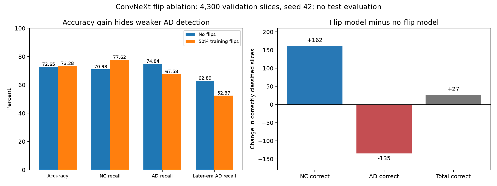

**Figure 9. Impact of horizontal flips on validation predictions (Job 719873)**
- **Left plot (Performance metrics)**: Shows that while flips raise overall accuracy and normal recall, they cause a large drop in Alzheimer's recall.
- **Right plot (Slice-level changes)**: Breaks down the net slice count changes. Flips helped the model catch 162 more normal slices, but caused it to miss 135 more Alzheimer's slices. This resulted in a net gain of only 27 correct slices across all 4,300 validation slices.

**Takeaway**
1. **The overall accuracy gain is misleading**. Flips raised accuracy by 0.63 percentage points. However, this gain happened only because the model predicted normal scans better while missing 135 more Alzheimer's slices.
2. For newer accelerated Alzheimer's scans, recall dropped from 62.89% down to 52.37%.
3. Overall metrics show mixed results such as Macro-F1 rose slightly, yet AUROC dropped. This shows that flips do not improve overall model performance.
4. I kept horizontal flips turned off. My main goal is to improve accuracy without missing more Alzheimer's cases. Because flips reduced Alzheimer's recall, I kept flips disabled in my main pipeline.

### 5.6 ImageNet initialization: accuracy versus AD detection

I compared two ConvNeXt models to evaluate the impact of transfer learning: a model trained from scratch versus a model initialized with torchvision ImageNet-1K weights (Job 723091). Both models used random seed 42, the corrected subject split, fixed grayscale normalization, no horizontal flips, and the same training recipe.

For the pretrained model, I summed the three RGB stem channels into a single grayscale input channel, attached a new two-class classification head, and fine-tuned all parameters. Scratch training completed in 33.82 minutes, and pretrained training completed in 26.80 minutes.

| Validation measure | Fresh scratch | ImageNet initialization |
|---|---:|---:|
| Accuracy | 72.70% | **82.49%** |
| NC recall | 71.02% | **91.02%** |
| AD recall | **74.89%** | 71.29% |
| Later-era accelerated AD recall | **63.16%** | 25.26% |
| Macro-F1 | 0.7253 | **0.8170** |
| AUROC | 0.7976 | **0.8905** |


| Validation metric	| Fresh scratch |	ImageNet initialization |	Trade-off / Impact |
|---|---:|---:|---:|
| **Overall accuracy** | 72.70%	| **82.49%** | Large overall gain (+9.79%) |
| **Normal (NC) recall** |	71.02% | **91.02%**	| Higher normal detection (+20.00%) |
| **Alzheimer's (AD) recall**	| **74.89%** | 71.29%	| Lower disease detection (-3.60%) |
| **Later-era accelerated AD recall**	| **63.16%** | 25.26%	| Severe drop in target subgroup (-37.90%) |
| **Macro-F1 score** | 0.7253 | **0.8170** | Higher overall balance (+0.0917) |
| **AUROC**	| 0.7976 | **0.8905**	| Higher ranking quality (+0.0929) |

**Validation analysis and overfitting patterns** 
- **Accuracy gains mask higher missed disease cases**: Pretraining added 488 correct normal predictions but lost 67 correct Alzheimer's predictions, giving a net gain of 421 correct slices.
- **Subgroup performance collapsed**: In the critical later-era accelerated Alzheimer's group, correct detection dropped from 240/380 slices down to 96/380 slices. Pretraining failed to resolve the acquisition-era imbalance.
- **Overfitting and overconfidence**: The pretrained model reached its peak validation accuracy at epoch 6. Training accuracy approached 100%, but validation loss rose from 0.5513 at epoch 1 to 1.0378 at epoch 6. This indicates that the network produced increasingly overconfident errors as training progressed.

#### Frozen test evaluation

I evaluated both validation-selected checkpoints on the frozen test set of 4,400 slices using the standard 0.5 threshold without temperature scaling or referral rules (Job 724514).

| Test measure | Fresh scratch | ImageNet initialization | Description |
|---|---:|---:|---:|
| **Overall accuracy** | 74.98% | **79.55%** | Unmet (3,500/4,400 correct, 20 short of target) |
| **NC recall** | 73.97% | **90.84%** | 361 more correct normal slices |
| **AD recall** | **75.93%** | 68.85% | 160 more missed disease slices |
| **Later-era accelerated AD recall** | **63.67%** | 27.00% | Drops from 191/300 to 81/300 slices |
| **Macro-F1** | 0.7495 | **0.7939** | Higher macro balance |
| **AUROC** | 0.8284 | **0.9170** | Better score ranking |
| **AD average precision** | 0.8375 | **0.9182** | Higher precision ranking |

The test confusion matrix for the ImageNet-initialized model contains 1,944 true normal predictions, 196 false alarms, 704 missed Alzheimer's cases, and 1,556 correct Alzheimer's predictions.

**Decision**: I retained this result as a clear accuracy-versus-sensitivity trade-off rather than adopting it as a primary screening model. Even though validation accuracy exceeds 80%, the pretrained model fails the disease-recall safeguard by missing significantly more Alzheimer's cases.

### 5.7 Checkpoint selection and cached GPU augmentation

I evaluated fresh ImageNet-initialized ConvNeXt runs on 4,300 validation slices across 102 subjects. I compared CPU augmentation (Job 724532) against GPU-cached augmentation (Job 724703), while evaluating peak accuracy checkpoint selection versus lowest validation loss selection.

| Validation measure | CPU accuracy selection | CPU loss selection | GPU accuracy selection | GPU loss selection |
|---|---:|---:|---:|---:|
| Job | 724532 | 724532 | 724703 | 724703 |
| Selected epoch | 3 | 1 | 5 | 3 |
| Overall accuracy | 83.05% | 76.88% | **84.00%** | 82.42% |
| Correct / 4,300 slices | 3,571 | 3,306 | **3,612** | 3,544 |
| NC recall | 85.70% | 68.93% | **87.79%** | 79.71% |
| AD recall | 79.57% | **87.31%** | 79.03% | 85.97% |
| Later-era accelerated AD recall | 48.42% | **67.63%** | 42.89% | 57.89% |
| Macro-F1 | 0.8270 | 0.7688 | **0.8360** | 0.8230 |
| AUROC | 0.8975 | 0.8773 | **0.9207** | 0.9027 |
| Probability NLL (lower is better) | 0.7200 | **0.5703** | 0.6193 | 0.5733 |
| Brier score (lower is better) | 0.1450 | 0.1691 | **0.1318** | 0.1406 |

**Takeaways**
- **Accuracy versus loss selection**: Within the GPU run, choosing the lowest validation loss checkpoint detects 129 more Alzheimer's slices than accuracy selection. It improves later-era Alzheimer's detection from 163/380 to 220/380 slices, but misses 197 more normal slices.
- **Calibration disconnect**: Lower negative log-likelihood (NLL) does not guarantee better overall reliability, as the Brier score worsens under loss selection.
- **Persistent subgroup weakness**: Despite achieving 84.00% aggregate validation accuracy under GPU accuracy selection, later-era Alzheimer's recall remains dangerously low at 42.89%.

**Acquisition-era sampling evaluation**

I tested whether sampling reweighting during training could fix the subgroup weakness (Job 725046). I configured training batches to sample 50% normal scans, 25% later-era Alzheimer's scans, and 25% earlier-era Alzheimer's scans.

| Validation measure | GPU accuracy selection (724703) | Era accuracy selection (725046) | GPU loss selection (724703) | Era loss selection (725046) |
|---|---:|---:|---:|---:|
| Selected epoch | 5 | 3 | 3 | 1 |
| Accuracy | 84.00% | 82.79% | 82.42% | 80.44% |
| NC recall | 87.79% | 82.70% | 79.71% | 91.72% |
| AD recall | 79.03% | 82.90% | 85.97% | 65.65% |
| Later-era AD recall | 42.89% | 49.21% | 57.89% | 30.53% |
| Macro-F1 | 0.8360 | 0.8258 | 0.8230 | 0.7928 |
| AUROC | 0.9207 | 0.9092 | 0.9027 | 0.8910 |
| Probability NLL | 0.6193 | 0.6440 | 0.5733 | 0.5967 |
| Brier | 0.1318 | 0.1433 | 0.1406 | 0.1552 |

Era accuracy selection gains 72 correct Alzheimer's slices (improving later-era recall from 163/380 to 187/380), but misses 124 more normal slices. Era loss selection performs significantly worse, missing 378 more Alzheimer's slices.

**Decision**: Sampling reweighting alone changes training exposure without creating missing scanner examples. Because it fails to resolve the underlying data coverage deficit, I retained these findings strictly as validation trade-off studies.

**Runtime smoke check** 
I performed an execution smoke check on a Rangpur A100 GPU allocation (Job 724686). Repeated cached image loading generated identical feature tensors, and device augmentation produced valid output tensors of shape `[1, 1, 224, 224]`. Evaluating a single validation slice produced an output probability of `P(AD)=0.0244 (97.56% normal confidence)`, correctly demonstrating that pipeline referral rules execute as expected without runtime errors.

#### Validation ROC replay

I re-evaluated both checkpoint selection strategies from Job 724703 on the same 4,300 validation slices to compare their Receiver Operating Characteristic (ROC) curves (Replay Job 725399).

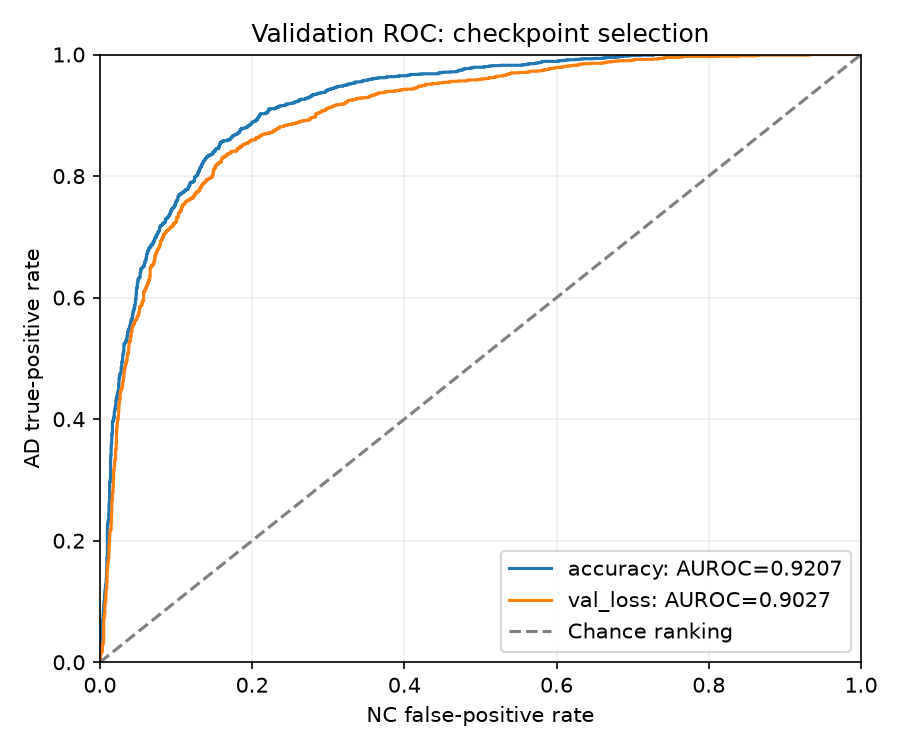

**Figure 10. Validation ROC curves for checkpoint selection strategies (Job 725399).** 
- **Blue line (Accuracy selection)**: Achieves a higher overall ranking score with an AUROC of 0.9207.
- **Orange line (Loss selection)**: Reaches a slightly lower overall ranking score with an AUROC of 0.9027[cite: 5].
- **Dashed diagonal line**: Represents random chance ranking

**Takeaways**
- **A higher AUROC does not guarantee higher disease recall at every threshold**. Even though accuracy selection achieves higher overall score ranking, loss selection detects more Alzheimer's cases at the standard 0.5 decision threshold (85.97% versus 79.03% recall)
- **ROC curves measure score ranking across all cutoffs**. An ROC curve summarizes score separation across every possible threshold. However, it does not measure probability calibration, guarantee clinical safety, or prove that a model hits the 80% test accuracy goal.

### 5.8 Labelled validation predictions and confident errors

I evaluated the job-724703 checkpoint on 12 validation slice examples from 12 distinct subjects, split evenly between six normal control (NC) cases and six Alzheimer's disease (AD) cases. Out of the 12 examples, ten predictions were correct and two were wrong.

- **False positive error (Panel 4)**: A true normal slice predicted as Alzheimer's disease with 0.9178 confidence.
- **False negative error (Panel 12)**: A true Alzheimer's disease slice predicted as normal with 0.8998 confidence.

Because both error confidence scores exceeded the demonstration referral threshold of 0.80, the system failed to flag either error for human review and referred zero slices overall.

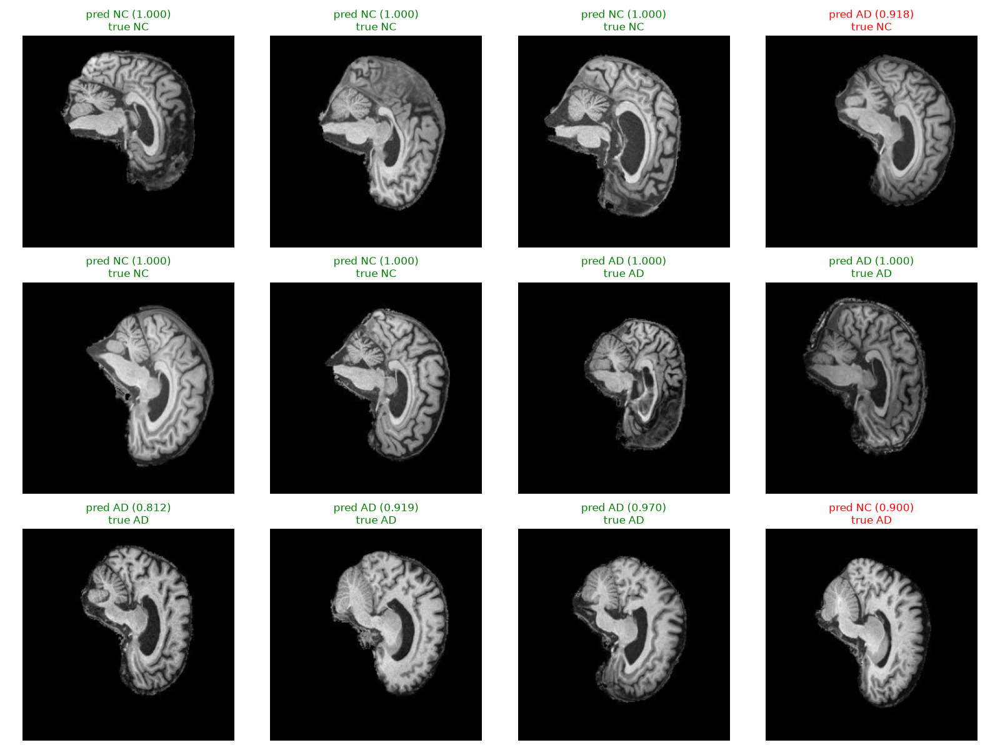

**Figure 11. Labelled validation prediction examples (job-724703 checkpoint).**
- Panels are arranged left-to-right and top-to-bottom. Each panel title displays the predicted class, confidence score rounded to three decimal places, and true ground-truth diagnosis.
- **Correct predictions (Green)**: Ten panels show correct classifications. Displayed confidence scores of 1.000 reflect decimal rounding rather than absolute mathematical certainty.
- **Confident errors (Red)**: Panel 4 displays a false positive (true NC predicted as AD with 0.918 confidence), while Panel 12 displays a false negative (true AD predicted as NC with 0.900 confidence).
- **Referral failure**: No yellow referral markers appear because all predicted confidence values clear the 0.80 threshold line.

**Takeaways**
- **High confidence scores do not ensure diagnostic correctness**. Both incorrect predictions bypassed the confidence cutoff rule without triggering human review.

Reproduction commands are in [Section 8.3](#83-inference-and-example-output).

#### Grad-CAM as a supporting diagnostic

I generated Grad-CAM feature heatmaps for the unregularized ConvNeXt checkpoint (job-724703) across the same 12 validation slice examples using train.py --save_validation_gradcam (Job 725543). This feature overlays gradient-weighted activations from the final convolutional stage for the predicted class.

I scaled each heatmap individually for display, meaning color intensity reflects relative activation within a single image rather than an absolute score across slices. All 12 images produced valid, non-zero activation maps.

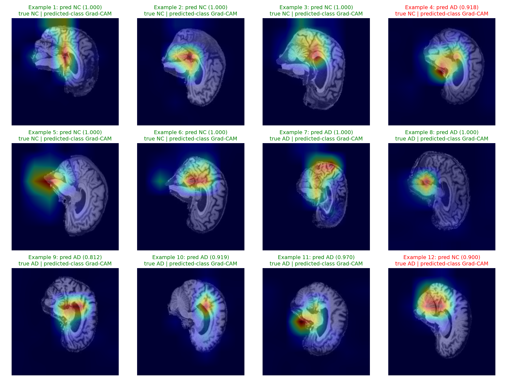

**Figure 12. Predicted-class Grad-CAM overlays for unregularized validation predictions (Job 725543)** 
- Warm colors showing higher relative activation within each image, while cool colors show lower activation. Title text colors (green for correct, red for error) show classification outcome rather than heatmap quality.
- Both confident errors—the false positive in Example 4 and the false negative in Example 12—display focused activation over brain tissue rather than empty background noise.
- Several correct predictions, such as Examples 1 and 5, show activation extending beyond the skull boundary into background space.

**Qualitative takeaways:** 

Plausible heatmaps do not prove that a network has learned true anatomical biomarkers, nor do they explain why an error occurred. Confirming feature causality requires controlled occlusion tests rather than visual inspection alone. Grad-CAM aids qualitative failure analysis, but generating heatmaps does not improve accuracy or satisfy the 80% test benchmark.

#### Current regularized model: matched validation predictions and Grad-CAM

I evaluated the current regularized ConvNeXt model (epoch-2 checkpoint from Job 725521, which achieved 82.09% exploratory test accuracy) on the exact same 12 validation slices (Job 725687). All 12 saved heatmaps produced valid, non-zero activation maps.

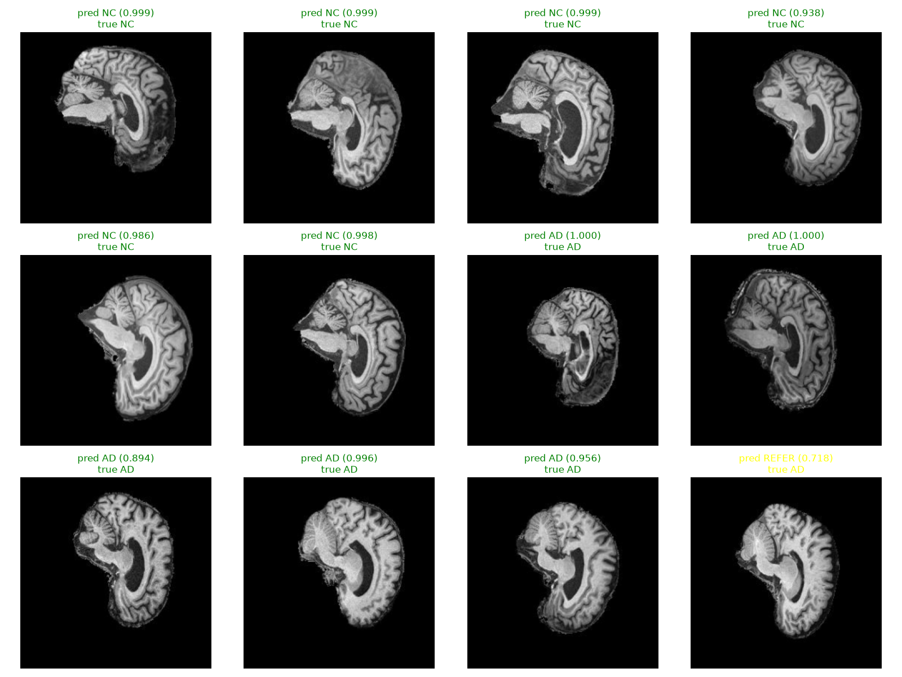

**Figure 13. Labelled validation predictions for the current regularized model (Job 725687).** 

- **All 12 class predictions are correct**. Eleven predictions clear the 0.80 confidence threshold and are accepted (green titles).
- Example 4 changes from a confident false positive to a correct normal prediction (
P(AD)=0.0617, or 93.83% normal confidence)
- Example 12 (true Alzheimer's) changes from a confident false negative to a correct Alzheimer's prediction with `P(AD)=0.7181`. Because its confidence falls below the 0.80 threshold, the system flags it as REFER for human clinician review (yellow title)

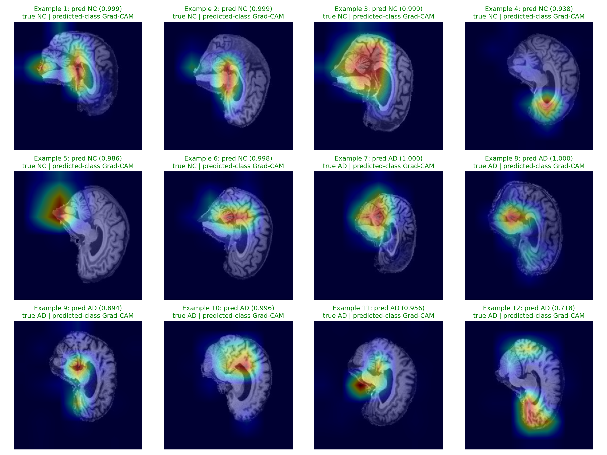

**Figure 14. Predicted-class Grad-CAM overlays for the current regularized model (Job 725687).** 
- All titles are green because **all underlying class predictions are correct**. 
- Activations remain focused inside brain tissue, though some boundary spillover persists in Example 5.
- Example 4 now highlights features driving the normal prediction, while Example 12 highlights features driving the Alzheimer's prediction. 

**Takeaways** 

Shifted target logits, updated model weights, and independent display scaling prevent attributing heatmap changes strictly to improved anatomical focus. These maps support qualitative comparisons across runs, but they do not provide causal proof of the measured accuracy gain.

## 6. Computational cost

Numerical evidence: [resource profile and recorded environment](results/resource_profile.json).

I benchmarked the resource consumption of both trained models on the corrected validation set using a batch size of 8 and num_workers=0 (Job 718436).

| Measurement | CNN baseline | ConvNeXt |
|---|---:|---:|
| **Parameters** | 389,314 | 27,818,594 |
| **Training duration** | 9.52 min | 32.82 min |
| **Inference peak allocated memory** | 111.2 MiB | 216.6 MiB |
| **Synthetic training-step peak allocated memory** | 287.5 MiB | 1,199.4 MiB |
| **Synthetic training-step peak reserved memory** | 422 MiB | 1,444 MiB |
| **Pipeline median batch latency** | 10.68 ms | 16.74 ms |
| **Pipeline p95 batch latency** | 11.27 ms | 17.24 ms |
| **Amortized pipeline latency per slice** | 1.352 ms | 1.988 ms |

- Pipeline timing scope: My pipeline timing measures the complete end-to-end processing pipeline, including image loading, preprocessing, GPU transfer, forward pass, softmax calculation, and CPU memory copying.
- Batch evaluation: I measured latency across 537 warm-cache batches after running one initial warm-up batch, covering 4,292 timed slices out of the 4,300 total validation slices.

**Takeaways**
1. **ConvNeXt requires substantially greater storage and hardware memory**. ConvNeXt uses 71.5 times more parameters and nearly double the allocated GPU memory during inference compared to the CNN baseline.
2. **ConvNeXt increases slice processing latency**. Amortized pipeline latency per slice increases from 1.352 ms to 1.988 ms, representing a 47% increase in slice-level processing overhead.

## 7. Recommendation and limitations

### 7.1 Deployment decision memo

**To:** Project Manager, MRI Classification Research Prototype<br>
**Subject:** Model selection and next-stage evaluation

**Recommendation:** retain the lightweight CNN as a research benchmark,
not a clinical service. The original scratch ConvNeXt has lower test accuracy
and AD recall than the CNN despite greater computational cost. ImageNet
initialization initially raised test accuracy to 79.55%, but remained below 80% and
reduces AD recall to 68.85%, with only 27.00% recall in later-era AD.
Neither primary-model referral rule meets the 50% error-referral target.
The subsequent regularized model reaches 82.09% exploratory test accuracy
and 80.22% AD recall, but only 50.00% later-era AD recall. It is a research
candidate for independent evaluation, not a validated screening service.

#### Evidence supporting the decision

1. **Classification performance**
The current regularized ConvNeXt reaches **82.09% exploratory test accuracy**
(3,612 / 4,400), meeting the numerical 80% target, with **80.22% AD recall**
and **84.07% NC recall**. However, later-era AD recall is only **50.00%**:
150 of 300 slices are missed. The original CNN/scratch comparison remains
75.80% versus 74.98% accuracy, with higher AD recall for the CNN
(83.85% versus 75.93%). Those historical results support retaining the CNN
as a benchmark, not claiming it has higher accuracy than the current model.
All follow-ups remain single-seed, same-cohort exploratory evidence.
2. **Score ranking quality**
The regularized model achieves test **AUROC 0.9159** and **AD average
precision 0.9149**, substantially above the original scratch ConvNeXt
(0.8284 and 0.8375). These are slightly below the initial pretrained
model's 0.9170 and 0.9182 despite improved threshold accuracy and AD recall.
Better aggregate ranking does not establish calibration or resolve the
later-era disease-detection weakness.
3. **Error referral routing**
Full-test referral measurements apply only to the original CNN and scratch
ConvNeXt: their validation-fixed rules refer **35.12%** and **31.52%** of
errors, below the 50% target. No full-cohort referral benefit has been
established for the regularized model. Its matched 12-example validation
demo has 12 correct predictions and one referral (Figure 13), but contains
no errors from which to estimate error-referral performance. The
demonstration threshold 0.80 is not a validated operating rule.
4. **Calibration performance**
The regularized accuracy-selected checkpoint has lower validation NLL
(**0.5137 versus 0.6193**) and Brier score (**0.1233 versus 0.1318**) than
the unregularized GPU control. This does not establish independent
calibration or test probability quality. Temperature scaling worsened NLL,
Brier and ECE on the original models' validation assessment half. Those
findings are not measurements of the regularized model. Its temperature
scaling and ECE have not been evaluated. Positive scalar scaling preserves
the 0.5 decision boundary and cannot recover missed AD predictions there.
5. **Computational overhead**
The regularized ConvNeXt retains **27,818,594 parameters**, 71.5 times the
CNN's count. Its training-and-validation job completed in **25m 46s**, within
the two-hour cap. Section 6's memory and latency measurements describe
the original models, not a new profile of cached GPU augmentation or the
regularized checkpoint. Different stopping epochs and timing scopes
prevent claiming a speedup from whole-job durations. The current model's
accuracy gain makes it a research candidate, but does not establish a
safe operational benefit given subgroup failures and unassessed
full-cohort referral performance.

#### Recommended actions

- Preserve the initial pretrained comparison (Section 5.6) and the later
  regularized result (Section 7.3): 82.09% meets the numerical accuracy
  target, but prior test exposure and 50.00% later-era AD recall require
  independent evaluation before broader claims.
- Keep the CNN baseline strictly as an experimental benchmark, not a clinical tool.
- Do not deploy raw or scaled confidence scores to make automated diagnostic decisions.
- Shift future checkpoint selection from peak validation accuracy to validation NLL or ECE.
- Prioritize dataset acquisition balance over model capacity expansion.

#### 7.2 Evidence required before reconsidering deployment

Before any future candidate can be considered for clinical evaluation, I require the following empirical proof:

- **Target accuracy and safety bounds**: Achieve at least 80.00% overall slice accuracy on an authorized independent cohort, with disease recall targets established by medical specialists.
- **Acquisition era balance**: Demonstrate balanced representation of both normal and disease cases across older and newer scanner eras. Data re-weighting on existing splits has failed to resolve this weakness.
- **Reliable error referral**: Prove that a validation-selected review rule achieves at least 80% scan coverage and routes at least 50% of errors to human review on unseen data.
- **Multi-seed repeatability**: Confirm performance across multiple training seeds and independent patient cohorts using a fixed preprocessing setup.

### 7.3 Completed regularization results and remaining priorities

I tested stronger regularization because the initial pretrained model
reached **79.55% test accuracy** but still missed many AD slices.
Its normal recall was 90.84%, compared with 68.85% AD recall and only
27.00% recall on newer AD scans. Training accuracy approached 100%
while validation loss increased, suggesting that the model was overfitting.
Separating subjects prevented patient overlap, but did not remove the
imbalance between diagnosis and scanner era.

The published ConvNeXt recipe includes stochastic depth alongside longer
ImageNet training, large batches and exponential moving average
(Liu et al., 2022). I used this as motivation to test regularization,
rather than assuming ImageNet weights alone would solve the problem.
My experiment did not reproduce the paper's full training recipe.

**Training changes**

I compared the regularized model (job 725521) with the pretrained GPU
model without regularization (job 724703):

- **Drop-path:** increased from 0 to a maximum of **0.10**.
- **Head dropout:** increased from 0 to **0.20**.
- **Unchanged settings:** the subject split, GPU augmentation, fixed normalization, optimizer and no era-balanced sampling.
- **Checkpoint selection:** I saved the best-accuracy and lowest-loss checkpoints while keeping accuracy-based early stopping.

The run took 25m 46s. Both selection rules chose epoch 2 with the same
weights. Dropout and stochastic depth were disabled during evaluation.

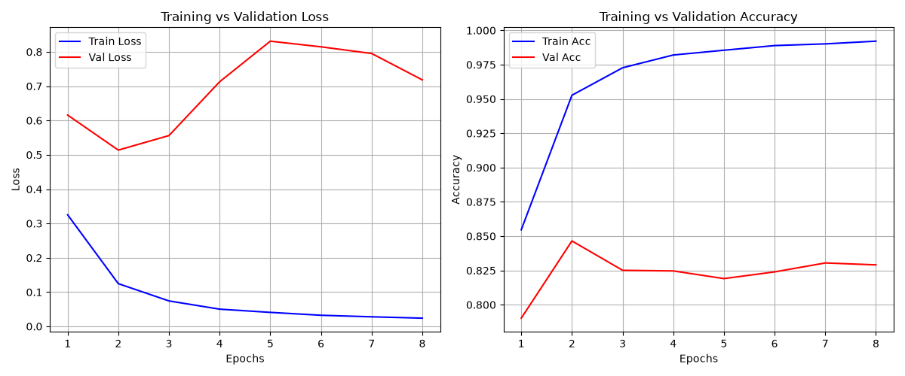

**Figure 15. Current regularized ConvNeXt training curves (job 725521).**
The model performed best on validation at epoch 2. Training continued
to epoch 8, but later epochs did not improve validation accuracy.

- **Selected epoch 2:** validation accuracy was **84.65%** and loss was **0.5137**.
- **Final epoch 8:** training accuracy reached **99.21%**, while validation accuracy was **82.91%** and loss was **0.7183**.
- **Interpretation:** the growing training/validation gap suggests that overfitting remained. I used epoch 2, not the final epoch, for testing.

| Validation measure | Job 724703 accuracy selection | Regularized epoch 2 |
|---|---:|---:|
| Overall accuracy | 84.00% | 84.65% |
| NC recall | 87.79% | 85.57% |
| AD recall | 79.03% | 83.44% |
| Later-era AD recall | 42.89% | 55.00% |
| Macro-F1 | 0.8360 | 0.8441 |
| AUROC | 0.9207 | 0.9201 |
| Probability NLL | 0.6193 | 0.5137 |
| Brier | 0.1318 | 0.1233 |

**Validation findings**

- The regularized model correctly classified **82 more AD slices** but **54 fewer normal slices**, giving a net gain of **28 correct predictions**.
- It detected **46 more of the 380 newer AD slices**, although recall remained below the proposed 80% subgroup target.
- Lower NLL and Brier score showed lower probability error on validation, but did not establish performance on the test set.

**Test results**

I then evaluated the selected epoch-2 model on all **4,400 test slices**
(job 725645). I kept the decision threshold at 0.5 without temperature
scaling or excluding uncertain predictions. The table compares this model
with the initial pretrained model.

| Test measure | Initial pretrained (723091) | Regularized (725521) |
|---|---:|---:|
| Overall accuracy | 79.55% | **82.09%** |
| Correct / 4,400 slices | 3,500 | **3,612** |
| NC recall | 90.84% | 84.07% |
| AD recall | 68.85% | **80.22%** |
| Later-era AD recall | 27.00% | **50.00%** |
| Macro-F1 | 0.7939 | **0.8209** |
| AUROC | 0.9170 | 0.9159 |
| AD average precision | 0.9182 | 0.9149 |

The regularized model reached **82.09% accuracy**, meeting the numerical
80% target. Compared with initial pretraining:

- **Overall:** 3,612 slices were correct, which is **92 above** the 3,520 required.
- **AD detection:** 257 more AD slices were correct.
- **Normal detection:** 145 fewer normal slices were correct.
- **Newer AD scans:** correct predictions increased from **81 to 150 out of 300**, but half were still missed.

The gain in AD detection outweighed the loss in normal detection.
However, this test used one training seed and a cohort I had already
examined. It does not establish independent performance or show that
regularization alone caused the improvement. Referral and calibration
benefits were not measured in this test.

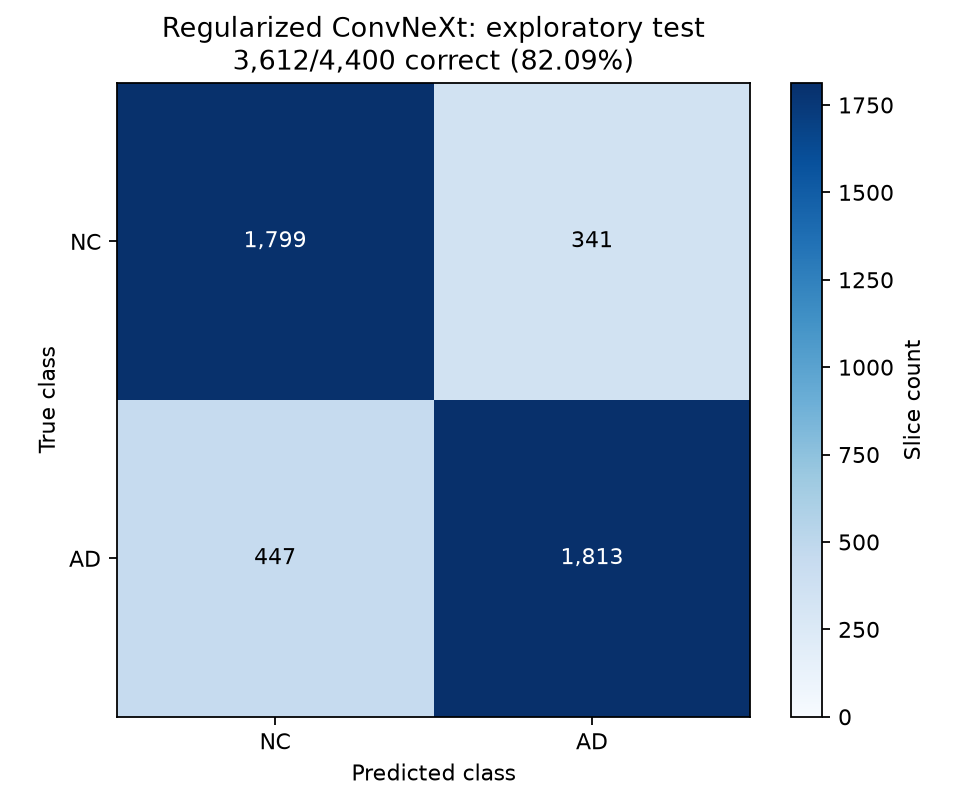

**Figure 16. Regularized ConvNeXt test confusion matrix (job 725645).**
Rows show the true class and columns show the predicted class.

- **Correct predictions:** 1,799 normal slices and 1,813 AD slices.
- **False positives:** 341 normal slices were predicted as AD.
- **False negatives:** 447 AD slices were predicted as normal.

The diagonal gives **3,612 correct predictions (82.09%)**. The model
exceeded the accuracy target, but the remaining missed AD slices show
why this score alone is not enough to support clinical screening.

#### How the model crossed the 80% target

My ConvNeXt test accuracy increased from **74.98% to 79.55%, then to
82.09%** after the training changes described below. I evaluated each
model on the same 4,400 test slices, using a decision threshold of 0.5
without temperature scaling or excluding uncertain predictions.

| ConvNeXt model | Correct test slices | Test accuracy | Difference from the 80% target |
|---|---:|---:|---|
| Scratch control, job 723091 | 3,299 | 74.98% | 221 short |
| Initial ImageNet initialization, job 723091 | 3,500 | 79.55% | 20 short |
| Regularized pretrained model, job 725521 | 3,612 | **82.09%** | **92 above** |

**Initial improvement with pretraining**

I first used ImageNet weights instead of training ConvNeXt entirely from
scratch. This raised test accuracy from 74.98% to 79.55%, but the model
was still 20 correct predictions short of the target. It correctly
classified 361 more normal slices but 160 fewer AD slices. This means
the accuracy gain mainly came from recognising normal cases better,
not from improving disease detection. Recall on newer AD scans fell
to 27.00%.

The training curves also showed a growing gap between training and
validation performance. Together with the scanner-era imbalance, this
suggested overfitting and uneven disease detection, although it did not
prove the cause of the errors. I tested a lower learning rate,
training-derived normalization and balanced sampling, but these changes
did not consistently improve AD recall.

**Adding regularization**

For the final model, I made the following training choices:

- **Starting weights and data:** I kept ImageNet initialization and the same subject split.
- **Augmentation:** I used GPU augmentation without horizontal flips.
- **Regularization:** I added maximum drop-path at **0.10** and head dropout at **0.20**.
- **Checkpoint selection:** I selected **epoch 2**, which had both the highest validation accuracy and lowest validation loss.

Drop-path and dropout randomly disable
some residual paths or classification features during training to reduce
reliance on particular features. Stochastic depth is also part of the
published ConvNeXt training recipe (Liu et al., 2022), although the paper
does not establish the best rates for this MRI dataset.

Compared with the GPU model without regularization:

- **AD recall** increased from **79.03% to 83.44%** on validation.
- **Recall on newer AD scans** increased from **42.89% to 55.00%**.
- **Correct validation predictions** increased by **28 slices**.
- **NLL and Brier score** decreased, indicating lower probability error on validation.

Image caching reduced repeated decoding rather than changing the classification task.

**How this reached the target**

The final model correctly classified **3,612 test slices**, compared with
3,500 for the initial pretrained model. The change included:

- **257 more correct AD predictions**.
- **145 fewer correct normal predictions**.
- A net gain of **112 correct slices**, raising accuracy by **2.55 percentage points to 82.09%**.
- **92 correct predictions above** the 3,520 needed for the 80% target.

The improvement therefore came with a trade-off: better AD detection
but lower normal recall.

**Remaining limitations**

- **Newer AD scans:** the final model still missed half of these slices.
- **Overfitting:** Figure 15 shows that the training/validation gap continued to grow after epoch 2.
- **Effect of each change:** the pretrained test models used different augmentation implementations and selected epochs. I did not test the GPU model without regularization, so I cannot separate dropout's effect from the other training changes.
- **Earlier test exposure:** the result meets the numerical target, but the test cohort had already been used in earlier experiments.

Testing on new subjects and repeating training with different seeds would
give stronger evidence that the improvement transfers beyond this experiment.

Longer-term priorities are:

1. **Improve acquisition coverage:** obtain permitted data with both diagnoses
   represented across acquisition eras and sequences.
2. **Evaluate on independent subjects:** freeze preprocessing, model selection
   and decision rules before using an authorized independent cohort.
3. **Assess patient-level workflow:** only after adequate slice-level
   performance, evaluate scan-level aggregation and specialist review.

These priorities focus on reducing missed AD cases within the resource
budget, rather than repeatedly tuning against known test results.

### 7.4 Important limitations

- **Prior test set exposure**: Same-cohort testing history limits broader generalization claims.
- **Single random seed**: Reported results reflect single training runs without multi-seed variance bounds.
- **2D slice inputs**: Slice-level predictions do not constitute a full 3D patient-level diagnostic workflow.
- **Data confounding**: Scan acquisition era and imaging sequence remain heavily correlated with disease diagnosis labels.

Added architectural complexity has not demonstrated an operational benefit in this project. Expanding data coverage and evaluating on independent cohorts are far more defensible next steps than assuming high model confidence or higher validation accuracy establishes clinical safety.

## 8. Reproduction

### 8.1 Directory layout

```text
recognition/ConvNeXt_ADNI_s5022035/
|-- README.md       Report, results and reproduction commands
|-- modules.py      CNN and ConvNeXt models
|-- dataset.py      Preprocessing and subject splits
|-- train.py        Training and checkpoint saving
|-- predict.py      Predictions and evaluation
|-- utils.py        Data checks and sampling helpers
|-- figures/        Report figures
`-- results/        Aggregate results
```

The repository includes aggregate results and report figures. Restricted
datasets, model weights and subject-level records are stored separately.

### 8.2 Environment and data

I ran the GPU experiments on **UQ Rangpur** in the `comp3710` environment.

| Package | Version |
|---|---|
| Python | 3.11.13 |
| PyTorch | 2.7.1+cu118 |
| torchvision | 0.22.1+cu118 |
| NumPy | 2.4.6 |
| scikit-learn | 1.9.1 |
| SciPy | 1.17.1 |
| Pillow | 12.3.0 |
| Matplotlib | 3.11.2 |

The recorded environment uses CUDA **11.8** and cuDNN **9.1.0**.
Inside a GPU allocation:

```bash
cd ~/PatternAnalysis-2026/recognition/ConvNeXt_ADNI_s5022035
source ~/venvs/comp3710/bin/activate
```

Training and evaluation use the course-provided data:

```text
/home/groups/comp3710/ADNI/AD_NC
  train/NC/
  train/AD/
  test/NC/
  test/AD/

/home/groups/comp3710/ADNI/meta_data_with_label.json
```

The loader accepts **PNG, JPG and JPEG**. Metadata links scans to subjects
and is required for subject-disjoint splitting.

### 8.3 Inference and example output

Prediction uses the saved checkpoint and its matching configuration.
Input images become grayscale tensors of shape `[B, 1, 224, 224]`.
The output classes are **NC and AD**. A labelled validation example is:

```bash
python predict.py --model convnext --convnext_variant paper_tiny \
  --checkpoint ./checkpoints/regularization_v1_seed42_725521/best_convnext_paper_tiny_model.pt \
  --images /path/to/known_NC.jpeg /path/to/known_AD.jpeg \
  --true_labels NC AD --referral_threshold 0.80 \
  --results_dir /path/to/new_private_labelled_demo
```

Replace the image paths with validation images and use their metadata
labels. Omit `--true_labels` if the labels are unknown. The command saves
prediction JSON and labelled images in a new output directory without
evaluating the test split.

Green means correct, red means wrong and yellow means referred.
The example threshold 0.80 is not a validated clinical rule.
Current-model predictions and Grad-CAM are shown in Figures 13-14.

### 8.4 Training

The current regularized ConvNeXt uses this training recipe inside a GPU allocation:

```bash
python train.py \
  --model convnext --convnext_variant paper_tiny \
  --split_protocol subject_70_15_15 \
  --metadata_path /home/groups/comp3710/ADNI/meta_data_with_label.json \
  --data_dir /home/groups/comp3710/ADNI/AD_NC \
  --seed 42 --epochs 40 --batch_size 8 --lr 5e-5 --weight_decay 0.05 \
  --patience 6 --loss cross_entropy --label_smoothing 0 \
  --initialization imagenet --drop_path_rate 0.1 --head_dropout 0.2 --layer_scale_init 1e-6 \
  --normalization fixed --augmentation standard --skip_test \
  --gpu_augmentation --cache_dir /path/to/private/cache --save_best_val_loss \
  --save_dir ./checkpoints/regularized_reproduction
```

The cache path and output directory are new private locations.
`--skip_test` limits the run to training and validation.
Both checkpoint criteria selected epoch 2 in the reported experiment.

The original scratch comparison uses the settings in Section 2.4.
For scratch ConvNeXt, omit the ImageNet, GPU augmentation, cache and
additional checkpoint flags, and set both dropout rates to zero.
For the CNN baseline, also change `--model convnext` to `--model baseline`.

### 8.5 Reproducibility

- **Fixed protocol:** seed 42 and the corrected subject split. The current
  model's frozen test uses threshold 0.5, temperature 1 and no rejection.
- **Saved records:** checkpoints, configurations, split manifests and
  training histories preserve each run's settings and outcomes.
- **Software checks:** automated tests cover subject separation, metrics,
  normalization, augmentation and checkpoint loading. CUDA runtime checks
  were performed on Rangpur.
- **Numerical variation:** CUDA operations were not forced deterministic,
  so reruns can differ despite using the same seed.

## 9. References and AI disclosure

### References

1. Alzheimer's Disease Neuroimaging Initiative. (n.d.). *ADNI data*.
[https://adni.loni.usc.edu/data-samples/adni-data/](https://adni.loni.usc.edu/data-samples/adni-data/)

2. Facebook Research. (n.d.-a). *ConvNeXt model implementation*
[Source code]. GitHub.
[https://github.com/facebookresearch/ConvNeXt/blob/main/models/convnext.py](https://github.com/facebookresearch/ConvNeXt/blob/main/models/convnext.py)

3. Facebook Research. (n.d.-b). *Training* [Software documentation]. GitHub.
[https://github.com/facebookresearch/ConvNeXt/blob/main/TRAINING.md](https://github.com/facebookresearch/ConvNeXt/blob/main/TRAINING.md)

4. Guo, C., Pleiss, G., Sun, Y., & Weinberger, K. Q. (2017). On calibration of
modern neural networks. In D. Precup & Y. W. Teh (Eds.), *Proceedings of the
34th International Conference on Machine Learning* (Vol. 70, pp. 1321–1330).
PMLR.
[https://proceedings.mlr.press/v70/guo17a.html](https://proceedings.mlr.press/v70/guo17a.html)

5. Liu, Z., Mao, H., Wu, C.-Y., Feichtenhofer, C., Darrell, T., & Xie, S. (2022).
A ConvNet for the 2020s. In *Proceedings of the IEEE/CVF Conference on Computer
Vision and Pattern Recognition* (pp. 11976–11986).
[https://doi.org/10.1109/CVPR52688.2022.01167](https://doi.org/10.1109/CVPR52688.2022.01167)

6. Pleiss, G. (n.d.). *Temperature scaling* [Source code and documentation].
GitHub.
[https://github.com/gpleiss/temperature_scaling](https://github.com/gpleiss/temperature_scaling)

7. PyTorch Contributors. (n.d.). *Transforming and augmenting images*.
Torchvision documentation.
[https://docs.pytorch.org/vision/stable/transforms.html](https://docs.pytorch.org/vision/stable/transforms.html)

8. Scikit-learn Developers. (n.d.). *brier_score_loss*. Scikit-learn documentation.
[https://scikit-learn.org/stable/modules/generated/sklearn.metrics.brier_score_loss.html](https://scikit-learn.org/stable/modules/generated/sklearn.metrics.brier_score_loss.html)

### Artificial Intelligence Usage Disclosure

During this project, I utilized GitHub Copilot (powered by GPT-6 Luna) as an assistive tool for brainstorming, conducting audits, debugging code, and helping guidelines testing. The tool provided advice on model setup, flagged potential bugs that I independently cross-examined, and assisted in writing and proofreading this README. While Copilot provided structural support and code optimization suggestions, I independently wrote all core code such as the model development, preprocessing, data collection, and result
