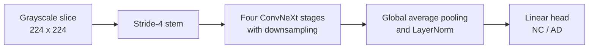
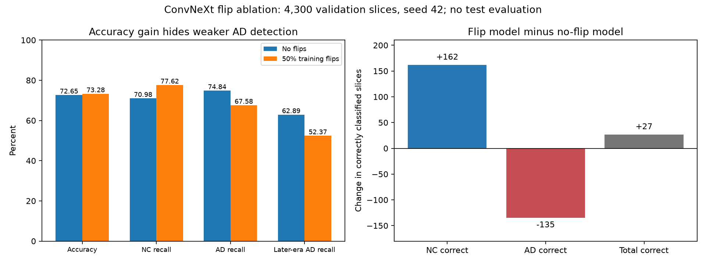

# ConvNeXt for Alzheimer's Disease Classification

**Student:** Khairunnisa Rahmahdani Danang | **Student ID:** s50220353<br>
**Course:** COMP3710 Pattern Recognition and Analysis<br>
**Track:** 2.1 Classification - Medical Diagnosis | **Difficulty:** Hard

## Project summary

In this project, I compare ConvNeXt with a small CNN to classify brain MRI
slices as Alzheimer's disease (**AD**) or cognitively normal (**NC**).
I investigate three questions: which model is more accurate, whether low
confidence helps identify mistakes for human review, and whether ConvNeXt's
extra computation provides a useful benefit.

**Main conclusion:** ConvNeXt ranks AD probabilities better, but the CNN has higher
accuracy and detects more AD slices at the fixed decision threshold. Neither
model meets the 80% accuracy target or the error-referral criterion.

| Main finding | Result |
|---|---|
| Overall corrected-test accuracy | CNN **75.80%**, ConvNeXt **74.98%** |
| Assignment target: at least 80% overall test accuracy | **Not met by either model** |
| Confidence-based referral | Both rules retain over 80% of slices but refer fewer than 36% of errors |
| Cost of ConvNeXt | 71.5 times as many parameters; 3.45 times the observed training time |
| Recommendation | CNN retained as the research baseline; **neither model is suitable for automated diagnosis** |


## Contents

1. [Feasibility review](#1-feasibility-review)
2. [Data and method](#2-data-and-method)
3. [Classification results](#3-classification-results)
4. [Confidence and referral](#4-confidence-and-referral)
5. [Failure analysis](#5-failure-analysis)
6. [Computational cost](#6-computational-cost)
7. [Recommendation and limitations](#7-recommendation-and-limitations)
8. [Reproduction](#8-reproduction)
9. [References and AI disclosure](#9-references-and-ai-disclosure)

## 1. Feasibility review


### 1.1 Intended use and success criteria

I compare models **ConvNeXt** and a simpler model **CNN** to see if the larger model gives more reliable predictions without using too much computer power. I also test whether the models can flag uncertain cases for a human doctor to check. My goal is to classify individual MRI brain slices as either **Alzheimer's Disease (AD)** or **Cognitively Normal (NC)**.

The comparison uses five success criteria:

| Criterion | Expected outcome |
|---|---|
| **Subject separation** | All **30,520 slices** are used. All brain scans from the same person stay in one group so no patient is accidentally shared across my training, validation, and testing sets. |
| **Classification performance** | Reaches at least **80% accuracy** on unseen test scans, backed up by balanced scores across all categories. |
| **Error referral** | Automatically processes at least **80% of scans**, while correctly flagging at least **50% of mistakes** for a doctor to review. |
| **Computational cost** | Model training takes under 2 GPU hours, calibration takes under 15 GPU minutes, and model size, memory usage, and speed are fully tracked. |
| **Failure analysis** | **3-5 incorrect cases** are examined in detail to understand why the model failed and suggest future improvements. |

### 1.2 Model and evaluation design

I adjusted the ConvNeXt model to process grayscale MRI slices and predict two outcomes (AD vs. NC). For comparison, I built a simple four-layer CNN from scratch. Both models learn features from images using convolutions, but ConvNeXt uses advanced shortcuts and normalization techniques to learn better features. Both models use standard training settings, image adjustments (data augmentation), and early stopping to prevent overfitting.

The dataset contains 30,520 MRI slices from 680 people. I grouped all scans by patient ID and split the people into three groups: 476 patients for training, 102 for validation, and 102 for testing. Both models received the exact same data and training steps. I used validation data to pick the best checkpoints and set referral rules, while final testing was done on the held-out test group. Because I viewed the test group during earlier testing, this report is an initial comparison rather than a completely fresh benchmark.

### 1.3 Evidence supporting feasibility

Before training, I checked the dataset and linked 1,526 total scans to 680 individual patients. I discovered that the original folder setup placed 216 of the same patients in both the training and testing folders. To fix this overlap, I rebuilt the dataset splits using patient IDs instead of file names, ensuring all scans from one person stay together.

An early test run I executed for ConvNeXt took 70.65 minutes, which proves that training easily fits within my 2-hour GPU limit. However, this test run does not guarantee that my final accuracy on the fixed dataset will meet the project goals.

### 1.4 Risks and bounded next step

- **Main risks:** The model picking up on background scanner noise instead of brain features, overfitting, using validation data too many times, and running out of GPU time limits.
- **Planned comparison after the audit:** Train and test both models side-by-side using identical settings, relying only on validation data to make decisions.
- **Resource budget:** Two training runs capped at 2 GPU hours each, followed by diagnostic tests on saved models.
- **If jobs time out:** If a job runs out of time, it will not restart automatically and it will simply save partial results.
- **Fallback:** If ConvNeXt does not offer a good balance of speed, accuracy, and error detection, I will keep the simple CNN as my main baseline for future work.

### 1.5 Implementation updates and outcomes

During this project, I made four main updates:

| Implementation change | Reason and outcome |
|---|---|
| **Grouped data by patient ID instead of scan name** | Preserve all scans from the same person in one group. This fix completely eliminated patient overlap across my datasets. |
| **Kept horizontal flips disabled during data augmentation** | In my matched validation experiment, enabling image flips slightly raised overall accuracy, but it reduced Alzheimer's recall (Section 5.5). |
| **Completed the two-model comparison** | The CNN finished training in 9.52 minutes and ConvNeXt in 32.82 minutes. Test accuracy reached **75.80% (CNN) and 74.98% (ConvNeXt)**.|
| **Tested error referral and fixes** | Both models met the target for accepting enough scans, but neither flagged enough errors for human review. I ran three extra follow-up experiments, but they also failed to improve the detection of Alzheimer's cases. |

## 2. Data and method

### 2.1 Subject separation

I used the course-provided Alzheimer's Disease Neuroimaging Initiative (ADNI) collection (Alzheimer's Disease Neuroimaging Initiative, n.d.).

The dataset includes **30,520 slices across 1,526 scans from 680 subjects** (459 NC and 221 AD subjects), labeled as NC = 0 and AD = 1. A file's prefix identifies a specific scan, not a person; a single subject can have multiple scans.

My audit revealed that the original training and test folders shared **216 subjects**. As a result, previous scan-grouped results did not measure performance on unseen subjects. To fix this, I created the corrected `subject_70_15_15` split using metadata mappings. This guarantees that all scans and slices from a single person stay within one partition.

| Corrected partition (Seed 42) | Subjects | Scans | Slices |
|---|---:|---:|---:|
| Training | 476 | 1,091 | 21,820 |
| Validation | 102 | 215 | 4,300 |
| Test | 102 | 220 | 4,400 |
| **Total** | **680** | **1,526** | **30,520** |

My audit confirmed zero patient overlap across splits and verified that labels match the metadata. A diagnosis-stratified split sets aside 15% of subjects (rounded up) for validation and another 15% for testing. Total slice counts vary across splits because individual subjects have different numbers of scans.

I built the dataset split in [dataset.py](dataset.py) using helper functions in [utils.py](utils.py). The private split manifest records the overall inventory and metadata hash, which I verify during evaluation.

### 2.2 Preprocessing and augmentation

For my main model comparison, I applied image conversion, resizing, normalization, and affine augmentation using torchvision transforms (PyTorch Contributors, n.d.). These settings reflect my experimental choices rather than a published ADNI standard:

1. Convert images to single-channel grayscale.
2. Resize images to **224 x 224** pizels and scale pizel values to `[0, 1]`.
3. Normalize pixel values using a fixed **mean 0.5 and standard deviation 0.5**.
4. Apply random affine augmentation (training only) allowing up to **8 degrees** of rotation, **4%** translation, and **5%** scaling.

For validation and testing, I used only fixed resizing and normalization without random transforms.

I kept horizontal flips disabled in my main pipeline. Looking at nine training-image contact sheets (Job 719152), the slices showed sagittal side-view brain profiles where left-to-right flips could distort anatomical orientation. My experiment in Section 5.5 confirmed this choice, showing that adding horizontal flips actually reduced Alzheimer's recall across both overall and later-era scans.

In a separate validation test (Section 5.4), I evaluated dataset-specific intensity normalization. Using dataset.py, I calculated pixel mean and standard deviation strictly from corrected training images after grayscale conversion and resizing to `224 × 224 pixels`. This calculation included background pixels, used float64 accumulation for accuracy, and excluded random transforms. I then applied these saved statistics directly to validation and test images without re-calculating values from those sets.

### 2.3 Models

ConvNeXt is a convolutional neural network (CNN) that incorporates design elements from Vision Transformers while retaining standard convolutions (Liu et al., 2022). I adapted its core architecture rather than replicating the paper's full ImageNet training setup.



Each ConvNeXt block uses a 7 × 7 depthwise convolution, channel-wise LayerNorm, fourfold channel expansion, GELU activation, and a scaled residual connection. My baseline CNN uses four convolutional layers with batch normalization, ReLU, max pooling, and global average pooling.

#### How the model processes a slice

I designed the ConvNeXt model to process single 2D grayscale MRI slices. As an image moves through the network, the model shrinks its pixel height and width while expanding the number of feature channels.

| Processing step | Output per slice | ConvNeXt blocks |
|---|---|---:|
| Input | `1 x 224 x 224` | - |
| Stem and stage 1 | `96 x 56 x 56` | 3 |
| Downsample and stage 2 | `192 x 28 x 28` | 3 |
| Downsample and stage 3 | `384 x 14 x 14` | 9 |
| Downsample and stage 4 | `768 x 7 x 7` | 3 |
| Global Pooling & Head| 2 scores (NC, AD) | - |

**ConvNeXt block operations**
Inside each ConvNeXt block, three simple steps process the image features:
- **Spatial filtering**: A `7×7` depthwise convolution analyzes local visual patterns within each feature channel separately.
- **Feature mixing**: LayerNorm stabilizes the feature values. Two linear layers with GELU activation expand the channel count fourfold and then restore it, blending information across channels.
- **Residual connection**: The block adds its processed features back to the original input, using a learned scaling parameter to keep training stable.

After Stage 4, global average pooling compresses each 7 x 7 feature map into a single number. The final classification head converts these numbers into two scores (logits) representing normal (NC) and Alzheimer's (AD) predictions.

**Architecture comparison and parameter counts**
My baseline CNN uses a simple design with four standard convolutional layers (32, 64, 128, and 256 channels) paired with ReLU activations and max pooling. This allows me to test whether ConvNeXt's much larger size gives better results on this dataset.

| Model architecture | Stage depths | Channels layout | Total parameters |
|---|---|---|---:|
| **CNN baseline** | Four convolutional layers | (32, 64, 128, 256) | 389,314 |
| **ConvNeXt: main comparison** | **(3, 3, 9, 3)** | **(96, 192, 384, 768)** | **27,818,594** |

I adapted ConvNeXt for single-channel grayscale inputs (Liu et al., 2022). I initialized weights using a truncated normal distribution (std = 0.02), set all biases to zero, and set initial layer-scale parameters to 1e-6. I implemented these network components directly in modules.py.

### 2.4 Matched training and evaluation

| Setting | Main corrected comparison |
|---|---|
| Initialization / seed | From scratch / 42 |
| Optimizer | AdamW |
| Learning rate / weight decay | `5e-5` / `0.05` |
| Batch size / maximum epochs | 8 / 40 |
| Loss / label smoothing | Cross-entropy / 0 |
| Scheduler | Cosine decay over the 40-epoch horizon |
| Early stopping / checkpoint | Patience 6 / highest validation slice accuracy |
| Drop-path / head dropout | 0 / 0 |
| Augmentation / normalization | Standard affine / fixed 0.5, 0.5 |
| AD decision threshold | P(AD) >= 0.5 |

I ran both models using identical training settings and subject splits. Validation performance guided checkpoint selection, while test set evaluation remained completely isolated until final testing.

**Primary metric:** Total correct predictions divided by all test slices. I also evaluated per-class precision/recall, macro-F1, and AUROC scores to analyze overall performance.

## 3. Classification results

### 3.1 Model training and checkpoint selection

I monitored training progress across all epochs and saved execution histories for both the [CNN](results/baseline_history.json) and [ConvNeXt](results/convnext_history.json).

| Model	| Best validation accuracy | Selected epoch / Total epochs | Training accuracy at selected epoch | Total training time | Job ID |
|---|---:|---:|---:|---:|---:|
| **CNN baseline** | 72.47% | Epoch 3 / 9 | 75.96% | 9.52 minutes | 717634 |
| **ConvNeXt** | 72.65% | Epoch 9 / 15 | 81.29% | 32.82 minutes | 717690 |

I selected the optimal checkpoint weights for each architecture using its highest validation accuracy score. ConvNeXt achieved a peak validation accuracy that was only **0.19 percentage points higher** than the baseline, while requiring **3.45 times longer** to train.


**Figure 1. Training dynamics on the corrected subject split (Jobs 717634 and 717690).** 
- **Top plots (CNN baseline)**: Training loss decreases steadily while validation loss fluctuates wildly, spiking by epoch 9. Validation accuracy peaks early at epoch 3 (72.47%) before dropping sharply.
- **Bottom plots (ConvNeXt)**: Training accuracy climbs steadily past 85% while training loss steadily decreases. However, validation accuracy plateaus and peaks at epoch 9 (72.65%) before declining, showing a widening gap between training and validation performance.
- **Dotted vertical lines**: Mark the checkpoints selected based on peak validation accuracy (epoch 3 for the CNN and epoch 9 for ConvNeXt). I used peak validation accuracy as my selection rule rather than minimum validation loss.

### 3.2 Frozen corrected-test comparison

Numerical evidence: [test metrics and confusion counts](results/test_metrics.json).

I evaluated both selected checkpoints on a fixed test set of 4,400 MRI slices from 220 scans across 102 subjects (Job 719057). For this evaluation, I used the default 0.5 decision threshold without temperature scaling or rejection rules.

| Test metric | CNN baseline | ConvNeXt |
|---|---:|---:|
| **Overall accuracy** | **75.80%** | **74.98%** |
| Correct / total slices | 3,335 / 4,400 | 3,299 / 4,400 |
| Accuracy: 95% subject-clustered interval | 68.39-82.13% | 67.61-81.11% |
| NC precision | 0.7978 | 0.7442 |
| NC recall | 0.6729 | 0.7397 |
| NC F1 | 0.7300 | 0.7420 |
| AD precision | 0.7303 | 0.7549 |
| AD recall | 0.8385 | 0.7593 |
| AD F1 | 0.7806 | 0.7571 |
| Macro-F1 | 0.7553 | 0.7495 |
| AUROC | 0.8187 | 0.8284 |
| AD PR-AUC: average precision | 0.7724 | 0.8375 |
| **80% overall test target** | **Unmet: 4.20 points below** | **Unmet: 5.02 points below** |

| Test metric | CNN baseline | ConvNeXt | Target status |
|---|---:|---:|---:|
| **Overall accuracy** | **75.80%** | **74.98%** | **Unmet (80.00% target)** | 
| Correct / total slices | 3,335 / 4,400 | 3,299 / 4,400 | - |
| Accuracy: 95% subject-clustered interval | 68.39–82.13% | 67.61–81.11% | Includes target, yet mean falls short |
| **Normal (NC) precision** | 0.7978 | 0.7442 | - |
| **Normal (NC) recall** | 0.6729 | 0.7397 | - |
| **Normal (NC) F1 score** | 0.7300	| 0.7420 | - |
| **Alzheimer's (AD) precision** | 0.7303 | 0.7549 | - |
| **Alzheimer's (AD) recall** | 0.8385 | 0.7593	| Higher baseline recall |
| **Alzheimer's (AD) F1 score**	| 0.7806 | 0.7571 | - |
| **Macro-F1 score **|	0.7553 | 0.7495	| - |
| **AUROC** | 0.8187 | 0.8284 | Higher ConvNeXt ranking quality |
| **AD PR-AUC (Average precision)**	| 0.7724 |	0.8375 | Higher ConvNeXt precision |

**Takeaways from the test benchmark**
1. **ConvNeXt ranks probabilities better**. ConvNeXt reaches a higher AUROC (0.8284) and PR-AUC (0.8375) than the CNN baseline. This means ConvNeXt separates Alzheimer's cases from normal cases more accurately when ranking raw confidence scores.
2. **The CNN baseline is more accurate at the standard threshold**. At the default 0.5 decision cutoff, the simple CNN achieves higher overall accuracy (75.80% versus 74.98%). It gets 36 more slices right overall because it misses far fewer Alzheimer's cases (365 missed slices for the CNN versus 544 for ConvNeXt).
3. **Neither model reaches the 80% accuracy target**. The CNN fell short by 4.20 percentage points, and ConvNeXt fell short by 5.02 points. Because I tested only one random training seed, I cannot conclude that the baseline will always outperform ConvNeXt under different starting conditions.

**Confusion matrix comparison**
The table below summarizes class-level predictions, where rows represent true labels and columns represent predicted labels:

| Model architecture | True NC: Predicted NC / AD | True AD: Predicted NC / AD | Total errors |
|---|---:|---:|---:|
| **CNN baseline** | 1,440 / 700 | 365 / 1,895 | 1,065 slices |
| **ConvNeXt** | 1,583 / 557 | 544 / 1,716 | 1,101 slices |


**Figure 2. Corrected test confusion matrices for the CNN baseline and ConvNeXt (Job 719057).** 
- The left matrix displays predictions for the CNN baseline and the right plot displays ConvNeXt across 4,400 test slices
- **Missed disease cases**: The bottom left box in each matrix shows missed Alzheimer's cases. ConvNeXt misses 544 disease slices compared to 365 for the CNN baseline, even though ConvNeXt makes fewer false alarm errors in the top right box (557 versus 700).
- I calculated the 95% confidence intervals using 2,000 subject-level bootstrap samples. These slices represent repeated measurements from individual patients rather than completely independent patient outcomes.


### 3.3 Acquisition-group performance

I evaluated recall across specific acquisition groups to determine how scan dates and imaging protocols affect performance.

| Test group | Subjects / scans / slices | Baseline recall | ConvNeXt recall |
|---|---:|---:|---:|
| **Normal (NC), 2017+, accelerated** | 69 / 107 / 2,140 | 67.29% | 73.97% |
| **Alzheimer's (AD), 2017+, accelerated** | 10 / 15 / 300 | 67.33% | 63.67% |
| **Alzheimer's (AD), pre-2017, accelerated** | 2 / 2 / 40 | 100.00% | 100.00% |
| **Alzheimer's (AD), pre-2017, non-accelerated** | 23 / 96 / 1,920 | 86.09% | 77.34% |

**Takeaway**
- **Overall recall masks subgroup weakness**: The baseline model's overall Alzheimer's recall score of 83.85% hides significantly worse performance on newer scans. In the 2017+ accelerated group, Alzheimer's recall drops to 67.33% for the baseline and 63.67% for ConvNeXt.
- **Neither model hits the target on newer scans**: Neither architecture reaches the 80% Alzheimer's recall target on newer 2017+ scan acquisitions.
- **Small sample size caution**: Although both models achieve 100% recall on pre-2017 accelerated Alzheimer's scans, this subset contains only 40 slices across two subjects.
- **Non-additive subject totals**: Subject counts across these subgroups do not sum to the total subject count because individual patients completed visits across multiple acquisition groups.

## 4. Confidence and referral

**Research question:** Can model confidence identify mistakes well enough to support routing cases for human review, and does ConvNeXt improve on the CNN baseline?

### 4.1 How predictions are accepted or referred

My evaluation framework separates each model's output into two distinct decisions:

1. **Class prediction**: The model assigns a label based on estimated probability. If `P(AD)≥0.5` it predicts **AD** and if 
`P(AD)<0.5` it predicts **NC**
2. **Confidence evaluation***: The model calculates confidence as the larger class probability: `max(P(AD), 1 - P(AD))`.

A slice is accepted for automated reporting when its confidence reaches a chosen threshold, dispite that it is flagged for expert review.

| Term | Mathematical definition | Practical meaning |
|---|---|
| Coverage | Accepted slices / Total evaluated slices |
| Accepted accuracy | Correct accepted slices / Total accepted slices |
| Error referral | Referred incorrect slices / Total incorrect slices |

As the project goal requires at least 80% coverage and 50% error referral. These are research targets rather than clinical standards. Accepted accuracy measures correctness strictly among accepted slices, so it does not replace overall test accuracy.

Using corrected validation data, I selected thresholds by maximizing accepted accuracy subject to a minimum 80% coverage floor over a candidate grid from 0.50 to 1.00. The selected thresholds were **0.60 for the CNN baseline and 0.65 for ConvNeXt**.

### 4.2 Validation-fixed rules on corrected test

In job 719094, I applied these validation-selected thresholds directly to the frozen test checkpoints (results/test_referral.json). I did not adjust thresholds or re-evaluate predictions on the test set.

| Test referral metric |	CNN baseline | ConvNeXt |	Project target | Status |
|---|---:|---:|---:|---:|
| Confidence threshold	| 0.60 | 0.65 | - |	- |
| Accepted / Referred slices | 3,565 / 835 |	3,633 / 767	| - |	- |
| **Slices accepted by the rule (Coverage)** | **81.02%**	| **82.57%** | **>= 80.00%** | **Met** |
| Accepted accuracy	| 80.62% | 79.25% |	- |	- |
| Accepted false positives | 501 | 378 | - | - |
| **Missed AD slices still accepted** | **190**	| **376** | -	| - |
| Errors referred / Total errors | 374 / 1,065 | 347 / 1,101 |	-	| - |
| **Mistakes referred for review** | **35.12%**	| **31.52%** | **>= 50.00%** |	**Unmet** |
| Confidence AUROC | 0.6646 |	0.7062 | - | - |
| False negatives at confidence >= 0.90	| 20 | 130 | - | - |

**Takeaways from Test Results**
1. **Evethough both models accepted enough slices to pass 80% coverage goal (81.02% for CNN and 82.57% for ConvNeXt), neither model referred the required 50% of mistakes**. The CNN referred 35.12% of its errors, and ConvNeXt referred only 31.52%.
2. **ConvNeXt let many dangerous errors pass through**. ConvNeXt accepted 376 missed Alzheimer's slices under its rule, compared to 190 for the baseline. In fact, ConvNeXt produced 130 false-negative slices with confidence scores at or above 0.90, proving that high model confidence does not guarantee correct predictions.
3. **Exploratory diagnostic role**. I specified this extra inference pass after learning the overall test scores to check threshold transfer across patient groups, rather than using test data to search for better thresholds.


**Figure 3. Evaluation of confidence-based error referral on the corrected test set (Job 719094).**
- **Left**: Compares average predicted confidence against actual slice accuracy. Points below the dotted line show overconfidence, where the model's reported certainty is higher than its real accuracy. ConvNeXt consistently sits below the diagonal in high-confidence bins, showing that high confidence scores cannot guarantee correct predictions.
- **Right**: Shows performance against project targets. Both validation-fixed rules successfully exceed the 80% coverage floor (81.02% for CNN and 82.57% for ConvNeXt). However, both models fail the 50% error referral requirement (35.12% for CNN and 31.52% for ConvNeXt). Referring uncertain slices is an automated routing step, not a guarantee that a human reviewer would correct the mistake.

### 4.3 Does temperature scaling help?

Numerical evidence: [calibration and assessment summaries](results/calibration.json).

I also tested whether temperature scaling improves model probability estimates. Temperature scaling fits a single positive parameter (*T*) to adjust confidence scores without changing the final predicted class (Guo et al., 2017).

In job 719040, I split the 102 validation subjects into 51 calibration subjects and 51 assessment subjects, stratified by diagnosis. All scans and slices from a single subject remained within one split. I fitted the scaling parameters and confidence thresholds strictly on the calibration half (
`T=1.9422` for CNN, `T=2.4653` for ConvNeXt), then applied them unchanged to the assessment half.

| Assessment probability quality (2,060 slices) | CNN raw | CNN scaled | ConvNeXt raw | ConvNeXt scaled | Direction for improvement |
|---|---:|---:|---:|---:|---:|
| **Brier score** | 0.1533 | 0.1705 | 0.1485 | 0.1585 | Lower is better |
| **Negative log-likelihood (NLL)** | 0.4754 | 0.5233 | 0.4486 | 0.4910 | Lower is better |
| **Expected calibration error (ECE)** | 0.0383 | 0.1233 | 0.0403 | 0.0985 | Lower is better |
| **Coverage** | 83.01% | 83.59% | 81.84% | 85.19% | Target >= 80.00% |
| **Share of errors referred** | 34.99% | 34.13% | 36.12% | 30.84% | Target >= 50.00% |

**Takeaways from the Calibration Experiment**
1. **Probability quality worsened after scaling**. The Brier score measures squared probability error, NLL penalizes confident mistakes, and ECE measures agreement between predicted probabilities and real outcomes. All three scores worsened for both models on assessment, so I do not recommend using these fitted temperatures.
2. **Classification results remained unchanged**. Assessment accuracy stayed at 77.52% for my CNN baseline and 77.96% for ConvNeXt. Because positive scalar temperature scaling preserves the original decision boundary at 0.5, it cannot recover missed Alzheimer's predictions at that threshold (Guo et al., 2017).

In this experiment, ECE uses ten equal-width AD-probability bins rather than maximum-confidence bins.


**Figure 4. Reliability curves for raw and temperature-scaled probabilities (Job 719040).** 
- **Diagonal line**: The dotted black line represents ideal calibration, where predicted probabilities match real Alzheimer's case fractions.
- **Blue lines**: Showcase raw model probabilities
- **Orange lines**: Showcase probabilities after temperature scalin
- **Effect of Temperature Scalling**: For both models, temperature scaling shifts the orange curves away from the ideal diagonal line, showing that scaling actually made probability calibration poor on assessment data.

### 4.4 Answer to the engineering dilemma

**Confidence helps rank errors, but neither tested rule identifies enough of them for the proposed workflow.** 

The table below summarizes the practical workload and error trade-offs when applying these rules to the 4,400 test slices:

| Model architecture | Slices sent for review | Total incorrect slices still accepted | Alzheimer's slices misclassified as normal and accepted |
|---|---:|---:|---:|
| **CNN baseline** | 835 / 4,400 (18.98%) | 691 | 190 |
| **ConvNeXt** | 767 / 4,400 (17.43%) | 754 | 376 |

Case C1 illustrates this limitation clearly, as every single slice is wrong yet none are referred for review. Case C3 also contains confident missed Alzheimer's predictions (Section 5.2). In addition, referral measures routing efficiency only, so no human correction outcomes were evaluated.

**Decision:** I chose to retain the lower-cost CNN as my research baseline, though not as a clinical service. ConvNeXt's better score ranking did not outweigh its accepted errors and additional computational cost. This conclusion covers a single training seed and a previously consulted cohort, so independent evaluation is required before any future deployment.

My investigation of this dilemma brings four distinct types of evidence:

| Evidence Source | Contribution to the decision |
|---|---|
| [Matched benchmark, Section 3.2](#32-frozen-corrected-test-comparison) | On identical test slices, ConvNeXt improves AUROC however achieves lower overall accuracy and lower Alzheimer's recall than the baseline CNN. |
| [Failure autopsies, Section 5.2](#52-four-actual-corrected-validation-failures) | Four actual MRI cases show persistent false positives, missed Alzheimer's predictions, and slice-level disagreement. Visual observations suggest potential image triggers rather than proven causes. |
| [Resource profile, Section 6](#6-computational-cost) | Parameter counts, GPU memory usage, and inference latency quantify the additional computational expense of running ConvNeXt. |
| [Manager decision, Section 7](#7-recommendation-and-limitations) | My decision weighs classification accuracy, missed Alzheimer's cases, review workload, and compute cost, while outlining the evidence required before considering clinical deployment. |

## 5. Failure analysis

### 5.1 Acquisition confounding

In the metadata audit has revealed a strong link between a patieent's diagnosis and the time period when their scan was acquired.

| Acquisition group, whole inventory | NC scans | AD scans |
|---|---:|---:|
| 2017+, accelerated | 783 | 118 |
| 2017+, non-accelerated | 0 | 2 |
| Pre-2017, accelerated | 0 | 102 |
| Pre-2017, non-accelerated | 0 | 521 |

Every normal scan in the dataset comes from 2017 or later, while about 84% of the Alzheimer's scans are from before 2017. In the original training and validation folders, the scan era separates the two classes perfectly.

If I use a simple date-only rule that predicts Alzheimer's just because a scan is from before 2017, it reaches **100% accuracy on the original validation set and 73.33% on the original test set**. This matches the trained models' original test scores almost exactly.

This findings showcase that the models may be learning shortcuts based on the scanner era, rather than actual brain anatomy. While my corrected data split introduces newer Alzheimer's scans into the training set, it cannot create older normal scans because they do not exist in the dataset. Therefore, fixing the data split alone cannot completely remove this era-based shortcut.

### 5.2 Four actual corrected-validation failures

To analyze these errors, I examined four specific validation cases. In job 718436, I selected ConvNeXt's most confident and median-confidence errors for both false positives and false negatives. All four cases belong to the newer 2017+ accelerated group, which contains both diagnoses in the training data.

| Case ID | Error type | Mean predicted P(AD) | Slice error rate | Did the CNN also fail? |
|---|---|---:|---:|---|
| **C1** | Most-confident false positive | 0.972 | 100% | Yes |
| **C2** | Median-confidence false positive | 0.612 | 70% | No |
| **C3** | Most-confident false negative | 0.173 | 87.5% | Yes |
| **C4** | Median-confidence false negative | 0.470 | 55% | Yes |

The images below show saved slice predictions rather than heatmaps or anatomical diagnoses. A predicted probability of 
`P(AD) ≥ 0.5` results in an Alzheimer's prediction, while lower scores predict a normal case. The table above averages all slices for each case, not just the four panels displayed below. By selecting both extreme and median-confidence errors, I illustrate specific failure modes rather than their overall frequency.

**Case C1: Consistent false alarms**


**Figure 5. C1: Consistent false alarms.** 
Both models give high Alzheimer's probabilities (ranging from 0.85 to 0.99) across these slices, even though the patient is completely healthy[cite: 6]. ConvNeXt gets all 20 slices wrong and does not flag any of them for human review. The pixels in these slices are noticeably darker than the average correctly classified normal brain. The actual brain tissue also takes up less space in the image.

- **Possible cause**: Darker image contrast or less tissue showing in the frame.
- **Next step**: A possible imporvement is to run a test taht intentionally change the brightness of the image to see if that causes the error. However, brightness alone does not prove the root causes

**Case C2: Model disagreement and mixed slices**


**Figure 6. C2: Model disagreement and mixed slices.** 
The simple CNN correctly predicts a normal brain on the first three slices with low probabilities, but ConvNeXt incorrectly predicts Alzheimer's with high probabilities (up to 0.92). By slice 113, both models switch to predicting Alzheimer's. Across two different scans for this same patient, ConvNeXt gets 28 out of 40 slices wrong and flags 40% of them for review. The CNN's overall average decision for this patient is correct.The CNN predicts

- **Possible cause**: The model is overly sensitive to the slice's position or how the brain is framed.
- **Next step**: Future improvement is to compare this case with correctly classified normal cases at the exact same slice position to see what is confusing the model.

**Case C3: Confident missed cases**


**Figure 7. C3: Confident missed cases.**
ConvNeXt gives extremely low Alzheimer's probabilities (0.03 and 0.01) on slices 104 and 108. These are highly confident but completely wrong normal predictions, because the patient actually has Alzheimer's. Across four scans for this patient, ConvNeXt gets 70 out of 80 slices wrong and flags only 16.25% of them.

- **Possible cause**: The model is weak at detecting Alzheimer's in this specific scanner group because the training data is unbalanced. The training set has only 84 Alzheimer's scans compared to 554 normal scans in this era.
- **Next step**: To test more patients in this specific group to see if this pattern holds up. Because earlier balancing experiments did not fix this, the unbalanced data is just a theory right now, not a proven fact.

**Case C4: Mixed evidence in the same scan**


**Figure 8. C4:Mixed evidence in the same scan.** 
ConvNeXt correctly predicts Alzheimer's at slice positions 103 and 113, but it flips to predicting a normal brain at positions 94 and 97. When I average all 20 slices together, the overall Alzheimer's probability is 0.4701. This falls just below the cutoff line, meaning the model ultimately missed the diagnosis. In total, 11 out of 20 slices were wrong.

- **Possible cause**: The visual signs of the disease are not consistent across different parts of the same brain.
- **Next step**: I should analyze how much predictions vary within a single scan. I also need to test a new rule for combining slice scores to see if it makes the final decision more stable. While the slice-level rule flagged 45% of the slices for review, the overall subject-average rule flagged the entire case. These rules work differently, and neither guarantees a doctor would actually catch the mistake.

### 5.3 Proposed review gates

I designed three theoretical safety gates to determine whether an MRI scan can be processed automatically or if it must be routed to a clinician for human review. These serve as research evaluation checks:

1. **Acquisition gate:** A scan group is eligible for automated processing only if the training set includes at least 50 scans for each diagnosis. Scan groups with fewer training examples are automatically routed to a human reviewer.
2. **Confidence gate:** Eligible scan groups must meet a fixed confidence threshold determined on validation data.
3. **Release check:** An eligible group must achieve at least 80% validation Alzheimer's recall before release, followed by evaluation on independent test data.

In my corrected training dataset, only the 2017+ accelerated group meets the 50-scan requirement, containing 554 normal scans and 84 Alzheimer's scans. Within this eligible group, validation Alzheimer's recall reaches only 62.37% for the CNN baseline and 62.89% for ConvNeXt, falling well short of the 80% release requirement.

Neither architecture reaches the required release threshold, neither model qualifies for automated deployment. The test referral results in Section 4 evaluate the confidence gate alone rather than all three gates combined.

**Implications**
- Model confidence scores are unreliable on scan types that appear infrequently during training.
- Both models still make serious classification errors even within the most well-represented scanner types.
- The evidence does not justify removing difficult subjects, altering ground-truth labels, or treating high softmax confidence as an anatomical explanation.

### 5.4 Why is accuracy below 80%, and what was tried?

To reach the 80% accuracy target on my test set of 4,400 slices, a model must correctly classify at least 3,520 slices. My frozen models fell short of this benchmark:

- **CNN baseline**: Correctly predicted 3,335 slices, leaving a net shortfall of **185 correct predictions** (4.20 percentage points below target).
- **ConvNeXt**: Correctly predicted 3,299 slices, leaving a net shortfall of **221 correct predictions** (5.02 percentage points below target).

**Core concerns: Data coverage and overfitting**
- All normal scans in the dataset originate from 2017 or later, whereas most Alzheimer's scans are earlier. Subject-level splitting eliminates patient identity overlap across splits, but it cannot create missing earlier-era normal scans.
- ConvNeXt optimizes 27.82 million parameters using only 476 training subjects. ConvNeXt's training performance improves over time without sustained validation gains (Figure 1), indicating that the network easily memorizes dataset artifacts instead of learning true anatomical features.

**Attempted remedies on validation data**
I evaluated three potential modifications using validation data while keeping the main test evaluation frozen and unchanged.

| Experimental change and motivation | Validation accuracy | Later-era AD recall | Final decision |
|---|---:|---:|---|
| Era-aware CNN sampling: Rebalanced exposure to scanner groups | 72.74% -> 74.23% | 63.16% -> 59.47% | Accuracy gained, yet disease detection in the target subgroup got poorer |
| Lower ConvNeXt learning rate: Reduced starting rate from 5e-5 to 2e-5 | 72.65% -> 73.12% | 62.89% -> 47.89% | Gained normal accuracy at the expense of weaker disease detection |
| Training-only normalization: Applied dataset-specific intensity scaling | 72.65% -> 72.09% | 62.89% -> 42.89% | Overall screening performance declined |

Saved comparisons: [era sampling](results/era_sampling.json),
[lower learning rate](results/lower_learning_rate.json) and
[normalization](results/normalization.json). These are validation results,
not replacements for the frozen test comparison.

**Detailed experimental evaluation**
- **Era-aware CNN sampling**: I rebalanced training batches so the model sampled equal expected mass from normal and Alzheimer's classes, with Alzheimer's draws split equally between earlier and later scan eras. While overall validation accuracy increased from 72.74% to 74.23%, Alzheimer's recall in the critical later-era group dropped from 63.16% to 59.47%.
- **Lower ConvNeXt learning rate:** I reduced ConvNeXt's initial learning rate from `5e-5` to `2e-5`. The training run completed 16 epochs in 36.74 minutes, selecting epoch 10. Validation accuracy rose slightly from 72.65% to 73.12%, but later-era Alzheimer's recall collapsed from 62.89% to 47.89%. Macro-F1 fell from 0.7248 to 0.7235, and AUROC declined from 0.7976 to 0.7936.
- **Training-only normalization**: I evaluated dataset-specific intensity scaling using training statistics (mean 0.1160, standard deviation 0.2231). This candidate correctly classified 176 more normal slices but missed 200 more Alzheimer's slices, resulting in 24 fewer correct predictions overall. Validation accuracy dropped to 72.09%, later-era Alzheimer's recall dropped to 42.89%, and Macro-F1 fell to 0.7130. Job 719449 ran for 1:22:08 elapsed time. Note that this normalization test relies on completed-job logs rather than full checkpoint integrity checks.

**Takeaways**
1. **Higher accuracy can mask worse screening performance**: Lowering the learning rate and adding intensity normalization reduced overall Alzheimer's recall to 65.27% and 64.09% (down from 74.84%). A slight bump in overall accuracy hid a severe loss in disease sensitivity.
2. **Calibration cannot alter boundary decisions**: Temperature scaling adjusts probability confidence, but it cannot recover missed cases at a fixed decision boundary (Guo et al., 2017).
3. **None of the candidate remedies were adopted**: Because none of these modifications improved disease detection on validation data, I did not evaluate or adopt any of them on the final test set.


These are research checks, not an approved clinical operating procedure:

1. **Acquisition gate:** eligibility requires at least 50 training scans of
   each diagnosis in the acquisition group; other groups are routed to review.
2. **Confidence gate:** eligible groups use the validation-fixed confidence
   threshold.
3. **Release check:** eligibility also requires at least 80% validation AD
   recall in those groups, followed by evaluation on independent data.

Only the 2017+ accelerated group qualifies in corrected training, with
554 NC and 84 AD scans. Validation AD recall there is **62.37% for CNN**
and **62.89% for ConvNeXt**, below the proposed release criterion.
Neither model reaches the proposed 80% validation AD-recall requirement.
The test referral results in Section 4 assess the
confidence gate alone, not the combined gates.

**Implications:** confidence interpretation depends on acquisition coverage,
and familiar acquisition groups still contain serious
errors. The evidence does not justify removing difficult subjects, altering
their labels or treating a high softmax score as an anatomical explanation.

### 5.5 Augmentation evaluation: horizontal flips

I tested whether adding horizontal flips during training improves classification without missing more Alzheimer's disease (AD) cases. I turned off flips in my main pipeline because MRI scans in this dataset show side views (sagittal profiles) of the head, where mirroring flips the front and back of the brain. I ran a controlled experiment to measure the actual impact of flipping.

**Experimental setup**
I trained two ConvNeXt models using the same random seed (seed 42) and identical settings, changing only the data augmentation: no flips versus 50% horizontal flips. I tested both models on 4,300 validation slices (Job 719873).

| Validation measure | No flips | 50% horizontal flips | Result |
|---|---:|---:|---:|
| **Overall accuracy** | 72.65% | 73.28% | Small overall gain (+0.63%) |
| **Normal (NC) recall** | 70.98% | 77.62% | Better normal detection (+6.64%) |
| **Alzheimer's (AD) recall** | 74.84% | 67.58% | Worse disease detection (-7.26%) |
| **Later-era accelerated AD recall** | 62.89% | 52.37% | Big drop in hard cases (-10.52%) |
| **Macro-F1 score** | 0.7248 | 0.7268 | Small changes (+0.0020)
| **AUROC** | 0.7976 | 0.7930 | Slight drop in ranking quality (-0.0046) |



**Figure 9. Impact of horizontal flips on validation predictions (Job 719873)**
- **Left plot (Performance metrics)**: Shows that while flips raise overall accuracy and normal recall, they cause a large drop in Alzheimer's recall.
- **Right plot (Slice-level changes)**: Breaks down the net slice count changes. Flips helped the model catch 162 more normal slices, but caused it to miss 135 more Alzheimer's slices. This resulted in a net gain of only 27 correct slices across all 4,300 validation slices.

**Takeaway**
1. **The overall accuracy gain is misleading**. Flips raised accuracy by 0.63 percentage points. However, this gain happened only because the model predicted normal scans better while missing 135 more Alzheimer's slices.
2. For newer accelerated Alzheimer's scans, recall dropped from 62.89% down to 52.37%.
3. Overall metrics show mixed results such as Macro-F1 rose slightly, yet AUROC dropped. This shows that flips do not improve overall model performance.
4. I kept horizontal flips turned off. My main goal is to improve accuracy without missing more Alzheimer's cases. Because flips reduced Alzheimer's recall, I kept flips disabled in my main pipeline.

## 6. Computational cost

Numerical evidence: [resource profile and recorded environment](results/resource_profile.json).

I benchmarked the resource consumption of both trained models on the corrected validation set using a batch size of 8 and num_workers=0 (Job 718436).

| Measurement | CNN baseline | ConvNeXt |
|---|---:|---:|
| **Parameters** | 389,314 | 27,818,594 |
| **Training duration** | 9.52 min | 32.82 min |
| **Inference peak allocated memory** | 111.2 MiB | 216.6 MiB |
| **Synthetic training-step peak allocated memory** | 287.5 MiB | 1,199.4 MiB |
| **Synthetic training-step peak reserved memory** | 422 MiB | 1,444 MiB |
| **Pipeline median batch latency** | 10.68 ms | 16.74 ms |
| **Pipeline p95 batch latency** | 11.27 ms | 17.24 ms |
| **Amortized pipeline latency per slice** | 1.352 ms | 1.988 ms |

- Pipeline timing scope: My pipeline timing measures the complete end-to-end processing pipeline, including image loading, preprocessing, GPU transfer, forward pass, softmax calculation, and CPU memory copying.
- Batch evaluation: I measured latency across 537 warm-cache batches after running one initial warm-up batch, covering 4,292 timed slices out of the 4,300 total validation slices.

**Takeaways**
1. **ConvNeXt requires substantially greater storage and hardware memory**. ConvNeXt uses 71.5 times more parameters and nearly double the allocated GPU memory during inference compared to the CNN baseline.
2. **ConvNeXt increases slice processing latency**. Amortized pipeline latency per slice increases from 1.352 ms to 1.988 ms, representing a 47% increase in slice-level processing overhead.

## 7. Recommendation and limitations

### 7.1 Deployment decision memo

**To:** Project Manager, MRI Classification Research Prototype<br>
**Subject:** Model selection and next-stage evaluation

**Recomendation:** I recommend retaining the lightweight CNN baseline strictly as a research benchmark and not deploying either network for clinical screening. Neither model meets the 80.00% overall accuracy target, and neither error referral rule meets the 50% error referral target. While ConvNeXt provides slightly better score ranking, its 71.5-times larger parameter footprint and 3.45-times longer training duration yield lower decision-threshold accuracy and miss more Alzheimer's disease cases.

#### Evidence supporting the decision

1. **Classification performance**
CNN test accuracy reaches 75.80% compared to 74.98% for ConvNeXt. Alzheimer's disease recall reaches 83.85% for the CNN baseline versus 75.93% for ConvNeXt. Neither model meets the 80.00% project goal, but the simple CNN is the stronger baseline at the standard 0.5 decision cutoff because it catches 179 more disease slices.
2.**Score ranking quality**
ConvNeXt achieves higher AUROC (0.8284 versus 0.8187) and PR-AUC (0.8375 versus 0.7724) than the CNN baseline. However, better probability ranking alone does not offset its lower threshold accuracy or its higher rate of missed disease cases.
3. **Error referral routing**
Fixed confidence rules refer only 35.12% of CNN errors and 31.52% of ConvNeXt errors to human review. Both models fall far short of the 50% project referral target, meaning accepted predictions cannot be assumed correct.
4. **Calibration performance**
Temperature scaling worsened Brier score, negative log-likelihood (NLL), and Expected Calibration Error (ECE) for both architectures on validation data. Positive scalar scaling preserves the original 0.5 decision boundary, so it cannot recover missed disease predictions at that threshold.
5. **Computational overhead**
ConvNeXt uses 71.5 times as many parameters, consumes nearly double the inference memory, and takes 3.45 times longer to train. This added resource cost brings no clear operational benefit.

#### Recommended actions

- Keep the CNN baseline strictly as an experimental benchmark, not a clinical tool.
- Do not deploy raw or scaled confidence scores to make automated diagnostic decisions.
- Shift future checkpoint selection from peak validation accuracy to validation NLL or ECE.
- Prioritize dataset acquisition balance over model capacity expansion.

#### 7.2 Evidence required before reconsidering deployment

Before any future candidate can be considered for clinical evaluation, I require the following empirical proof:

- **Target accuracy and safety bounds**: Achieve at least 80.00% overall slice accuracy on an authorized independent cohort, with disease recall targets established by medical specialists.
- **Acquisition era balance**: Demonstrate balanced representation of both normal and disease cases across older and newer scanner eras. Data re-weighting on existing splits has failed to resolve this weakness.
- **Reliable error referral**: Prove that a validation-selected review rule achieves at least 80% scan coverage and routes at least 50% of errors to human review on unseen data.
- **Multi-seed repeatability**: Confirm performance across multiple training seeds and independent patient cohorts using a fixed preprocessing setup.

### 7.3 Prioritized improvement plan 

These findings motivate targeted experiments focused on data coverage and decision stability. I have structured the next technical steps in order of priority:

1. **Data coverage audit**
Perform a comprehensive site and scanner audit to collect balanced normal and disease scans across all acquisition eras. Sampling reweighting alone cannot replace missing data points.

2. **Single-factor generalization study**
Evaluate stochastic depth (drop_path_rate = 0.1) on ConvNeXt in a controlled single-factor experiment on the corrected subject split.

3. **Multi-slice consensus rules**
Develop a scan-level decision rule that aggregates predictions across multiple slices per patient scan to improve individual decision stability.

4. **Calibration-driven checkpoint selection**
Use validation NLL or ECE rather than peak validation accuracy to select saved checkpoint weights during training runs.

5. **External cohort evaluation**
Reserve final evaluation for an authorized independent patient cohort, keeping all preprocessing and model hyperparameter choices frozen in advance.

Candidate rejection criteria include increased false negatives for Alzheimer's disease, resource budget overruns, or reliance on test set retuning.

### 7.4 Insights from reference literature

**1. ConvNeXt training setup (Liu et al., 2022)**
The published ConvNeXt setup relies on 300 epochs of ImageNet pretraining, a batch size of 4,096, a learning rate of 4e-3, stochastic depth, and exponential moving average (EMA) tracking. My short batch-8 training runs from scratch did not reproduce these conditions. Testing stochastic depth (drop_path_rate = 0.1) represents the most direct architecture experiment to run next.
**2. Probability calibration limits (Guo et al., 2017)**
Temperature scaling assumes that training and evaluation datasets share matching underlying distributions. Scanner acquisition imbalances in this dataset violate that assumption, causing temperature scaling to degrade probability calibration. Additionally, my implemented ECE measures P(AD) against AD frequency across ten equal-width bins, whereas Guo et al. bin maximum confidence across 15 bins.

### 7.5 Important limitations

- **Prior test set exposure**: Same-cohort testing history limits broader generalization claims.
- **Single random seed**: Reported results reflect single training runs without multi-seed variance bounds.
- **2D slice inputs**: Slice-level predictions do not constitute a full 3D patient-level diagnostic workflow.
- **Data confounding**: Scan acquisition era and imaging sequence remain heavily correlated with disease diagnosis labels.

Added architectural complexity has not demonstrated an operational benefit in this project. Expanding data coverage and evaluating on independent cohorts are far more defensible next steps than assuming high model confidence or higher validation accuracy establishes clinical safety.

## 8. Reproduction

### 8.1 Directory layout

```text
recognition/ConvNeXt_ADNI_s5022035/
|-- README.md       Report, results and reproduction commands
|-- modules.py      PyTorch-only CNN and ConvNeXt architectures
|-- dataset.py      Image transforms and subject-disjoint data loading
|-- train.py        Training, validation, checkpoints and learning curves
|-- predict.py      Checkpoint loading, evaluation and failure plots
|-- utils.py        Identity checks, acquisition parsing and sampling helpers
|-- figures/        Five quantitative plots and four approved MRI contact sheets
`-- results/        Nine aggregate JSON evidence files
```

The repository includes aggregate results and report figures. Restricted
datasets, model weights and subject-level records are stored separately.

### 8.2 Environment and data

The reported GPU experiments ran on **UQ Rangpur**, using the existing
`comp3710` virtual environment inside Slurm GPU allocations. The recorded
dependencies are:

| Package | Version |
|---|---|
| Python | 3.11.13 |
| PyTorch | 2.7.1+cu118 |
| torchvision | 0.22.1+cu118 |
| NumPy | 2.4.6 |
| scikit-learn | 1.9.1 |
| SciPy | 1.17.1 |
| Pillow | 12.3.0 |
| Matplotlib | 3.11.2 |

Package versions come from training jobs 717634 and 717690. Audit 718436
recorded Python, CUDA **11.8** and cuDNN **9.1.0**.
Activate the existing environment inside a Rangpur GPU allocation:

```bash
cd ~/PatternAnalysis-2026/recognition/ConvNeXt_ADNI_s5022035
source ~/venvs/comp3710/bin/activate
python -c "import torch; print(torch.__version__); print('CUDA available:', torch.cuda.is_available())"
```

Training and evaluation use the course-provided data:

```text
/home/groups/comp3710/ADNI/AD_NC
  train/NC/
  train/AD/
  test/NC/
  test/AD/

/home/groups/comp3710/ADNI/meta_data_with_label.json
```

The loader accepts **PNG, JPG and JPEG**. Metadata links scans to subjects
and is required for subject-disjoint splitting.

### 8.3 Inference and example output

Evaluation requires the saved checkpoint, matching configuration and split
manifest. Input slices are converted to grayscale tensors of shape
`[B, 1, 224, 224]`. The model returns two scores per slice, in **NC, AD**
order. Run:

```bash
python predict.py \
  --model convnext --convnext_variant paper_tiny \
  --checkpoint ./checkpoints/subject_paper_tiny_seed42_717690/best_convnext_paper_tiny_model.pt \
  --data_dir /home/groups/comp3710/ADNI/AD_NC \
  --metadata_path /home/groups/comp3710/ADNI/meta_data_with_label.json \
  --split_protocol subject_70_15_15 --seed 42 \
  --results_dir ./results/authorized_demo
```

The command loads checkpoint-specific normalization, checks the split and
prints class metrics. It saves a confusion matrix and, when errors exist,
a failure-case plot in the output directory. Failure plots contain restricted
MRI data and identifiers.

Example metrics from the saved ConvNeXt test results:

```text
              precision    recall  f1-score   support
          NC     0.7442    0.7397    0.7420      2140
          AD     0.7549    0.7593    0.7571      2260
    accuracy                         0.7498      4400
```

Figure 2 shows the confusion matrix; Figures 5-8 show validation failures.

### 8.4 Training

Inside a GPU allocation, use the following explicit settings to reproduce
the main ConvNeXt training recipe:

```bash
python train.py \
  --model convnext --convnext_variant paper_tiny \
  --split_protocol subject_70_15_15 \
  --metadata_path /home/groups/comp3710/ADNI/meta_data_with_label.json \
  --data_dir /home/groups/comp3710/ADNI/AD_NC \
  --seed 42 --epochs 40 --batch_size 8 --lr 5e-5 --weight_decay 0.05 \
  --patience 6 --loss cross_entropy --label_smoothing 0 \
  --drop_path_rate 0 --head_dropout 0 --layer_scale_init 1e-6 \
  --normalization fixed --augmentation standard --skip_test \
  --save_dir ./checkpoints/convnext_reproduction
```

Use a new output directory. `--skip_test` limits training to training and
validation data. For the CNN, change `--model convnext` to `--model baseline`
and use a separate output directory. For the flip experiment, change
`--augmentation standard` to `--augmentation standard_flip`.
The `paper_tiny` identifier selects the main ConvNeXt architecture.

### 8.5 Reproducibility

- **Fixed protocol:** both main models use seed 42, the same subject split
  and the settings in Section 2.4.
- **Saved records:** checkpoints, configurations, split manifests and
  training histories preserve each run's settings and outcomes. Frozen
  evaluation checks model and data fingerprints.
- **Software checks:** 88 automated tests passed, covering subject
  separation, metrics, normalization and training-only flips. Runtime and
  job-script syntax checks also passed.
- **Numerical variation:** CUDA operations were not forced deterministic,
  so reruns can differ despite using the same seed.

## 9. References and AI disclosure

### References

1. Alzheimer's Disease Neuroimaging Initiative. (n.d.). *ADNI data*.
[https://adni.loni.usc.edu/data-samples/adni-data/](https://adni.loni.usc.edu/data-samples/adni-data/)

2. Facebook Research. (n.d.-a). *ConvNeXt model implementation*
[Source code]. GitHub.
[https://github.com/facebookresearch/ConvNeXt/blob/main/models/convnext.py](https://github.com/facebookresearch/ConvNeXt/blob/main/models/convnext.py)

3. Facebook Research. (n.d.-b). *Training* [Software documentation]. GitHub.
[https://github.com/facebookresearch/ConvNeXt/blob/main/TRAINING.md](https://github.com/facebookresearch/ConvNeXt/blob/main/TRAINING.md)

4. Guo, C., Pleiss, G., Sun, Y., & Weinberger, K. Q. (2017). On calibration of
modern neural networks. In D. Precup & Y. W. Teh (Eds.), *Proceedings of the
34th International Conference on Machine Learning* (Vol. 70, pp. 1321–1330).
PMLR.
[https://proceedings.mlr.press/v70/guo17a.html](https://proceedings.mlr.press/v70/guo17a.html)

5. Liu, Z., Mao, H., Wu, C.-Y., Feichtenhofer, C., Darrell, T., & Xie, S. (2022).
A ConvNet for the 2020s. In *Proceedings of the IEEE/CVF Conference on Computer
Vision and Pattern Recognition* (pp. 11976–11986).
[https://doi.org/10.1109/CVPR52688.2022.01167](https://doi.org/10.1109/CVPR52688.2022.01167)

6. Pleiss, G. (n.d.). *Temperature scaling* [Source code and documentation].
GitHub.
[https://github.com/gpleiss/temperature_scaling](https://github.com/gpleiss/temperature_scaling)

7. PyTorch Contributors. (n.d.). *Transforming and augmenting images*.
Torchvision documentation.
[https://docs.pytorch.org/vision/stable/transforms.html](https://docs.pytorch.org/vision/stable/transforms.html)

8. Scikit-learn Developers. (n.d.). *brier_score_loss*. Scikit-learn documentation.
[https://scikit-learn.org/stable/modules/generated/sklearn.metrics.brier_score_loss.html](https://scikit-learn.org/stable/modules/generated/sklearn.metrics.brier_score_loss.html)

### Artificial Intelligence Usage Disclosure

During this project, I utilized GitHub Copilot (powered by GPT-6 Luna)
as an assistive tool for brainstorming, conducting audits, debugging
code, and helping guidelines testing. The tool provided advice on model
setup, flagged potential bugs that I independently cross-examined, and
assisted in writing and proofreading this README. While Copilot
provided structural support and code optimization suggestions, I
independently wrote all core code such as the model development,
preprocessing, data collection, and result
